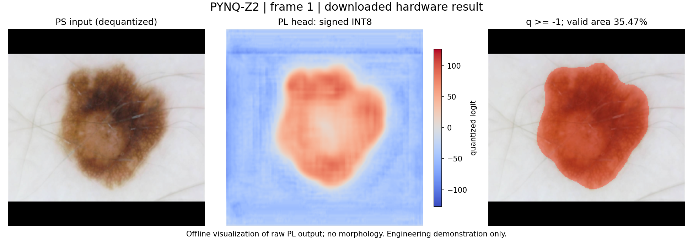

# PYNQ-Z2 皮损分割：B 计算子系统

本仓库交付A最终 `soup_v5_a050` 模型的 PL INT8 TinyUNet 推理，以及 PS 预处理、DDR/DMA 调度和错误恢复。C使用B返回的原始head完成后处理、叠加、HDMI/UI和整机集成。

**团队当前使用版本：125 MHz / ABI 1.2 / c_v3_20260929。**已在PYNQ-Z2上用638张原始JPEG连续运行1000帧，PL输出逐字节等于冻结INT8参考，三类故障恢复通过。dev638宏平均Dice 0.8421、IoU 0.7583；核心1.422 FPS，在线B延迟P95 1.266秒，尚未达到原定≤1秒。后处理/HDMI尚未联调，dev638为开发集。用户决定先交付当前可运行版本，暂不继续性能试验。

## 从哪里开始

| 工作 | 入口 |
|---|---|
| C上板使用 | [冻结交付包及三步运行](delivery/c_v3/README.md)、[B→C合同](docs/C_HANDOFF.md) |
| 网页与HDMI显示端（C源码） | [display_web 使用说明](display_web/README.md)、[板端部署与自启](display_web/docs/DEPLOYMENT.md) |
| 理解实现 | [整体数据流与模块职责](docs/IMPLEMENTATION.md)、[PL寄存器合同](docs/design/ACCELERATOR_REGISTERS.md) |
| 核对真实结果 | [板测汇总](delivery/c_v3/validation/summary.json)、[详细验证记录](docs/FINAL_MODEL_STATUS.md) |
| 修改与协作 | [团队开发说明](CONTRIBUTING.md)、[计划与剩余目标](docs/PLAN.md) |
| 查阅旧版本 | [文档目录](docs/README.md)，旧证据集中在`docs/history/` |

## 目录

```text
rtl/                  PL算子、AXIS、AXI-Lite及顶层
board/                PYNQ控制、DMA、整网调度、JPEG推理入口
reference/            冻结模型校验、量化与预处理、软件参考
sim/                  Python回归和SystemVerilog自校验TB
vivado/               IP打包、PS7/DDR/DMA最小BD、构建Tcl
scripts/              仿真、构建、数据准备、打包和审查工具
docs/                 当前计划、实现说明和C合同
  design/             数值、硬件接口和PS集成细节
  validation/         环境及评估方法
  history/            按版本保留的历史审查与阶段证据
  requirements/       原始题目与分工文件
delivery/             随Git共享的冻结运行包、模型、XSA及板测证据
display_web/          C的网页操作、轮廓后处理与HDMI显示应用源码，板上部署为PLD_Web目录
local/                仅本机保留的第三方资料、镜像、缓存，不上传
out/、ip_repo/        可再生成的产物和实验日志，不上传
```

`role_a_final/`、`role_a_handoff/`由下面的模型准备命令恢复，不把展开的重复模型文件放进Git。原始ISIC数据集和历史教程仍在本机原路径，以兼容既有复现命令；团队运行当前交付包不依赖这些本机目录。根目录不再散放题目文件，原始文件已移入`docs/requirements/`，并使用ASCII文件名保证跨平台解包。

## 新克隆的主机检查

使用Python 3.10或以上。在仓库根目录执行：

```bash
git clone git@github.com:wangzhongyuan11/PLD.git
cd PLD
python scripts/verify_delivery.py --prepare-models
python -m pip install -r requirements-reference.txt
python -m unittest discover -s sim -p 'test_*.py' -v
```

第一条Python命令只用标准库，核对14个交付文件、运行包161个文件、模型266个文件及硬件构建来源；缺少模型时恢复最终与旧回归模型，遇到不同的现有模型直接报错，不覆盖。Windows可使用已验证的`D:\conda\python.exe`或相应虚拟环境。`requirements-reference.txt`用于主机；**不要用它替换板上已验证的Pillow 9.0.1环境**。需要FP32评估时另见`requirements-evaluation.txt`及[评估说明](docs/validation/EVALUATION.md)。

板上运行直接使用[冻结运行包](delivery/c_v3/runtime.tar.gz)。它保留真实测试时的原始文件字节和SHA256；源码仓库统一LF换行，校验工具对源码比对仅容忍CRLF/LF差异。修改源码后自行重建、重新打包，并为新版本保留验证证据，不覆盖此冻结包。



上图为ISIC_0000003的板上head下载后渲染，对应Dice 0.9673；不是HDMI画面，也不代替全集统计。数据及原始材料的权属归各自提供方；本项目用于工程教学和算法演示。
