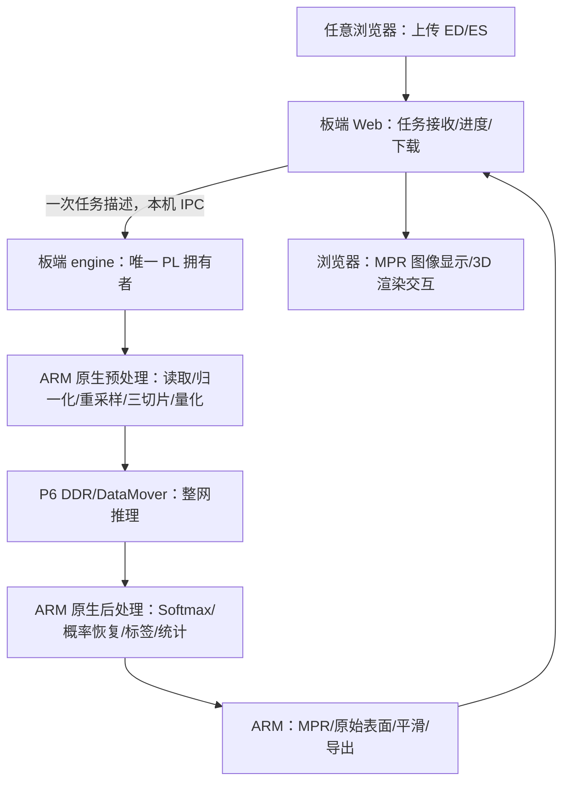

# ACDC Board Standalone V2：独立板端实现与小于 40 秒优化计划

日期：2026-10-21，实施收尾更新至2026-10-23：**C12免访问码版已部署，实际本机浏览器容量边界112片完整可交互38.521秒**。C11连续40次任务/3232新鲜PL片与独立参考输入、head、原空间标签/affine/统计/ZIP一致；完整资源P95 23.272s、最大27.223s。MPR空闲/忙时P95分别179.520/328.619ms。按用户最新要求停止追加重复测试、取消跨设备验收，以本机浏览器为最终展示入口。版本、证据范围及限制见[最终部署与验证](VALIDATION_BOARD_V2_20261023.md)与[最终证据](evidence/appliance_final_20261023.json)。此前C9整板重启记录保留，原因未知；不把本轮通过扩展为无限期稳定保证。

本计划承接用户要求：保留当前 PC+PYNQ 版本；新增一个无需指定电脑后台、任何同网电脑通过浏览器上传 ED/ES 即可运行的版本。文件读取、预处理、完整 Axial PL 推理、概率恢复、标签、统计、MPR、原始/平滑网格及导出全部在 PYNQ-Z2 完成；浏览器负责页面显示和最终 3D 渲染交互。目标是服务就绪后一次新鲜任务从开始上传到完整结果可交互 **严格小于 40 秒**，在正确性和展示质量不下降的条件下继续缩短。

用户于2026-10-23明确取消V2访问码，因此下文设计阶段涉及访问码的内容仅作历史设计记录，以实际免认证入口和最终验证为准。

本文是 **V2 的主实施计划**，不覆盖 [V1 最终模型对齐计划](FINAL_ALIGNMENT_OPTIMIZATION_PLAN_20261019.md)、[V1 验证记录](VALIDATION_P6_20261021.md) 或历史证据。下文“拟新增”保留设计阶段的职责划分；当前实际文件、部署目录和使用命令以应用说明为准，不能把未关闭的退出条件视作已验收。

## 1. 保留当前版本：版本、代码、环境、数据和回退

### 1.1 不可混淆的身份

| 项目 | V1 保留基线 |
|---|---|
| 源码提交 | `69e18ecc49c10ee319a5386f7dc036cd86877b96`；含 PC 平滑展示和历史结果浏览 |
| Axial spec SHA256 | `fef60178abaf8f81cd3206b2c37e3ca1aef56299ee01c2f8cb3dac3c28bf33be` |
| P6 runtime manifest SHA256 | `1f0bdf8739980ea8e8e2a06ee349b57ed81d041d87515e4e9400cd30b7ae7747` |
| bit SHA256 | `232954378f8c7a42c36589031d9588f50ea2c370f3a29edd40500bab877dc1df` |
| 硬件 | `spatial_p6_100_bankstage_v1`；ACD8 `0x41434438`，ABI `0x00020000`，P6@100 MHz |
| V1 板端运行目录 | `/home/xilinx/jupyter_notebooks/pld/releases/acdc_spatial_20261020_p6_rpc_v1` |
| V1 板端入口 | `pld-acdc.service`，loopback 8093 worker；PC 经隧道调用 |
| V1 PC 入口 | `python -m acdc web --backend remote ...`；`python -m acdc view ...` 历史结果浏览 |
| V1 结果 | 既有 jobs、ZIP、manifest、`_presentations` 和验证证据原样保留 |

源码版本与硬件运行包是不同身份，不能把含新 PC 展示的源码提交称为已经打入旧板端运行包。以上为仓库保存的基线证据，不声称当前板卡在线或正在运行该服务。

### 1.2 隔离方法

1. V2 实现时建立独立任务分支，例如 `codex/acdc-board-appliance-v2`。保留 V1 提交及原任务分支；不重写历史、不强推、不覆盖模型 Release。
2. 新增 `acdc/appliance/` 作为 V2 应用目录，具有独立 CLI、Pipeline、Web/MPR 和运行配置。原 `acdc` 的 PC `web/run/view/worker` 行为与默认选项保持不变。
3. 优先复用只读数值常量、已验证的模型导入和 P6 设备接口。确需修改共享模块时，使用显式可选参数且保持 V1 默认值；必须同时通过 V1 回归。影响硬件 ABI 的候选放在独立版本，不能悄悄改变旧设备行为。
4. V2 板端依赖、原生库、配置、服务、数据目录独立。不能升级覆盖系统 PYNQ/NumPy，也不能改动 PC 的 `acdc/.venv`。
5. 建议新部署根为 `/home/xilinx/jupyter_notebooks/pld/releases/acdc_board_v2_<version>`；数据根为 `/home/xilinx/jupyter_notebooks/pld/data/acdc_board_v2`。服务拟名 `pld-acdc-v2-web.service` 和 `pld-acdc-v2-engine.service`。最终名称在实现时检查冲突。
6. V1 与 V2 可保留在磁盘并同时提供历史结果浏览，但 **同一时间仅一个推理服务拥有 FPGA**。换版需安全停止当前拥有者、确认 DMA 退出和锁释放，再启用目标版本。
7. 回退只切换 V2 服务和 V1 运行入口；不迁移、覆盖或重新签写 V1 结果。V2 新结果使用新 schema 和独立命名空间。
8. 原 Skin/CAMUS 正式目录、服务配置和 `delivery/current.json` 不改。新发现的其他 FPGA 服务不能未经确认自动停止。
9. 实施前核验 V1 运行包/模型/位流的现有副本和 SHA 可恢复；缺少工件时先找回已有资产，不通过覆盖正在使用的目录解决。

## 2. 范围与成功标准

### 2.1 功能不缩减

- 输入：显式选择同一患者 ED、ES 两个 3D `.nii` / `.nii.gz`，不自动把 4D cine 当成两个时相。
- 模型：A 冻结的 Axial B16、相邻三切片输入、15 Conv/21 逻辑节点、四类 INT8 输出。权重、偏置、尺度、CAT 次序和量化合同不变。
- 完整覆盖：每期所有工作网格中心片均真实 PL 推理；不省略切片、不用结果缓存冒充新鲜推理、不回退到电脑或 ARM 神经网络推理。
- 输出：原空间标签、原空间统计、LV/RV EF、三方向 MPR、两期原始/平滑表面、原始/平滑切换、类别显隐、三维透明度/裁切/截图、完整导出。
- 不增加三方向模型融合；MPR 三平面显示与三方向模型推理是不同功能。
- 浏览器不运行 NIfTI 归一化、体数据重采样、模型推理、概率恢复、网格提取或网格平滑；3D 光照、旋转、缩放、裁切和透明排序保留在浏览器。
- 不要求互联网、SSH 隧道、某台电脑上的服务或本机模型目录。板卡接入局域网，客户端仅需可用浏览器及网络。

冻结模型接口为输入 `[1,3,256,256]`、输出 `[1,4,256,256]`，均 signed INT8，零点0、范围[-127,127]；类别0/1/2/3对应背景/RV/MYO/LV。主干通道16/32/64/128，decoder CAT输入192/96/48通道；总计2,674,917,376 MAC/中心片。卷积保持INT32累加、bias加一次、INT64乘积和Q24 ties-to-even重量化，隐藏层ReLU、head无ReLU。三次CAT均保持skip在前、deep在后以及分支各自的尺度转换，不能因模型没有变化就省略这些合同。当前物化15Conv+3Pool，3个CAT由已验证的融合加载路径实现；21逻辑节点不能误报为21个独立DDR输出。

### 2.2 正确性门槛

1. 相同输入文件与策略下，采用后的物理 affine、工作网格尺寸、原点、letterbox 和邻片索引一致；affine 数值对照绝对误差不超过 `1e-8`。
2. 验收集全部 INT8 模型输入逐字节相等；PL head 对独立整数参考逐字节相等。
3. 原空间四类概率先使用绝对误差 `<=1e-6` 的候选门槛，同时必须最终标签零差异。出现概率超差、argmax 平局处理不一致或标签变化均定位修复，不能只凭 Dice 接近通过。
4. 体素计数相等；体积、EF 按同一 float64 公式计算，数值差异门槛分别 `<=1e-6 mL` / `<=1e-6` 百分点，null/无效原因一致。
5. 平滑不回写标签或统计。空类别、视野截断、左右方向和各期不同 affine 必须正确。
6. 旧 PC 实现继续可运行，旧结果/ZIP/manifest 的 SHA 不变。

### 2.3 小于 40 秒的明确口径

`T_visible = 浏览器开始上传至完整结果可交互的同一浏览器单调时钟差值`。

终点要求：两期全部切片完成；标签、体积和 EF 已生成；两期默认 MPR 与平滑网格准备完毕；浏览器已接收并解析两期初始浏览所需资产，当前期三个 MPR 和 3D 已绘制，ED/ES 切换无需再做网格构建；完整结果 ZIP 已可下载。ZIP 的用户点击下载过程不计入，但生成 ZIP 计入。

不允许以“第一张预览出现”“ED 已完成”“服务器 completed”“原始网格已显示、平滑还在后台”为终点。初始两期切面可预取；任意新位置的 MPR 按需请求，交互延迟另测。

- 服务已就绪、单个活动任务、约定数据规模与网络条件下，验收样本 **每次 `<40.0 s`**，同时报告 P50/P95/max，不只报告平均值。
- 当前 82 片代表病例内部预算为 32 s，优化目标区间 25～35 s；这是工程目标，非已测时间。更大 112 片预算 38 s，保留 2 s 余量。
- 开机至 ready 单独记录。未就绪时页面明确禁用分析；若允许提前提交，则等待初始化计入用户总时间，不能隐去。
- 忙碌时显式拒绝新计算或显示排队时间；默认首版一个计算任务，不能承诺多个用户同时各自 40 s。历史浏览并发也要有资源上限。
- 样本超时即性能未达标，不能减少切片、降采样输入、取消平滑或隐藏导出来达标。

## 3. 现有证据与可行性边界

| 已有记录 | 数值 | 可以支持什么 |
|---|---:|---|
| P6 1000 新鲜帧持续吞吐 | 8.151268 FPS | 原负载下板内推理可满足约 8 FPS |
| PS-DMA-PL P95 | 106.257678 ms | 单片计算/板内调度已有余量 |
| 中位 PL 时间 | 95.540735 ms | 当前单片主要仍在 PL，不能仅靠 PS 把它降到任意值 |
| 20 个开发病例 | 40 体，1616 片；每对 52～102 片 | V1 整链路数值对照范围，非独立测试集 |
| 20 例 CLI 任务至 ZIP | 10.726～21.859 s | PC 协同历史记录，不包含上传/浏览器最终显示 |
| 当前 82 片网页任务 | 20.306547 s | 本机服务器收上传至 ZIP；不包含全部新增平滑和浏览器显示 |
| 同任务新鲜推理窗口 | 16.772013 s | 含 RPC/调度/检查点/阶段间空隙 |
| 设备构造、worker 就绪观测 | 51.34 s、47.71 s | 不同口径，不能相加；必须把初始化移到开机阶段 |

证据：[P6 板测](evidence/p6_board_20261020.json)、[开发集](evidence/development_PL_20261021.json)、[网页](evidence/web_P6_20261021.json)、[初始化](evidence/initialization_power_20261021.json)、[PC 平滑](evidence/pc_surfaces_20261021.json)。这些是已保存的测量，不代表本轮重新连接板卡或重新板测。

按已有吞吐折算：52/82/102/112 片分别约 6.38/10.06/12.51/13.74 s。82 片的远程窗口与折算板内时间差约 6.7 s，只表示消除远程逐片调用的优化空间，**不是严格测得的纯网络耗时**。迁移后 CPU 与 DDR 竞争可能使板内推理变慢，必须重新测量。

原尺寸 256×256×12 不足以确定次数。无倾斜且层间距 10 mm 时，2 mm 工作网格每期 `ceil((12-1)*10/2)+1=56`，两期 112 片；旋转/倾斜时必须按八个体素中心角点的 RAS 包围盒计算。不能统一按原始 24 片预算。

## 4. 板卡资源与初期性能包络

### 4.1 硬件预算

PYNQ-Z2 是 650 MHz 双核 Cortex-A9、ARMv7/NEON、512 MB DDR3、16 位 DDR 总线、千兆以太网和 microSD。DDR 标称 1050 Mbps 对应理论峰值约 2.1 GB/s，ARM/PL/外设共享，不能作为应用实测吞吐。CPU 实际运行频率和网口协商速率实施时现场采集。

| 资源 | 当前 P6 用量/容量 | 决策 |
|---|---:|---|
| DSP | 210/220，95.5% | 首版不额外堆叠大算术核 |
| BRAM36 等效 | 106.5/140，76.1% | 剩余约 1206 Kibit，不能承担体数据缓存 |
| LUT | 21143/53200，39.7% | 有逻辑余量，但还受时序/布线/访存约束 |
| FF | 28274/106400，26.6% | 不能由 FF 余量推出可增加相同比例吞吐 |
| P6 CMA arena | 6,004,736 B，约 5.73 MiB | 常驻、单拥有者；不复制整套激活工作区 |
| V1 推理 RSS 样本 | 约 83～84 MiB | 不是峰值，更不是 V2 整体内存 |
| 路由时序 | WNS +0.189 ns，WHS +0.013 ns | 任何 RTL/时钟变化都要重新闭环 |

优先充分使用现有两核、NEON、PL 的并行执行和有限 DDR 工作集。充分利用不等于把 CPU、RAM、DSP 全部占满；保留缓冲和调度余量才能稳定完成任务。

### 4.2 待标定的性能包络

初期容量候选：每期原始体素 `<=2,000,000`、工作体素 `<=4,000,000`、ED/ES 工作中心片合计 `<=112`、上传合计 `<=20 MiB`。这是用于资源试算的候选范围，不是已经验证的产品上限。

P0 必须扫描全部 20 例参考数据确认实际最大值，不能为了让指标好看排除已有病例。性能包络还需约束每平面像素数、表面三角形规模、SD 卡性能、客户端和网络。包络之外可在内存允许时运行并明确不保证 40 s；不能假装在承诺范围内。超内存预算则在分配前拒绝并给出原因。

网络预算按实际有效吞吐标定：例如 20 MiB 输入在 10 MiB/s 时仅上传约 2 s；弱网络会使 40 s 不成立。千兆链路、浏览器/设备、SD 型号、系统负载写入验收配置。

## 5. 目标架构与模块边界



推荐轻量 Web 进程与 engine 分离：Web 不导入 PYNQ/模型/VTK，不接触 MMIO；通过 Unix socket 发送任务目录、配置和取消请求，接收状态。engine 内部直接调用 `SpatialBackend`，不逐片 HTTP，不通过 IPC 复制完整工作体。MPR 从最终灰度/标签的只读映射读取；网格模块在 engine 调用并明确释放内存，必要时使用单个受限辅助进程，禁止 fork 出多个继承 CMA 的计算进程。

拟新增入口为 `python -m acdc.appliance ...`，子命令负责 web、engine、verify、benchmark；具体 CLI 在实现时冻结。V1 CLI 保持原行为。

V2 资产由板卡本地提供，不依赖 CDN。UI 明确显示 `预处理/后处理/网格：PYNQ ARM`、`网络推理：PYNQ PL`、`三维渲染：浏览器`，取自服务返回的身份，不硬编码假状态。

## 6. 初始化、参数复用和 readiness

开机流程：Web 显示 initializing → 核对运行包/模型 → 确认 FPGA 所有权 → 加载 P6 → 常驻 CMA/参数/LUT/执行表 → 加载原生图像/网格模块 → 已知输入真实推理自检 → ready。

1. 原始模型 SHA 不变；V2 应用 manifest 另记源码、原生库、编译器/选项、依赖、模型 SHA 和被复用的硬件证书。
2. 不修改旧 runtime 的文件后继续使用旧 manifest。硬件工件可只读复用；更改 PS 应用时生成 V2 应用身份，若硬件包内容变化则重新生成配对证书。
3. 默认每次进程启动完整校验，运行期间常驻使用。可缓存已认证的权重布局和不含物理地址的执行模板，但缓存键必须绑定模型/ABI/profile/转换器 SHA。
4. 实际 CMA 基址和 epoch 在分配后填入并验证；不得缓存上次开机的物理地址。
5. 当前初始化包含验证、native layout、overlay、两次 compile_program、CMA、参数图像等，先逐段计时，再决定预生成布局/执行模板是否有收益。
6. 自检使用已知真实输入及期望 head SHA，不能仅依靠 systemd active 或端口监听判 ready。
7. 每次病例不重建 device；ED/ES 同模型不切换参数；刷新浏览器不改变 engine 生命周期。
8. readiness 失败明确报错，保留日志；恢复不能无界循环。取消/超时沿用 HALT 确认后复位策略，失败时隔离 CMA，不继续接受任务。

开机耗时是独立待优化指标。它不能通过从计时结果删除第一次病例来掩盖，正常 ready 后的第一例也必须满足任务时间目标。

## 7. 原生预处理：数值等价优先

### 7.1 实现策略

保留 PC 冻结环境作为参考；V2 运行时不安装完整 PyTorch，也不直接复制 `requirements-pc.txt`。Python 负责调度，C/C++ 原生库负责主要数组循环。使用匹配板卡 ARMv7 hard-float/NEON ABI 的工具链，锁定 sysroot/库版本，并在板卡实测。构建可以在开发机完成，最终使用不依赖开发机。

NIfTI 元数据解析优先复用经过验证且兼容板端环境的组件；数据转换/解压可用精简原生读取层。明确支持 dtype、字节序、`scl_slope/inter`、qform/sform 优先级、qfac、单位和仿射规则；不支持的格式显式拒绝，不猜测。不得因换读取库而忽略 header 规则。

### 7.2 必须保持的步骤

| 步骤 | 数值合同 | 优化方式 |
|---|---|---|
| 读取 | 缩放后原始 float32，有限值检查 | 流式接收、顺序解压，少复制 |
| 分位数 | 非零体素、1/99%、linear | 选择算法求所需秩；int16 直方图仅在证明转换等价时使用 |
| 归一化 | float64 中间公式、clip[-1,1]、转 float32；原始零值也转换 | 分块写入预分配输出，不生成多个全卷 float64 副本 |
| RAS 工作网格 | 八中心角点、2 mm、相同 ceil/原点；线性插值、外部 -1 | 预计算坐标；轴对齐快速路径加通用 affine 路径 |
| 平面 | `V[:,:,z].T` | 合适内存布局、预计算步长 |
| letterbox | Python ties-even round 尺寸；Torch bilinear、align_corners=False、antialias=False | 原生等价插值，缓存坐标/权重 |
| 输入 | 边缘邻片 clamp、补边 -127、float64×127 后 RNE、饱和[-127,127] | 三平面 LRU、预分配连续 INT8 输入 |

不得把两次插值合成一次“近似等价”重采样；中间 float32 舍入及边界语义也是合同的一部分。基础实现不使用 `-ffast-math`，对可能改变浮点舍入的收缩/FMA、NEON 运算顺序单独验证。

### 7.3 实现绑定

当前 `volume.check_binding()` 锚定 PC 库版本，V2 不能伪造版本或删除检查。新增独立的 `implementation_id`、原生库 SHA 与资格证据，保留 A 原始参考绑定。分别记录语义几何身份和实际实现环境；旧 geometry digest 包含版本信息，V2 不能强行把新环境记录改成旧值来制造 hash 相等。

数值比对使用文件身份、实际几何字段、张量与结果；任务内部仍严格校验自己的 geometry/model/runtime 身份。A 的模型文件不发生变化。

## 8. 后处理、体积和 EF

保持四类 INT8 → float32 logits → 减最大值 → exp/求和 → Softmax → 裁补边 → 平面双线性恢复 → 原空间三线性恢复 → 概率兜底/归一化 → argmax 的顺序。

- 预分配每片四类浮点工作区；分母/最大值就地或分块计算，避免反复分配。
- INT8 的有限取值可用于 Softmax 查表候选，但 `(q-maxq)*scale` 不保证与 `float32(q*scale)-float32(maxq*scale)` 舍入相同。候选须按参考运算顺序生成表并测试全部合法 q/maxq；四类求和顺序仍要一致。未经验证的近似 exp、倒数、float16 不进入正式路径。
- 首版保留单期四类工作概率体，随后按原空间 block 恢复。block 内同时处理四类、归一化和 argmax，立即写标签并累计计数，避免分配整个原空间四类概率体及其副本。
- debug 模式可输出完整概率；生产模式只保存标签/必要证据。两种模式的数值相同，性能分别记录。
- 轴对齐数据可进一步做按依赖层释放的概率 ring；通用倾斜 affine 先生成依赖表或继续使用完整工作概率体。不能假定任何方向仅需两张工作片。
- 不允许提前 argmax、改为标签最近邻恢复、删除心尖/基底层，或用粗间距换速度。
- 体积 `count * abs(det(affine[:3,:3])) / 1000`；LV/RV EF=`(EDV-ESV)/EDV*100`，保持原有效性规则；MYO 仅体积。

## 9. 流水、并行与缓冲区所有权

### 9.1 首版：现有 P6 不改 RTL 的 CPU/PL 重叠

当前 `SpatialDevice.forward()` 同步返回；内部等待有 0.2 ms sleep，并非持续忙等。首版让唯一硬件线程调用它，原生预后处理在释放 GIL 的受限工作线程执行：

```text
阶段                     帧 k                  帧 k+1                 帧 k+2
ARM 输入             准备下一输入         准备下一输入           准备下一输入
PL 唯一硬件拥有者      执行当前帧           执行下一帧             执行下一帧
ARM 输出             处理上一 head         处理当前 head          处理下一 head
```

这表示三个逻辑阶段可以重叠，不表示 ARM 有三个计算核。只有两核，输入和输出会共享 CPU；必要条件是其总 CPU 工作量、最大串行阶段和 DDR 带宽都能满足节拍。

近似下界：`T_steady >= max(T_PL+不可隐藏提交/同步, CPU总工作量/可用核数, 最长CPU依赖链, DDR流量/有效带宽)`。仅用 `max(T_input,T_PL,T_post)` 会高估双核上的重叠能力。

### 9.2 缓冲区表

| 对象 | 初始容量 | 复用/释放条件 |
|---|---:|---|
| 已量化平面缓存 | 3 张，边缘索引重复引用 | 下一中心片不再依赖后淘汰 |
| 普通 RAM 输入槽 | 2×192 KiB | 硬件线程已拷入当前 CMA 输入后可复用 |
| 普通 RAM head 槽 | 2×256 KiB | 原生后处理完成后复用 |
| P6 CMA 工作区 | 现有一套约 5.73 MiB | 只归硬件线程，保持当前设备同步规则 |
| 工作灰度/概率 | 一期 | 原空间标签生成后释放 |
| 网格处理 | 一个结构 | 写出/传递后释放 |

普通 RAM 双缓冲可以先实现。它 **不等于 DMA 双缓冲**：当前 PL 运行期间，不能提前覆写同一个 CMA input/head/program。下一帧提交前必须确认当前任务完成、输出同步和独立拷贝已经结束。

有界队列默认深度 2，满时背压，不无界提交 future。每个槽带 job/phase/z/epoch 身份；阶段错误或取消广播给全部线程，等待 DMA 安全结束后才释放相关缓冲区。

### 9.3 进一步可选优化

| 优化 | 条件与实施方式 | 验收重点 |
|---|---|---|
| 直接输出到预分配 head 槽 | 给 V2 增加显式设备 API，旧 API 默认不变 | 不泄露 staging/CMA 视图，head 字节一致 |
| 缩放/量化后直接打包 | 融合普通 RAM 中的布局写入 | 与当前 NCHW→native pack 逐字节一致 |
| 调整完成轮询 | 测量 0.2/0.5/1 ms 有界 sleep 或自适应等待 | CPU 占用与尾延迟权衡，保持取消/超时 |
| 中断等待 | 仅在确认实际 BD/驱动可支持或单独改造后采用 | 不能假设当前已有中断；丢中断仍有截止时间 |
| CPU 亲和性/线程数 | 比较默认与固定两核分配，原生库限制线程数 | 不启动多个各自全核的 BLAS/VTK 池 |
| 两期部分重叠 | ED 概率释放后，ES 推理期间低优先级处理 ED 网格 | 不保留两期概率；不拖慢 ES 输入供给 |
| 上传/准备重叠 | ED 文件收完并通过检查后，可在接收 ES 时准备 ED | ES 失败时不宣布完整成功；从上传起计时 |
| 哈希/写出重叠 | 流式接收/生成时增量 SHA，有限批量写出 | 最终原子完成，不能提前发布完整结果 |

ED 网格与 ES 推理重叠有 CPU/DDR 竞争。首版先测串行，再测单线程网格并发；按真实总时间选取，不能把两项耗时直接相减。若网格算子不可暂停，只有确认当前输入缓存和内存预算允许时才调度它。

### 9.4 可选第二阶段：真正 CMA 双缓冲

只有实测显示提交、输入打包/同步或 head 导出成为重要瓶颈时推进：新增输入/head 槽以及独立执行表，确保活动 program 不被下一帧 epoch 写入修改。检查所有绝对地址、DataMover outstanding、缓存线对齐及 reset 生命周期。

它可隐藏部分搬运，但不能让两个完整网络同时在同一阵列执行。若需变更程序布局、驱动、RTL 或 ABI，则建立新硬件/软件候选身份并重验。约 10 ms 的单片 PS 非 PL 时间只是历史总差额，不应全数视为可隐藏收益。

## 10. 内存与存储计划

当前 patient039 单期：原始 208×256×9，工作 171×211×41；原始灰度 1.83 MiB、工作灰度 5.64 MiB、工作四类概率 22.57 MiB、原空间四类概率 7.31 MiB、标签 0.46 MiB。

内存估算按阶段峰值，不把所有阶段无条件相加：

`M_peak ≈ 常驻进程/库 + 唯一CMA + max(读取/分位数/归一化峰值, 工作灰度+概率+片缓冲+恢复block, 标签+单结构网格工作集) + Web/MPR/下载缓冲`。

RSS/PSS、CMA、页缓存和 MemAvailable 分别采集，避免把已计入 RSS 的映射再次相加。完整服务目标峰值先设 200～240 MiB，系统 MemAvailable 希望保留至少 80 MiB；这是候选预算，P0 结合实际系统基线冻结，不能用“剩余内存”代替 CMA 连续分配条件。

具体措施：

1. ED/ES 概率不同时常驻；原空间概率按块恢复；阶段完成显式释放引用。
2. 原始灰度和标签保留紧凑只读文件，MPR 需要时 mmap，不复制到每个 Web 请求。
3. 上传限制同时包含压缩大小、解压体素数、工作体素数、dtype 和内存估算。当前 PC `MAX_WORKING_VOXELS=33,554,432` 不沿用，其四类 float32 单项已达 512 MiB。
4. 分位数 scratch、网格邻接表、VTK 中间输出纳入峰值；对大 mesh 设置预算并返回明确原因，不能 OOM 后静默降低精度。
5. 模型和工件放持久目录；短期缓冲优先普通 RAM。禁止默认把大 volume/checkpoint 全放 tmpfs，禁止依赖 swap 达标。
6. 当前每片强制 checkpoint head 写出约 256 KiB。V2 `audit` 保留逐片证据；`production` 使用有界批量顺序日志或不保存可恢复 head，保留输入/head SHA 和完整覆盖信息。是否可续算由模式明确标识。
7. 结果写临时目录，结束后原子发布；输入和未完成目录按独立配额管理。清理仅限 V2 管理目录，活动任务/下载不清理，旧版数据不动。
8. ZIP 低压缩级别；已压缩数据可 STORE，避免反复压缩。原始/平滑网格写出一次后复用；不先生成多份等价文件再重复扫描压缩。
9. SD 读写测速、任务期间 iowait 和写入量必须报告。只有确定 SD 成为瓶颈时才建议更换卡或外接存储，不把硬件采购作为计划默认前提。

## 11. MPR 与三维展示优化

### 11.1 MPR 在 ARM 生成

V2 新增 MPR 服务，输入 job/phase、切面方向、RAS 位置、窗宽窗位、叠加/轮廓/类别参数，输出图像与方向/位置元数据。采样保持灰度三线性、标签最近邻及统一 RAS 光标语义。

- 浏览器只显示板端生成的图像并发送交互参数，初始两期三视图预取。
- 原生批量采样、窗宽窗位 LUT、有限邻片缓存；缓存键含结果/几何身份及全部显示参数。
- 滚轮请求带递增序号，取消或丢弃旧请求，防止旧切面覆盖新位置。
- 根据测量选择无损 PNG 或紧凑已计算像素块；不能在浏览器重新执行医学重采样来声称板端完成。
- 初步交互目标：空闲板卡 MPR 响应 P95 <200 ms，任务执行中 <500 ms；单独验收，不由 40 s 推导。
- 不把冠状/矢状的薄覆盖范围拉伸伪装成更完整解剖；图像仍按物理比例显示。

### 11.2 网格与平滑在 ARM 生成

先移植相同版本/配置的精简 C++ VTK，不引入 GUI、OpenGL 渲染或完整 Python wrapping。锁定所需提取、变换、细分、Windowed Sinc、法线和网格 IO 模块及依赖。显式记录平滑窗口函数等配置，避免不同 VTK 版本默认值改变结果。

优化顺序：

1. 对每个结构取带 padding 的包围盒，保持对应原空间偏移和 affine；原视野截断根据全标签判定，不能根据 ROI 边缘误判。
2. 一次处理一个结构，原始几何留作导出，对平滑处理避免不必要深拷贝。
3. 首个候选保持当前一次细分、80 次 Windowed Sinc、pass band 0.005，测真实时间和峰值。
4. 若超预算，比较不细分/有限细分、较少迭代、保拓扑简化等候选。不能在没有质量对照时直接采用更快参数。
5. 与 PC 冻结平滑参考比较 RAS 包围盒、连通性、边界/非流形边、表面距离和网格体积；候选初始容差目标为双向表面距离 P95 <=0.5 mm、max <=2 mm、网格体积相对差 <=1%，并逐例可视检查。空类别和截断结构独立处理；目标不满足时先保持质量，不擅自放宽。
6. 上述是相对现有展示参考的工程一致性目标，不是解剖准确率；统计仍取标签。

### 11.3 浏览器资产

V1 当前样例两期平滑顶点/法线共约 12.6 MiB，按三角形展开存在重复。V2 改为共享顶点、法线、索引及元数据的二进制资产；WebGL2 或 uint32 index 扩展可用时用32位索引，不可用时分块为16位索引网格，不能无提示失去显示。

默认下载两期平滑网格和初始 MPR；原始网格按切换需要加载，但必须已由板端生成并纳入导出。透明排序仍属浏览器交互，可排序索引而不是复制全部位置。体素采样、平滑均不放到 Web Worker/WASM 以规避板端目标。

结果 schema 分别记录 `generator=pynq_ps`、`inference=pynq_pl`、`renderer=browser_webgl`、平滑配置和 `quantitative=false`。原始标签、原始/平滑网格分路径导出，ZIP README 说明用途。旧任务中的 `generator=local_pc` 保持原样。

## 12. Web、接口与部署

建议新增版本化接口（尚未实现）：

| 接口 | 用途 |
|---|---|
| `GET /api/v2/health` | initializing/ready/busy/fault，模型/应用/硬件身份和能力 |
| `POST /api/v2/jobs` | 流式 ED/ES 上传，接收前原子预留任务槽，返回 job ID |
| `GET /api/v2/jobs/<id>` | 阶段、两期总/已完成片数、阶段耗时、错误 |
| `POST /api/v2/jobs/<id>/cancel` | 取消并等待资源安全释放 |
| `GET /api/v2/jobs/<id>/mpr?...` | 板端切片生成与元数据 |
| `GET /api/v2/jobs/<id>/assets/...` | 两期网格、统计和导出，只读 |
| `POST /api/v2/jobs/<id>/client-timing` | 上传、资源加载和首帧完成的客户端测量 |

任务状态：`receiving → validating → preparing → infer/restore → meshing → exporting → assets_ready`；浏览器另报告 `interactive_ready`。首次可用预览可提前显示，但不终止正式计时。

接收 ED/ES 前原子占用计算槽，避免两个请求通过当前空闲检查后同时大量写入。限额内流式写盘，不把128 MiB请求体一次读入内存。中断上传清理自己的暂存并释放槽。

LAN 服务使用明确配置的监听地址；网页与 API 同源，带独立访问凭据/会话及必要来源检查，不暴露 root 命令、目录浏览或逐片硬件接口。配置不含仓库内密码。凭据与访问控制不得依赖某台电脑。

部署流程：独立目录校验 → 安装独立依赖/原生库 → 离线自检 → 停止已授权的当前硬件服务 → 安全接管 → readiness → 新鲜病例 → 本机浏览器直连验收 → 回退演练。先保留手动切换，验收后再设置 V2 为开机计算服务；不同时开机抢占 FPGA。

## 13. 性能预算、估算方法和继续压缩时间

### 13.1 不依赖理想并行的初始预算

各行按不重复的工作分类：输入准备包含所有片的 CPU 输入工作，后处理包含所有片 Softmax/恢复；PL 行包含实际设备调度但不重复计入输入预处理。后续重叠的收益通过时间轴测量，不从下表再随意扣减。

| 阶段 | 82片目标 | 112片目标 |
|---|---:|---:|
| 上传/接收 | 2 s | 2 s |
| 读取/归一化/重采样/三片输入准备 | 5 s | 6 s |
| 完整 PL 推理及板内调度 | 11 s | 15 s |
| Softmax/概率恢复/标签/统计 | 3 s | 4 s |
| 两期原始/平滑网格/法线 | 7 s | 7 s |
| 初始 MPR/元数据/完整导出 | 2 s | 2 s |
| 资产传输/解析/浏览器首帧 | 2 s | 2 s |
| 合计内部预算 | **32 s** | **38 s** |

这些是倒推的硬预算，不是 ARM 实测预测；网格 7 s、预处理 5～6 s、后处理 3～4 s 最先验证。参考 8.15 FPS 不能直接充当共享负载下吞吐。112片仅余2秒，任何阶段超支都要优化、调整真实支持范围或明确未达标，不能宣称40秒已完成。

### 13.2 正确的比较口径

`T_v2 = 上传 + 关键路径上的板端计算 + 未隐藏导出/传输 + 浏览器完成`。

与 V1 的差值受 ARM 新增计算、去掉逐片 RPC、文件读写、两期流水、网格格式、客户端网络共同影响。当前 20.31 s 旧记录不包括全部新平滑/浏览器耗时；因此“迁移多 5～15 s”只能作为82片目标区间的粗略描述，不能报告为实测增量。最终需用同一电脑、同一网络、同一数据、相同展示质量，对 V1/V2 从上传到交互进行配对比较。

### 13.3 优化优先级

1. **必做且收益明确**：开机初始化、模型/设备常驻、删除逐片网络往返、三平面复用、原生循环、避免大数组副本、有限队列、网格索引、减少小文件。
2. **测量后选择**：输入/PL/输出流水、ED网格与ES推理重叠、NEON、Softmax精确表、CPU亲和性、MPR缓存、压缩策略、轮询间隔。
3. **仅在关键路径需要时推进**：概率ring、CMA双缓冲、中断、PL预后处理小核、时钟或阵列改造。

每个候选记录相同病例新鲜任务时间、数值差异、峰值内存、CPU和DDR竞争；复杂候选没有可重复净收益就不合入。不能只展示某一子阶段更快而总时间变慢。

### 13.4 条件式 RTL 后续方案

首版不重综合 P6。若 ARM 某步在原生/NEON 优化后仍阻碍40秒，按实测决定是否做定点映射、格式搬运、窗宽窗位等小核；涉及浮点概率/插值不能随意改精度。现有DSP仅余10，不能默认并行增加大型卷积或插值阵列。

RTL 候选采用独立目录/构建标签/ABI，逐算子和整网精确验证、协议背压/取消、完整布局布线时序与资源检查、板上短测，再只对最终候选做必要稳定性验证。当前 P6 网表仿真历史缺口单独跟踪，复用或软件迁移不会自动关闭它。

## 14. 拟修改文件与交付物

| 路径 | 计划责任/边界 |
|---|---|
| `acdc/appliance/__main__.py`、`cli.py`（新增） | 独立 V2 命令入口；不改变 V1 默认 CLI |
| `acdc/appliance/config.py`、`identity.py`（新增） | 支持范围、资源限额、应用/实现/模型身份 |
| `acdc/appliance/volume.py`（新增） | NIfTI 元数据、严格几何、原生预处理适配 |
| `acdc/appliance/native/`（新增） | C/C++ 输入、插值、量化、Softmax/恢复、MPR；可复现 ARM 构建 |
| `acdc/appliance/reconstruct.py`（新增） | 有界概率工作体、block恢复、原空间标签/统计 |
| `acdc/appliance/pipeline.py`、`scheduler.py`（新增） | 完整两期流程、阶段计时、有界流水、取消/异常传播 |
| `acdc/appliance/engine.py`、`ipc.py`（新增） | 常驻唯一设备拥有者、Unix socket任务控制 |
| `acdc/appliance/surface.py`、`native/mesh/`（新增） | 精简VTK网格生成、平滑、索引资产及质量指标 |
| `acdc/appliance/web.py`、`mpr.py`、`web_assets/`（新增） | LAN服务、板端MPR、新schema前端与浏览器计时 |
| `acdc/appliance/export.py`、`storage.py`（新增） | V2结果目录、原子发布、ZIP、限额/检查点策略 |
| `acdc/appliance/deploy/`（新增） | 独立service模板、环境构建、安装/切换/回退/自检 |
| `acdc/appliance/benchmark.py`（新增） | 阶段、任务、浏览器、内存/CPU/IO统计及配对比较 |
| `acdc/tests/appliance/`（新增） | 数值、资源、缓冲、取消、HTTP、MPR、完整流程回归 |
| `acdc/backend.py`、`optimization/device.py`（条件修改） | 仅在明确收益时新增兼容API；V1默认行为回归 |
| `acdc/docs/` | V2使用/部署/验证记录与小型证据；旧记录不覆写 |

新增目录是职责划分，不要求为了文件数量机械拆分；实现时可合并紧密相关的少量代码。复用常量、数值统计和设备代码，避免复制一套长期漂移的底层库。

交付包括源码、原生构建说明、依赖锁定、部署/回退脚本、使用文档、结果格式、可复现证据。模型、病例、位流和大运行产物沿用既有工件管理，不进 Git；后续实现通过独立 PR 审查，不要求额外制作压缩交付包。

## 15. 分阶段执行与退出条件

| 阶段 | 工作 | 可观察结果/退出条件 |
|---|---|---|
| P0 基线与板卡盘点 | 核验V1可恢复；扫描全部病例尺寸/网格；采集CPU/内存/CMA/SD/网络；冻结40秒口径 | baseline manifest、病例规模表、可复现V1计时；未改旧部署 |
| P1 原生模块可行性 | ARM读取/预处理/恢复与精简VTK编译；使用冻结输入/head，不占用PL做阶段基准 | 数值通过、各阶段时间和真实峰值；找出预算风险，不能将复用head计为真实推理 |
| P2 板端串行闭环 | 单病例ED/ES从文件到PL到完整结果，本机直接backend | 不需要PC计算即可生成完整正确结果；实际总耗时可分解 |
| P3 CPU/PL流水 | 三片缓存、输入/head双槽、原生线程、背压；比较序列/重叠 | 无错片/复用污染；新鲜总时间下降或解释保留串行的原因 |
| P4 展示和Web | 板端MPR/平滑、索引网格、两期预取、LAN上传/进度/导出、浏览器计时 | 本机浏览器直连板卡完成操作；第二设备实测按用户要求取消 |
| P5 跨阶段优化 | 依据trace选择ED/ES重叠、写盘/缓存、poll/NEON等 | 82/112片预算有真实证据；候选质量和内存符合要求 |
| P6 验收与回退 | 全20例数值回归、多次完整任务、冷/热与并发浏览、取消/恢复、V1/Skin/CAMUS回归 | 发布逐项通过/失败清单，40秒结果含客户端终点，不以旧证据替代新验收 |

P1 是最重要的早期决策点：如果精简网格或精确预后处理在ARM上明显超过预算，立即优化该模块，不先堆砌全部UI再发现性能不可达。P2先建立正确串行参考，P3之后所有并行方案都与它比较。

## 16. 验证矩阵与测量设计

### 16.1 数值与功能

- 现有20例/40体/1616片：全部INT8输入、PL head、native label、几何、体积、EF对照；它们仍称开发集。
- 专项边界：非方形、奇数letterbox、首尾邻层、全负/零/饱和、量化半整数、插值边界、斜affine、轴翻转、NIfTI缩放/字节序、无效单位、空类别、视野截断、两期不同尺寸。
- 队列压力：延迟输入/后处理、槽复用、取消、错误phase/z、网络断开、两客户端同时上传，确保无错配和资源泄漏。
- MPR：方向/位置、灰度、标签、窗宽窗位、十字线与旧参考对照；3D检查索引兼容、原始/平滑切换、类别显隐、透明/裁切和截图。
- manifest/ZIP：输入及模型身份、源标签和网格关系、SHA/CRC、完成标志；失败任务不发布完整结果。

### 16.2 性能与稳定性

1. 候选先用小/中/大代表病例短测，所有实验均标记冷缓存、暖缓存、是否真实PL、是否有旧结果命中。
2. 2026-10-23按用户“尽快收尾、不要过多无用测试”的新要求，采用已完成的20例各2次，共40次连续任务及C12一次112片实际浏览器验证。原60次报告保留未完成标记，不改成60次通过。报告每次、P50/P95/max及超40秒名单；不声称所有未来输入均低于40秒。
3. 若20例未覆盖112片及计划最大体素/网格，加入明确标记的边界性能样例；合成样例仅用于性能/容量，不作医学准确率证据。
4. 记录连续任务RSS/PSS/峰值、MemAvailable、CMA、CPU利用率/频率、iowait、写入量和设备事件；全部临时队列有上限。
5. 板端新增CPU负载下复测PS-DMA-PL分位数和持续吞吐。只有驱动/硬件/数值路径变化或未解决问题需要时，重跑受影响的完整板测；不无理由重复所有旧综合。
6. 三种时钟分开：浏览器用performance单调计时算总时长，板端用monotonic算阶段，系统墙钟仅作记录。不能直接相减不同机器时钟。
7. trace至少含upload、prepare、input、layout/flush、PL wait/cycles、head、restore、mesh、MPR、export、资产接收/解析/首帧；有重叠时用事件区间和关键路径，不把所有线程时间直接相加冒充墙钟。
8. 测空闲历史浏览和分析期间少量浏览的干扰；40秒默认单计算任务，额外负载条件另报。

### 16.3 回退与独立性

用户已取消第二台设备验收；改由本机浏览器直接访问板卡LAN地址，无本机医学处理后台或SSH隧道依赖。服务重启后ready与第一例通过；中断任务后下一例真实PL正确；实际切回V1并核验原入口；原Skin/CAMUS按既有回归范围检查。所有硬件切换遵循独占与安全DMA退出，不通过两个service并发试错。

## 17. 风险、处理和最终判断

| 风险 | 预防/处理 | 不能采用的捷径 |
|---|---|---|
| ARM插值/浮点与Torch/SciPy不一致 | 独立原生实现资格、边界向量和全数据对照 | 删除版本检查、提前argmax、接受未说明的标签变化 |
| ARMv7依赖难以构建 | 精简原生模块、固定sysroot与库；尽早P1验证 | 覆盖系统PYNQ环境或要求客户端安装依赖 |
| 网格平滑超时/占内存 | ROI、单结构处理、索引格式、质量约束下调参 | 只显示粗网格却宣称完整目标通过 |
| 多线程拖慢PL供给 | 限线程、有限队列、trace决定并行策略 | 把理论重叠直接写成实测节省 |
| SD/网络慢 | 减少检查点、顺序IO、固定验收链路 | 从用户耗时中扣除上传或最终资源加载 |
| 冷启动超过40秒 | 开机预载、自检、readiness，单列启动时间 | 上传后加载模型却只统计后半段 |
| 内存峰值/OOM | 阶段预算、block恢复、容量准入、实测峰值 | 依赖swap或忽略解压后大小 |
| 当前服务与V2争用硬件 | 独立部署、唯一lease、受控切换与回退 | 同时让V1/V2或其他应用拥有DMA |
| 大输入/弱客户端超过40秒 | 明确包络与全范围验证、报告最大值 | 无条件声称任意体积/任意网络均40秒 |

最终交付时分别给出：功能是否完整、数值是否一致、浏览器是否独立、各病例是否小于40秒、冷启动多长、资源与稳定性是否通过、旧版是否可回退。未通过项明确保留，不由“已有8 FPS”或“服务能启动”替代。

## 18. 资料与证据入口

- [V1 实施状态](IMPLEMENTATION_STATUS.md)、[验证与使用](VALIDATION_P6_20261021.md)、[原优化计划](FINAL_ALIGNMENT_OPTIMIZATION_PLAN_20261019.md)。
- 现有实现：[volume](../volume.py)、[reconstruct](../reconstruct.py)、[pipeline](../pipeline.py)、[surface](../surface.py)、[backend](../backend.py)、[P6 device](../optimization/device.py)、[Web](../web.py)、[服务模板](../deploy/acdc-worker.service.in)。
- [TUL PYNQ-Z2 官方规格](https://www.tul.com.tw/images/PYNQ-Z2_PA_v2_pp_20201209_STD.pdf)：板卡CPU/DDR/网口/PL资源。
- [AMD Zynq-7000 NEON](https://docs.amd.com/r/en-US/ug585-zynq-7000-SoC-TRM/NEON)：ARMv7 SIMD与浮点能力。
- [VTK 构建配置](https://docs.vtk.org/en/latest/build_instructions/build_settings.html)：模块裁剪/交叉编译选项；具体9.6.0构建在P1验证。
- [VTK Windowed Sinc](https://vtk.org/doc/nightly/html/classvtkWindowedSincPolyDataFilter.html)：平滑算法说明；实现锁定版本与参数，不依赖nightly默认值。

当前结论：V1保持可用，V2通过ARM原生计算、消除逐片RPC、有限流水和内存/网格优化争取40秒；实现前的时间表是预算，必须由真实板端完整任务和客户端显示证据转换为验收结果。
