# ACDC Axial 最终模型对齐、完整实现与 4/8 FPS 优化计划

> 展示规划更新（2026-10-21）：按用户要求增加电脑端平滑表面与原始表面对照、表面/线框/半透明及明确的生成端标记。原空间标签和定量合同不改。后续独立板端目标需迁移文件/预处理、概率恢复、统计和任务服务，评估512MB内存及表面生成开销，并重新验收整卷性能；当前仍是PC+板卡架构。参见[使用说明](../README.md)与[当前状态](IMPLEMENTATION_STATUS.md)。

> 实施状态更新（2026-10-21）：P6已完成真实板测1000帧8.151268 FPS、40体1616片对齐、网页和原系统回归；P6功能网表终态仍待完成。按用户最新要求，R7改为GitHub PR交付源码及小型证据，不再新增压缩包。下文10月19日的“本次未实施”是计划制定时的历史范围；当前结果见[验证记录](VALIDATION_P6_20261021.md)。

版本：v1，2026-10-19。针对 A 的 `acdc-triplanar-b16-p3-v1-20261019` Release 冻结。

本文是后续实施的主计划，更新 [原实施计划](IMPLEMENTATION_PLAN.md) 和 [原性能计划](OPTIMIZATION_4FPS_8FPS.md) 中的模型状态、实施状态、任务顺序与预算。原计划中的有效数值规则继续适用；冲突时以本文列明的实际模型及证据为准。**本次完成下载、源码分析、主机数值审计和计划修订，没有修改运行代码，没有运行综合、RTL 仿真、部署或板测。**

本期范围仍是 **Axial-only**：A 模型不变，完成 ED/ES、2.5D PL 分割、原空间恢复、三平面 MPR、三维表面、LV/RV/MYO 容积、LV/RV EF、网页和导出。三方向模型已经收到，不因此自动扩大本期推理范围。模型已获得 A 的软件开发验收；B 的真实模型运行包接入与物理验收尚未完成。

## 1. 发布身份与实际取得的材料

| 项目 | 冻结事实 |
|---|---|
| 仓库 | `wangzhongyuan11/PLD` |
| 完整研究 Release | [acdc-triplanar-b16-p3-v1-20261019](https://github.com/wangzhongyuan11/PLD/releases/tag/acdc-triplanar-b16-p3-v1-20261019) |
| 发布索引固定提交 | `0a2d841a4ee3cdf95b36632a0a2f15fcc240f2cd`，其中 [RESEARCH_RELEASE.json](https://github.com/wangzhongyuan11/PLD/blob/0a2d841a4ee3cdf95b36632a0a2f15fcc240f2cd/docs/acdc/RESEARCH_RELEASE.json) |
| ZIP | `ACDC_TriPlanar_B16_P3_v1_Models_and_Dataset_20261018.zip`，138,046,731 B |
| ZIP SHA256 | `1998364295327c157c2ebfd52cca805d6933a992d700431abe955619c2feeaa0` |
| 校验附件 SHA256 | `04060c68da262ea31b051cfa9f095c7754fbfdd0761f49e462d4f5e6995f86f4` |
| 内部完整性 | 833 ZIP 成员；除 MANIFEST 自身外，832 文件长度及 SHA 通过包内审计 |
| 候选 | 总体 `qat_mixed_v4`；Axial=`qat_v2`、epoch 25；Coronal/Sagittal=`qat_v4` |
| 真实数据 | 官方训练集合 100 患者，80 训练/20 开发；每患者 ED/ES 图像、GT、Info.cfg，共 500 文件；不含官方 50 测试患者 |
| A 软件材料 | 三套 FP32、INT8 参数、合同、患者划分、完整输入/head、15 层独立 oracle 报告、原生指标、几何/恢复/展示源码和两个展示病例 |
| 明确未交付/未证明 | 本新架构的 bit/HWH、ACD8 驱动、物理板测；21 个逻辑节点的独立黄金张量文件；训练全过程源码不属于该运行包 |

本机包与审计位于 `out/acdc/release_review_20261019/`；解压根目录为其 `extracted/ACDC_TriPlanar_B16_P3_v1_Models_and_Dataset_20261018/`。下文 A 路径均相对这个根目录，B 路径相对仓库根目录。模型、MRI 和构建产物继续留在忽略目录，不加入源码提交。

研究包的 `software_development_accepted=true`、`physical_board_accepted=false`、`production_ready=false` 必须分别保存。B 可以按固定 SHA 开始接入和验证；不能将 A 没有板测的状态作为永远不能加载研究模型的循环依赖，也不能把软件许可加载直接标为生产验收。

## 2. 本轮已实际核对的内容

本轮证据索引：[release_alignment_20261019.json](evidence/release_alignment_20261019.json)。原始审计脚本和 JSON 保留于上述 `out` 目录。

1. 下载并核对固定提交索引、GitHub 附件大小/digest、ZIP SHA、校验附件 SHA、全部包内文件。
2. 三方向全部 45 个卷积层的参数尺寸、文件 SHA、合法 INT8、M 与尺度推导、累加器/乘积上界及三套 CAT 乘数通过审计。结构与 B 的固定 SHAPES 一致。
3. 对 **Axial 一个真实黄金输入**，在分析脚本中只做字段到内存对象的映射，调用现有 B `Graph`/`integer.py` 独立 INT64 参考。完整 262,144 元素 head 与 A 黄金 head **差异 0、最大误差 0**。这不等于生产导入器已完成，也不等于 tile/RTL/板上执行通过。
4. B 参考运行获得了 21 节点摘要；这是本轮计算的 B 派生证据，**不是包内提供的 21 节点 A golden**。后续需与独立 A 算术路径交叉验证再用于 RTL 定位。
5. 重新汇总 A 的 Axial 40 体 FP32/INT8 报告：量化总体下降 -0.0001377384，最差单体下降 0.027131678，未发现新增非空 GT 全空预测；属于复核报告，不是本轮重新跑完 40 体推理。
6. 实际扫描全部 200 MRI header：200 个空间单位标签均为 `unknown`。取 patient002/039/006 的 ED/ES 共六体，A/B 归一化结果完全一致；共享工作体后的 letterbox/邻层堆栈 INT8 完全一致。B 现有几何入口会因单位 unknown 拒绝这些数据。
7. 六体比较运行于 B 现有环境 NumPy 2.3.5 / SciPy 1.16.3 / Nibabel 5.4.2 / Torch 2.11.0；A 绑定 SciPy **1.18.1**、Python **3.12.14**、Torch **2.11.0+cu128**。当前结果是定位证据，未替代绑定环境的预处理全验收。
8. 读取既有源码与日志确认自主执行表/控制器已写出及旧仿真结果；未重跑旧仿真，未对尚未闭合的综合网表问题宣布修复成功。

Axial 身份：

```text
model_id = acdc_axial_v1
spec_sha256 = fef60178abaf8f81cd3206b2c37e3ca1aef56299ee01c2f8cb3dac3c28bf33be
checkpoint_sha256 = f841043165e9f34fb6c50fa293885bbf72231dfb3dd4f08fc732a563e7fbc868
input_scale = 1/127
head_scale = 0.09448818897637795
golden_input_sha256 = 6322290be4249c871c4674bbaaa0c3f51844791495def44d3630fbada5bba7fe
golden_head_sha256 = 42e8d2e03d85a3eb8d35155cbadb6b409e9507f47c04c372c448b5f38fa8c032
```

## 3. 固定模型：结构、数值、容量

### 3.1 15 卷积、21 节点

输入 `[1,3,256,256]` 为同一时相、同一 Axial 工作体的前/中/后层；首尾复制邻层。输出 `[1,4,256,256]` 为四类有符号 INT8 logits。类别 0/1/2/3 固定为 background/RV cavity/LV myocardium/LV cavity。B 的 RV/MYO/LV 是显示别名，不能变更类别编号。

| B ID | A 名称 | 分辨率 | Ci→Co | 核 | MAC |
|---|---|---:|---:|---:|---:|
| C01 | encoders.0.0 | 256² | 3→16 | 3² | 28,311,552 |
| C02 | encoders.0.2 | 256² | 16→16 | 3² | 150,994,944 |
| C03 | encoders.1.0 | 128² | 16→32 | 3² | 75,497,472 |
| C04 | encoders.1.2 | 128² | 32→32 | 3² | 150,994,944 |
| C05 | encoders.2.0 | 64² | 32→64 | 3² | 75,497,472 |
| C06 | encoders.2.2 | 64² | 64→64 | 3² | 150,994,944 |
| C07 | encoders.3.0 | 32² | 64→128 | 3² | 75,497,472 |
| C08 | encoders.3.2 | 32² | 128→128 | 3² | 150,994,944 |
| C09 | decoders.0.0 | 64² | 192→64 | 3² | 452,984,832 |
| C10 | decoders.0.2 | 64² | 64→64 | 3² | 150,994,944 |
| C11 | decoders.1.0 | 128² | 96→32 | 3² | 452,984,832 |
| C12 | decoders.1.2 | 128² | 32→32 | 3² | 150,994,944 |
| C13 | decoders.2.0 | 256² | 48→16 | 3² | 452,984,832 |
| C14 | decoders.2.2 | 256² | 16→16 | 3² | 150,994,944 |
| C15 | head | 256² | 16→4 | 1² | 4,194,304 |

总计 **2,674,917,376 MAC/中心片**。C09/C11/C13 合计约 50.8%，优化首先关注 decoder 的真实 stall 和访存。M0..M14 之类外部别名不得替换固定 C01..C15 的节点身份。

逻辑次序：`C01 C02 P0 C03 C04 P1 C05 C06 P2 C07 C08 CAT1 C09 C10 CAT2 C11 C12 CAT3 C13 C14 C15`。Pool 为 2×2 stride2；CAT 包含 nearest×2；前14层融合 ReLU，head 无激活。固定通道不是 8/16/32/64 的 Skin 网络，也不能缩为 base8。

### 3.2 精确量化合同

保留 A 原始 `weight.bin/bias.bin/multipliers.bin` 字节：OIHW signed INT8、little-endian INT32 bias/M，范围 [-127,127]、零点0。完整 Ci/k 累加，bias 加一次；INT64 `acc*M`；Q24 signed ties-to-even；饱和后隐藏层 ReLU。卷积补0，输入 letterbox 补 -127，两者不同。

本轮三方向 M 均与 JSON 中尺度推导一致，不能因为重新计算也得到相同数值就让导入器覆盖 A 参数。Axial 最大保守累加界 **8,905,375**，最大保守 `bound*M` **104,633,994,465**；INT32/INT64 足够。各层尺度及上下界保存在审计 JSON。

| CAT | skip/deep来源 | split | common scale | skip Q24 | deep Q24 |
|---|---|---:|---:|---:|---:|
| CAT1 | C06/C08 | 64 | 0.11374404486708754 | 1,401,040 | 16,777,216 |
| CAT2 | C04/C10 | 32 | 1.1214171882689468 | 190,343 | 16,777,216 |
| CAT3 | C02/C12 | 16 | 2.1839301642470472 | 70,395 | 16,777,216 |

三组均先 skip 后 deep，两路独立 RNE 后拼接；不能按相同 dtype 跳过转换。尤其 CAT3 的 skip 转换很强，这是冻结参数，不修正为“更合理”的尺度。deep 本版恰为单位映射，首期仍使用已验证的通用 LUT；后续如旁路也必须逐个合法输入证明完全相等。

### 3.3 存储布局

| 内容 | 字节数/位置 | 处理 |
|---|---:|---|
| A 原始所有权重 | 486,640 B | 只读冻结 |
| bias / M | 各 2,832 B | 每输出通道各一个 INT32 |
| 原始三项参数总量 | 492,304 B | 不含 JSON、FP32、报告 |
| C8/W8 派生参数 | 493,120 B | Co8 分组，每组64 B bias/M头；双向核对布局 |
| CAT LUT | 1,536 B | 3×2×256，索引 q&255 |
| 外部输入 / head | 196,608 / 262,144 B | NCHW，PC/PS接口保持 |
| PL输入 / head | 各524,288 B | C8HW8，输入3补8、head4补8；填充必须0 |
| P256执行表 | 66,560 B，1,040 job | 64 B/job |
| P384执行表 | 65,536 B，1,024 job | 同 ABI，按候选重新编译 |
| 已编译arena使用量 | P256 6,005,760 B；P384 6,004,736 B | 当前默认预留16 MiB；实际物理地址重定位 |

这些地址/容量用真实模型审计重新核对，拓扑未变，因此现有 program/image 可继续复用。PS 启动时长期分配并持有 arena；不每帧重建 Python 参数字节串或 flush 整块16 MiB。

## 4. 已有实现与真实缺口

| 模块/文件 | 已有内容与证据层级 | 本次对齐后还需完成 |
|---|---|---|
| `acdc/model.py`, `contract.py` | B 自定义模型格式、严格参数/资格检查；本轮实际拒绝 A schema | 新增 A 发布包适配入口，保持原模型 SHA，分开研究许可/数值/硬件状态 |
| `integer.py`, `graph.py` | 独立 INT64、21节点；本轮真实Axial head精确通过 | A/B 21节点交叉见证；tile和RTL真实参数回归 |
| `volume.py` | 归一化、RAS2mm、letterbox、三层LRU | ACDC unknown-unit来源绑定；SciPy版本；真实NIfTI输入清单 |
| `reconstruct.py`, `statistics.py` | 概率恢复、argmax、体积/EF、距离指标 | 绑定环境下与 A Axial 40体复核；softmax跨库差异量化 |
| `surface.py`, `web_assets/`, `web.py` | VTK无平滑表面、MPR、WebGL、交互、任务与下载 | 真实病例显示验收、PLY互通、标签/概率/表面来源标识 |
| `pipeline.py` | ED/ES有界预取与恢复重叠、断点、ZIP | 改正持续FPS口径；处理真实绑定、checkpoint写盘开销 |
| `hardware.py`, `backend.py`, `package.py` | ACD3/ACD4兼容后端、身份/哈希/独占 | **未支持 ACD8**；新增自主整网设备及证书，不能只放宽magic检查 |
| `optimization/rtl/conv_array.sv`, `conv_compute.sv`, `tile_banks.sv`, `tile_conv.sv` | P4/P6精确共享权重乘法、Q24、双输入slot、Co8卷积；组件仿真/OOC历史证据 | 修复并验证综合后metadata、真实参数、完整布线 |
| `input_loader/parameter_loader/lut_loader/dma_read_arbiter/dma_transfer.sv` | CAT/nearest、参数和查表DMA、原子仲裁、有界状态校验 | 厂商DataMover/AXI master、实际HP路径及故障恢复 |
| `tile_writer/pool_stream/stream_fork.sv` | full/Pool分流、双行缓存、背压 | 真实写响应、burst/4KiB边界、排空验证 |
| `tile_job_queue/tile_executor.sv` | 两任务预取、输入/参数独立slot、cache key、依赖屏障 | 整合后综合网表数值闭环、A实参和故障压力 |
| `program.py`, `image.py` | DDR执行表、6MB级arena、参数/输入转换与head解码 | 新设备绑定、可重用常驻段、物理地址范围校验 |
| `frame_dispatch/frame_engine/frame_control/spatial_accel.sv`, `ABI.md` | DDR取表、一次START、ACD8 ABI2.0、AXI-Lite | 完整BD、halt/reset、分层计数器、PS驱动 |

当前 Git HEAD 为 `21ff40d`；自主控制器等一批源文件尚未跟踪，`conv_array.sv` 有上一轮待验证修改。本轮不把这些文件顺手提交或覆盖。后续实施需先保存可追溯源码清单，再在验证闭环后聚焦提交。

**已知最高优先级硬件故障**：既有综合网表首个计算结果 `keep=0/tag=0`，无DDR写回，日志位于 `out/acdc/optimization/executor_netlist_sim/simulation.log`。上轮将 tag_pipe 改为 packed 向量后RTL局部回归通过，但用户叫停综合，综合网表修复尚未验证。132/196 DSP 的异常低计数伴随量化逻辑被裁剪，不能视为资源优化。根因仍需证据确认，不能写成“Vivado问题已解决”。

## 5. 必须修订的模型导入和资格门

新增 `acdc/import_release.py` 或等价独立适配器，旧 synthetic/内部格式入口继续存在。推荐输出只含清单与必要派生数据的规范化目录，不复制修改 A 原始包。

| A 实际字段/文件 | B当前预期 | 适配要求 |
|---|---|---|
| schema=`acdc-int8-model-v1` | `pld-acdc-model-v1` | 明确schema分派，禁止改原JSON冒充B格式 |
| architecture/direction/profile_id | architecture_id/orientation/model_id | 固定映射，必须Axial且spec SHA匹配 |
| layers[].id/name | C01..C15 | id用于B图；A name另存来源；验证顺序和形状 |
| files.weight/bias/multipliers | 带dtype/shape的描述 | 原bytes/SHA核验后添加推导元数据，数值字节不改 |
| weight_scales JSON数组 | `<f8`文件 | 可生成明确标为derived的f64文件；生成者/源spec绑定 |
| concat[]独立skip/deep M | concats[]乘数元组 | 保留level、scale、skip-first及两路整数 |
| implementation_binding.libraries | binding.versions | 版本与文件hash分开映射；不删除无法满足的版本约束 |
| A 40体报告/ACCEPTANCE | B自定义acceptance JSON | 重算20患者配对、40体、类/总体/单体下降和新增空预测；保留来源报告SHA |
| 完整golden_input/head | 强制21节点golden | 修改证据模型：A交付head＋A/B独立节点见证；不得伪造A已提供21张量 |
| software accepted / board false | synthetic boolean+passed | synthetic=false只说明训练模型；新增资格状态，不等于board validated |

身份分三层：`source_model_spec_sha256` 保留 A spec SHA，`normalized_manifest_sha256` 标识适配清单，`runtime_manifest_sha256` 绑定硬件/软件/布局。对外 A `model_spec_sha256` 和本地 backend `model_sha` 使用 A 原始 spec 身份，不能悄悄变成转换后JSON摘要。checkpoint只校验SHA；需FP32复核时使用审查后的 `weights_only=True` 加载。

当前 `validate_acceptance` 硬性要求 A 自定义不存在字段、当前 `verify_model` 要求21个包内张量，都应精确修订，而不是跳过这些检查。验收器要能验证实际报告和双参考生成的节点见证，并明确它们的来源不同。

## 6. 预处理、黄金输入与几何对齐

### 6.1 黄金输入来源必须分开

包内 Axial golden 标识 `patient002_ED/index16`。本轮从原始MRI按正式float32工作体生成该层时，196,608输入元素中 **1,267 个差1**；将工作体先转float16再取片可精确复现包内golden SHA。A `quantize.py:calibration_samples` 从缓存 `image.npy` 读取，正式生产合同明确禁止float16 roundtrip。

据此确定两套测试：

- **固定整数计算向量**：直接使用已发布 golden_input.bin，B参考、tile、RTL、PL必须逐元素匹配已发布head。输入来自历史缓存不使该整数向量失效。
- **原始MRI正式预处理向量**：在A绑定环境按完整float32链路生成新的输入/head及21节点见证，记录病例/时相/中心层/代码与环境SHA。这不是换模型、重新量化参数或重新训练。

不要通过给正式预处理加float16来消除差异。当前“float16可复现”是本机可重复定位结果；绑定环境下再次核对源MRI→工作体→堆栈，保存结论。若存在仍无法解释的差异，禁止继承A精度报告作为B链路结果，先定位环境或数据来源。

### 6.2 单位与依赖

全部200原始MRI的单位字段为unknown，B当前 `units!='mm'` 拒绝。增加明确的 **ACDC来源策略**：通过已固定MANIFEST中的影像SHA/病例记录认定来源，再采用A“ACDC采集元数据按mm解释”的规则；保存原单位unknown、单位解释来源、原affine/pixdim和采用affine。普通未知来源NIfTI仍要求明确mm，不能靠网页勾选一个通用布尔值就给任意文件套用修复。

direction-only sform修复仅满足qform0/sform2、单位列范数、正交、有限正pixdim时实施；平移不变。未失配时不改affine。输入影像、GT、导出标签统一用采用的物理几何；GT不进入归一化/推理。

创建独立匹配A的PC参考环境，先Python3.12.14、NumPy2.3.5、SciPy1.18.1、Nibabel5.4.2、Torch2.11.0+cu128的CPU路径；CPU-only轮子如改用须另记等价验证，不能把版本后缀处理错误当数值冲突。修正 `check_binding` 对 actual/wanted 两边的版本规范化和构建变体记录。板端继续NumPy/PYNQ，**不安装Torch/VTK来做PL推理**。

### 6.3 真实测试规模

扫描全部header所得范围：每体Axial工作层24～51；20开发患者ED/ES共 **1,616 Axial片**。同一批数据三方向会是15,530片，本期不执行它。最大工作体2,362,830体素，4类float32概率约36.05MiB；最大原生体1,753,088体素，4类概率约26.75MiB。

| 病例 | 原生每期shape | RAS2mm每期shape | ED+ES Axial片 | 4 FPS推理预算 | 8 FPS推理预算 |
|---|---|---|---:|---:|---:|
| patient002 | 232×256×10 | 159×176×46 | 92 | 23.0s | 11.5s |
| patient039 | 208×256×9 | 171×211×41 | 82 | 20.5s | 10.25s |
| patient006 | 232×256×11 | 205×226×51 | 102 | 25.5s | 12.75s |

这些是目标速率换算的推理预算，不是实测整例耗时。不能再把原始“12层×2期”当24次推理。256×256×12示例必须提供spacing/affine后重新算N；旧1.5/1.5/5mm轴对齐例仍为58工作片，14.5/7.25s。整例还要计入首尾预处理、网络、恢复、网格、写盘/ZIP及队列。

## 7. 最终系统数据流与边界

```mermaid
flowchart LR
  A[PC: ED/ES MRI与身份] --> B[绑定预处理 RAS2mm]
  B --> C[三邻层Axial NCHW INT8]
  C --> D[PC有界队列 / RPC]
  D --> E[PS: C8布局与范围flush]
  E --> F[DDR参数/执行表/输入]
  F --> G[ACD8: 取表与双任务预取]
  G --> H[PL Conv/Q24/Pool/虚拟CAT]
  H --> I[DDR head与完成状态]
  I --> J[PS: invalidate与独立NCHW head]
  J --> K[PC: softmax 概率回原空间]
  K --> L[三维标签/容积/EF]
  L --> M[MPR/3D/网页/导出]
```



PC负责任务清单、预处理、概率恢复、统计、表面与网页；PS负责单硬件拥有者、缓存同步、参数常驻、提交/等待/恢复和head交付；PL承担完整15Conv/Pool/CAT。无中间层golden注入，无失败后隐式CPU替代。

数据所有权：PC保留有界下一片；PS保留正在计算的输入/参数/输出及下一片staging；PL所引用slot在load/ready/run/完成通知消费前不重用；CPU直到写DMA完成确认后才invalidate/read，失败未证明master静止前不释放CMA。允许预处理下一片和恢复上一片重叠，不允许重写活动arena。

默认每次处理一个患者的一期概率体，完成恢复后释放再处理下一期；不要在512MiB板端缓存整个研究数据集或三方向概率体。用户看到的3D来自全部Axial片恢复，MPR三个方向不额外触发三套模型。

## 8. ACD8 硬件修订与完整集成

### 8.1 首先关闭综合后数值故障

后续实施恢复后，先按“最小计算元数据例→tile网表→整网网表”的顺序检查tag/keep/first/last/valid在stall、末拍和复位中的对应关系。检查 packed tag 修改在综合前后是否真保留metadata；必要时采用显式stage寄存器或稳定的存储模板，不能仅用dont_touch掩盖根因。

退出条件：功能网表首次写回和所有期望写回均正确；随机背压/复位/重复事务通过；乘加与Q24逻辑保留，资源可解释。P4/P6各自验收。预期148/212 DSP是当前结构检查线索，不取代数值证明；若后续有意改变Q24映射，更新证据和门禁而不是为凑数保留死逻辑。

### 8.2 厂商DMA、HP和复位

新建独立 `acdc/optimization/vivado/build_spatial.tcl`、打包脚本和顶层wrapper：

1. 复用已核验的PS7 DDR配置来源，固定XC7Z020，100MHz起步；ACD8 AXI-Lite经GP控制。
2. 接入DataMover Full，32-bit物理地址、64-bit数据、实际匹配的命令/status格式、BTT/EOF/TLAST/TKEEP。当前72-bit命令及状态解码必须对实际IP配置逐位验证。
3. 读写优先分别接HP0/HP2评估，避免假设两个端口带宽简单相加；遵守4KiB拆分、对齐、最大burst、ID与AXI错误响应。
4. 一次只在途一个读包的现有原子仲裁先形成正确基线；观察command/status等待后，再增加有限outstanding和响应归属，不能未经信用/slot设计直接放开并发。
5. 增加共同halt/reset控制和可观测停止状态；错误时先停止新命令、排空/停止master、再共同复位控制器及DataMover。无法确认静止则受控overlay重配，保留活动buffer直到安全。
6. CDC/复位同步、IRQ/有界轮询、时钟/能力寄存器与HWH一致；不得用宽松false_path消除真实数据路径违例。

完整布线验收含setup/hold/pulse、DRC、未约束路径、CDC、LUT/FF/BRAM/DSP、bit/HWH/XSA同构建配对、源hash。OOC仅筛选，旧ACD3/4的时序和证书不能继承。

### 8.3 保留已实现的数据复用

输入slot与参数slot分别分配；同空间tile跨Co8复用输入；下任务装载与当前计算/写回重叠；C02/04/06写skip同时Pool分流；C09/11/13虚拟CAT按全局坐标nearest读deep，避免大CAT张量写DDR；work_a/work_b复用必须由生产者ID与层屏障保护。

当前参数cache key含frame epoch，因此“DDR参数常驻”不代表“BRAM参数跨帧命中”。第一版保持保守失效；需要跨帧缓存时引入独立model/parameter generation与input epoch，明确model切换/地址重用/epoch回绕规则并升级ABI能力。不要仅从key删除epoch。

## 9. PYNQ-Z2 容量与 4/8 FPS 可行性

板卡基线：XC7Z020，220 DSP、140 BRAM36、53,200 LUT、106,400 FF；512MiB级DDR，16-bit/1050MT/s，理论原始带宽2.1GB/s由PS/PL读写共同分享。厂商规格见 [PYNQ-Z2](https://www.sparkle-embedded.com.tw/en/PYNQ-Z2)；不能将raw DDR带宽代入有效tile搬运。Linux可见内存、CMA、温度和实际FCLK在恢复上板时重测，10月18日只读库存不是当前保证。

| 项目 | P256 | P384 |
|---|---:|---:|
| 空间P × Ci8 × Co8 | 4×8×8 | 6×8×8 |
| 共享权重打包主阵列DSP | 128 | 192 |
| 四路Q24 + 当前地址开销后的tile预期DSP | 148 | 212 |
| 距220 DSP余量 | 72 | 8 |
| 输入双slot BRAM36 | 72 | 84 |
| 历史独立tile OOC BRAM36 | 88 | 100 |
| 纯MAC理想时间@100MHz | 104.489ms | 69.659ms |
| 完整SoC资源/时序 | 待验 | 待验，资源余量更紧 |

打包利用DSP48E1的25×18乘法、共享权重与精确负数修正，不是INT4或近似计算；原语能力见 [AMD DSP48E1](https://docs.amd.com/r/en-US/ug953-vivado-7series-libraries/DSP48E1)。本项目是否映射正确仍由综合网表/板测证明。

全部权重约475KiB，几乎耗尽全部BRAM可用容量；与输入双缓冲、参数双slot、写回和DMA同时全驻片上不可取。保留完整模型在DDR、Co8小组在BRAM的分级设计。初步内核预算≤125 BRAM36，把剩余至少15留给实际DMA/互连/FIFO；完整140上限不得突破，实际分配需按完整BD报告重新核算。LUT/FF也要留路由和调试余量，资源用满不等于性能最高。

### 9.1 既有全分辨率 RTL 数值证据与局限

| 旧密集合成测试 | P256 | P384 |
|---|---:|---:|
| 全网tile job | 1,040 | 1,024 |
| 读64-bit word | 1,492,668 | 1,593,940 |
| 写64-bit word | 1,073,152 | 1,073,152 |
| 读/写命令 | 36,172 / 33,536 | 18,200 / 16,384 |
| 有效读写量 | 20,526,560 B | 21,336,736 B |
| 平均读/写载荷 | 330.1 / 256 B | 700.6 / 524 B |
| tile_executor周期 | 11,777,085 | 9,461,455 |
| 100MHz换算 | 117.771ms | 94.615ms |

日志为 `executor_p4_d1_sim/simulation.log` 与 `executor_p6_d1_sim/simulation.log`。它们使用行为DataMover、演化DDR和独立oracle，检查每次实际写入；**尚未包含真实厂商IP/DDR/PS，也不是本轮真实模型RTL重跑**。这些旧全尺寸结果早于最后tag修改，不能自动继承为当前源码最终证书。全尺寸测试直接喂descriptor；实际DDR取表还要加约66KiB及取表/仲裁开销。小空间AXI顶层测试才覆盖一次START→DDR取表路径。

P384旧仿真仅比P256快约1.245倍，同时流量更多；其优势来自计算和更长条带，不能假设增加50%MAC就快50%。真实短burst往返和写状态可能主导。

### 9.2 冻结验收口径与设计预算

| 项目 | G4主目标 | G8冲刺 |
|---|---:|---:|
| 完整PS-DMA-PL单片P95 | ≤250ms | ≤125ms |
| 持续新鲜吞吐 | ≥4FPS | ≥8FPS |
| PL/DDR设计预算 | ≤210ms | ≤100ms |
| PS布局/同步/控制/head交付预算 | ≤25ms | ≤15ms |
| 剩余余量 | 15ms | 10ms |

以上是分项设计预算，不能通过相加几个独立P95证明总P95。最后以统一墙钟和完整样本判定。以旧流量估算，4FPS需约82～86MB/s平均有效载荷，8FPS约164～171MB/s；这只给长期带宽下限，不包含短burst延迟、命令等待、争用与计算关键路径。

采用事件分析 `T≈各层max(计算服务,可重叠传输)+未覆盖装载/写回/屏障/PS`，不把已重叠时间重复相加，也不直接拿旧仿真时间再加一遍全部DDR时间。新增模型记录每类stall与命令往返实测分布，再确定余量。

结论：**4FPS有值得继续实施的架构基础，8FPS仍是风险较高的条件目标。** P384在行为仿真中94.6ms已接近100ms PL预算，真实DMA/DDR开销可能耗尽余量。P256优先形成可靠G4；P384用相同条件短测决定是否采用。125MHz必须完整重新布线，不能把100MHz周期直接除125当实测。

按有效模型MAC计算，4/8FPS需要10.700/21.399 GMAC/s。P256@100MHz理论25.6 GMAC/s，分别要求41.8%/83.6%的有效利用率；P384@100MHz理论38.4 GMAC/s，分别要求27.9%/55.7%。这些利用率还未给PS时间留余量，Ci/Co补齐、空间尾、Q24与DDR等待都会降低有效利用率，因此P256@100的8FPS尤其紧张。

## 10. 优化优先级：从可用到更快

| 顺序 | 修改对象 | 具体方案与收益来源 | 退出/保留标准 |
|---|---|---|---|
| O0 | metadata/综合网表 | 先关闭keep/tag为0、无写回故障 | 综合后逐元素正确，之后才能比较速度 |
| O1 | 整网取表+PS | 一次START，参数/LUT/执行模板预生成，长期CMA，范围flush/invalidate | 真实PS分项耗时降低，无参数身份/缓存错误 |
| O2 | descriptor/行DMA | 宽条带优先，连续行在满足物理stride时合并；4KiB由实际IP处理验证 | 同模型同候选命令数、stall、完整单片时间下降 |
| O3 | 输入/权重调度 | 保留空间tile优先复用；比较混合Co循环、有限层权重缓存；不以增加输入重复抵消参数收益 | 用完整执行流量和时间判定，不能只看cache hit |
| O4 | PS/PL/网络重叠 | 原生NCHW↔C8转换、下一片staging、已完成head独立复制后异步发送；单计算拥有者 | 两个有界slot无串帧；PS≤预算；计入全部必要copy |
| O5 | P384候选 | 同模型同100MHz与P256比较；资源/布线合格再板测 | 数值一致且真实收益稳定，不能挤掉必要DMA容量 |
| O6 | outstanding/预取加深 | 当command/status等待占主导时加有限命令窗口和响应归属 | error/timeout/迟到响应/abort验证；无无界队列 |
| O7 | 125MHz | 对关键路径做局部流水和扇出/布线优化，独立bit目录 | 全系统setup/hold/pulse合格且实际更快 |
| O8 | 模型绑定精确专化 | 评估本冻结Axial M最大306198、累加界对Q24实现的影响；head尾通道/单位CAT可选旁路 | 完整范围证明、所有21节点精确、新身份门禁；保留通用实现回退 |
| O9 | 局部层融合 | 仅在DDR仍主导时，评估两卷积/条带跨层halo、skip保留与中间量化 | 不省略任何ReLU/Q24；额外halo计算与BRAM后真实收益为正 |

O8不是要求立即缩位宽：INT32/INT64接口保持，不能从一次golden激活范围推断所有输入都安全。不得剪枝、INT4、换激活、改输入尺寸或只算ROI。相邻三片只共享预处理缓存；三通道卷积结果不能简单沿相邻中心片复用，因为通道权重与边界不同。

计数器需补全：逐层有效发射、输入/权重等待、Q24/FIFO背压、读/写字节、命令数/长度分布、DMA命令/status等待、层屏障、总周期、PS各阶段；给重叠计数明确语义，计数不能直接全部求和。当前ABI仅有总周期/命中/overlap，尚不足诊断真实瓶颈。新增寄存器用能力位和ABI版本约束，累计32位计数跨长稳需处理溢出或改64位快照。

## 11. PS、PC、交换接口和运行包修改

### 11.1 新设备后端

新增 `acdc/optimization/device.py` 及必要 `native/`，由 `hardware.py/backend.py` 按真实能力选择整网设备，提供 `forward_frame(input)` 类接口；不把旧逐tile `Graph` 套在自主整网硬件外再重复调度。ACD8 magic=`0x41434438`、当前ABI=`0x00020000`；与CAM2=`0x43414D32`同ABI数值不代表兼容。

设备初始化核对bit/HWH/源清单/实际P/时钟/布局/模型SHA；arena按allocate返回的device_address编译，拒绝32-bit越界。参数与CAT仅换模型时写；每帧写输入、更新epoch/必要执行表并flush范围。等待DONE必须同时代表所有写状态确认，随后invalidate head、检查填充lane并复制独立NCHW输出。缓存同步依据 [PYNQ Buffer文档](https://pynq.readthedocs.io/en/latest/pynq_libraries/allocate.html)，不能以Python数组赋值代替设备同步。

编译执行表依赖实际地址，可缓存模板并定点重定位；避免每帧调用整个planner。双输入/输出staging可先复用同一计算arena，下一片仅在非活动区转换；若扩展两个arena，要重新核算CMA、参数共享与所有权，不默认占32MiB就必定可分配。

### 11.2 外部A文件协议与B RPC

A的文件交换协议和B的HTTP二进制RPC不是同一格式，新增边界适配器（例如 `acdc/exchange.py`），保持两侧既有语义：

| A字段 | B对应 | 处理 |
|---|---|---|
| model_id | 固定Axial身份 | 保留原profile，不从shape猜模型 |
| model_spec_sha256 | model_sha256 | 值为A原spec SHA |
| request_id/run_id/volume_id | request_id/run_id/显式volume身份 | 不丢弃；用于回复归属与幂等 |
| input.sha256 | 输入payload实际hash | 回复必须回填并验证，不仅依赖head hash |
| slice_count | total_slices | 来源为实际Axial工作Nz |
| geometry_sha256 | 文件字节SHA或B canonical几何SHA | 明确hash算法与所哈希对象，适配时两者分别保留，不混用 |
| backend=pynq_pl | backend=pl | 仅真实设备执行的边界转换；CPU不得冒充 |

A现成collect要求三方向全集，不能向它只提交Axial却宣称完整。Axial使用明确profile的B collector；如实现A风格目录导出，须增加Axial范围标记及专用collector，不改A原manifest。

### 11.3 持续性能口径缺陷修正

当前 `pipeline.py` 用 `len(times)/sum(times)` 生成 `measured_slice_throughput_fps`，忽略任务间checkpoint写盘、提交间隔等，不能作为持续FPS。改为首个新鲜计时任务开始至最后独立head交付的墙钟吞吐；保留逐片服务时间作为不同字段。RPC remote的板端计时来自worker，PC roundtrip另列，不能因为 `kind!='pl'` 就无法展示真实板端证据，也不能让remote元数据自证验收。

checkpoint命中、幂等缓存、demo/reference/emulator均不计新鲜PL帧。修正 `target_4fps_passed`，必须同时绑定实际硬件证据、正确性、完整墙钟、样本规模及稳定性；G8另列，不用单样本或CPU运行自动置true。

checkpoint原子写可由有界写线程完成，必要时合并fsync策略，但任务成功/ZIP前等待所有输出持久化。调试逐节点抓取与性能模式分开，不把关闭输出拷贝、检验或必要同步当优化。

## 12. 三维恢复、MPR、统计和最终展示

恢复顺序固定：head×0.09448818897637795→四类softmax→裁letterbox→bilinear恢复原平面→转置回Axial工作体→每类概率线性回采用的原生affine→低概率和兜底归一化→argmax。没有三方向平均，输出标记 `fusion_mode=none`。当前NumPy softmax与A Torch softmax要检查概率最大误差、argmax差异和最终统计；不预先承诺跨库逐位一致。整数head仍要求零差异，显示浮点容差不能掩盖head错误。

恢复验收预设：绑定环境下输入INT8/所有整数节点/head精确相等；对比同一head的浮点概率最大绝对误差≤1e-6，同时原生标签差异必须为0、类别体素数相等。若跨库softmax导致标签改变，优先统一A的绑定实现并复核，不能仅因Dice变化小而放行。相同标签/affine的mL与有效EF允许≤1e-6的浮点数值误差；无效EF及空类别状态必须一致。若实际绑定算法不能达到上述浮点容差，应记录原因并重新审定浮点合同，不能静默放宽整数标准。

网页最终页面：

- 顶部显示病例、ED/ES、Axial模型SHA短码、真实backend、阶段/完成片数；A参考结果与本机结果来源分开。
- 四面板为Axial/Coronal/Sagittal MPR与三维LV/RV/MYO表面；MPR在RAS物理坐标中采样，灰度三线性、标签最近邻，联动十字线、窗宽窗位、透明度/轮廓/类别开关。
- 三维支持旋转、缩放、结构显示/隐藏、透明度与切面裁剪；表面不平滑，注明由有限层厚数据插值得到，渲染帧率与PL推理FPS分开。
- ED/ES各自显示LV/RV/MYO mL；LV/RV显示EDV、ESV、SV、EF。由原生标签计数×abs(det(affine))/1000计算，不用三角网格容积。EDV≤0或ESV>EDV时EF=null并保留异常值/原因；MYO显示两期容积，不输出“心肌EF”。
- 导出ED/ES NIfTI、geometry/source/model身份、统计JSON/CSV、性能明细、每类PLY及现有VTP、显示资源、清单、ZIP。当前VTP已有，PLY是新增互通工作；CSV补EF表。将研究许可与引用纳入结果说明。

现有VTK与A scikit-image marching_cubes不会必然输出相同三角拓扑；验收标签/物理坐标/类别/FOV边界/空类别即可，不要求两种网格逐顶点一致。若需要A同格式同算法，使用独立PLY出口并绑定算法版本。表面更改不能反向改变用于体积统计的标签。

首次真实演示选择patient039与patient006，但A称“中位/最差”基于其展示/融合筛选，不自动称为Axial中位/最差。Axial最终演示样本按本模型报告重新排序并明确选择依据。

## 13. 实施里程碑及完成标准

下表是后续实施，不是本轮已执行内容。关键链：**R0→R1/R2→R3→R4→R5→R6→R7；G8在可靠G4基础上择优推进**。模型已经到位，不再把“等待A模型”当阻塞项。

| 阶段 | 主要文件/工作 | 可交付结果 | 退出条件 |
|---|---|---|---|
| R0 发布导入 | `import_release.py/model.py/contract.py`、资格与身份 | SHA固定的Axial研究模型、规范化清单、源码/原包映射 | 45层参数审计可复现；Axial loader可用；不重写A参数；坏SHA/错方向拒绝 |
| R1 实际数值与预处理 | `verify.py/volume.py/requirements-pc.*`、双参考见证 | A固定整数向量＋float32原MRI向量；来源绑定几何 | A/B21节点精确；真实MRI输入对应；unknown单位仅受控接受；依赖冻结 |
| R2 真实软件整例 | `reconstruct/statistics/surface/pipeline/web` | 一个ED/ES真实Axial参考案例、NIfTI/3D/MPR/EF/ZIP | 全部Nz齐全；A/B原生结果比较；渲染与导出检查；后端如实标记CPU |
| R3 RTL正确性闭环 | `conv_array/compute/tile_executor`及网表TB | metadata修复证据、A参数RTL与网表数值报告 | 最小复现关闭；完整首层输入到head精确；P4/P6状态明确 |
| R4 厂商IP与PS闭环 | 新BD/wrapper/device/native、能力/证书 | P256完整构建和新整网驱动 | 真实DataMover模型/故障验证、完整布线合格、CMA/有界等待/恢复可检查 |
| R5 隔离板上短测 | `board_verify/backend/package/deploy` | 固定A模型真实板上结果、分层profile | head零差异；A/B节点定位通过；PS/DMA/PL计时与当前瓶颈可解释 |
| R6 G4优化与验收 | O1～O4、必要的O6 | ≥4FPS候选、稳定性/恢复/资源/内存报告 | P95≤250ms、墙钟≥4FPS，正确性和故障恢复全过 |
| R7 完整交付 | 网页/PLY/统计/ZIP、20开发患者、原系统回归 | Axial独立可安装可回退包、完整源码/文档/报告 | 40体、1,616片数值与统计验收；真实整例演示；Skin/CAMUS回归 |
| R8 G8择优 | P384、burst/流水/缓存、可选125MHz | 同条件对比和候选采用记录 | P95≤125ms、墙钟≥8FPS且所有数值/时序/恢复标准满足；否则保留G4并报告差距 |

R1/R2的软件任务与R3硬件排查在依赖满足后可独立推进；本计划不要求创建新Agent或新会话。R4需要用户后续恢复实施时再运行综合/实现，本轮不会自行启动。

## 14. 最终验证矩阵与测速方法

| 层次 | 输入/检查 | 标准与证据 |
|---|---|---|
| 发布完整性 | 固定索引、ZIP、内部manifest | 全部SHA/字节一致；记录下载版本，不依赖latest |
| 整数参考 | A原golden＋正式预处理真实堆栈＋极值密集向量 | A/B参考、tile、RTL、网表、PL head逐元素0差异；错误报告层/坐标/期望/实际 |
| 预处理 | 35项A规则样例＋真实200header＋代表性MRI/边缘层 | 入口和几何身份可重现，严格/受控来源路径清晰；float16黄金来源独立标记 |
| 原生结果 | 固定20开发患者40体 | B Axial结果和独立A Axial参考比较，复核40体Dice/体积/EF/空类规则；不称独立测试 |
| 协议 | 丢层/重复/错模型/错phase/错geometry/input SHA/非法值 | 拒绝不完整结果；没有CPU/背景补齐 |
| AXI/DMA | 背压、源空洞、错status/tag、TKEEP/TLAST、短包、超时、4KiB边界 | 有界退出；中间内存不误写；错误后确认DMA静止再复位/释放 |
| 真实硬件 | 同次bit/HWH/XSA、时钟、复位、单拥有者 | 数值/路由时序/资源/构建身份均通过 |
| 性能 | 同输入序列、同冷/热态、相同输出交付 | 分列CPU/网络/PS/DMA/PL、P50/P95/P99/max与墙钟吞吐 |
| 稳定性 | 最终采用候选至少1000新鲜推理 | 无错误/死锁/持续RSS或CMA增长；推荐完整1616开发片覆盖，另做必要重复/故障测试 |
| 展示/导出 | 真实ED/ES、空类/负行列式affine/边缘FOV | MPR定位/类别色/统计正确，下载包清单和导出可读 |
| 回退 | 停ACDC，恢复正式hub/旧overlay | Skin/CAMUS受影响入口回归，保留原版本目录与数据 |

计时定义：

- cold_start：加载模型/overlay、分配、参数准备至可接任务，单列。
- slice_latency：PS已有连续NCHW INT8、开始范围检查/布局处理至独立NCHW head可交付，含同步/控制/等待/复制。
- sustained_fps：新鲜完成数 / 首次计时开始到末次交付墙钟，包含任务空洞；不使用sum(slice_latency)替代。
- RPC：PC发输入到收到验证head；网络不计入PS-DMA-PL目标，但必须单报。
- patient_end_to_end：服务收到上传体开始到ED/ES结果ZIP就绪；浏览器渲染/下载另列。先实际profile再给整例验收阈值，不能沿用旧Skin的3/5秒目标。

先用短测筛选候选，只对最终采用候选进行完整长稳。20片warmup显式记录；生产参数驻DDR属于warm态，首次加载单列。正确性比较可在PC有界异步进行；验证耗时单列但真实推理任务间空洞不得事后删除。保留失败和慢样本，不删除异常点以通过P95。

开发40体合计1616片若恰达4/8FPS，单推理预算404/202秒；是全部开发集而非单患者。实际CPU参考/评估、上传、恢复/ZIP另计，不能用于承诺完成时间。

## 15. 后续三方向扩展边界

已审计但本期不启用的另外两套模型：

| 方向 | spec SHA256 | head scale | A原生INT8 Dice |
|---|---|---:|---:|
| Coronal | `6d315635e9aadd0f12874cca32cd3523640dd271c3ad2d497353a0c65ef94371` | 0.06122951954603195 | 0.7839613763 |
| Sagittal | `c9b4699469c0052ac884f6293f71a82613da6bec7f3c0c0d30e581e8b8c2f6ca` | 0.06826238334178925 | 0.8111294203 |

未来按方向批处理，换模型时清缓存并更新model generation，同一几何每方向完成全部中心层；每方向使用自己的head scale，先softmax/回原空间/归一化，再以固定顺序等权平均概率。每片切换模型会重复参数装载，应避免。

以patient039为例，每期423三方向片、两期846片；4/8FPS对应211.5/105.75秒推理预算，远大于Axial-only的82片。三方向融合A报告Dice0.883383，对应Axial0.882304，不能把这一小幅差异宣称必然临床改进或用融合指标替代Axial验收。开发集用于选择模型，均不是官方独立测试成绩。

## 16. 最终采用原则与回退

发布单位是“源代码/模型SHA/派生布局/bit-HWH-XSA/驱动/依赖/验收证据”整体，独立命名ACDC运行包，不修改 `delivery/current.json` 或覆盖 Skin/CAMUS。保留A许可及Bernard等2018引用（DOI:10.1109/TMI.2018.2837502），数据用于所附非商业科研范围。

核心决策如下：

1. **模型不变**，补适配器、真实几何策略及证据格式；本轮真实Axial整数参考已说明主算术方向正确。
2. **先解决metadata综合网表故障，再做速度比较**；没有正确写回就没有性能基线。
3. **P256@100MHz形成G4主线，P384/125MHz按实测择优冲刺G8**；不把8FPS作为已保证目标。
4. **完整自主DDR与PS路径是主要剩余工程量**，不再把已写出的执行表/控制器列为从零开发，也不把行为DMA仿真说成完整上板。
5. **真实病例端到端对齐和显示并行推进**，生产float32输入与历史float16来源黄金向量分别验收。
6. 只有真实数值、完整时序、稳定性与统一计时都通过，才能标记G4/G8完成；若G8失败保留G4，若G4未达如实报告最高实测性能与具体瓶颈。

最终交付至少包含：可复现导入/部署/停止/回退命令、完整源码和测试、真实模型与构建身份、逐层及整网报告、40体评估、FPS/全流程/内存/资源/时序/稳定性报告、真实ED/ES示例、可用网页及导出、原系统回归记录。本文“最终版”指针对本Release完成的实施决策，不表示产品已完成物理验收。
