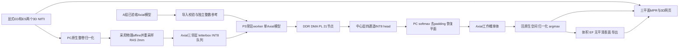

# ACDC25D-B16-P3-v1：Axial单方向完整实施与优化计划

修订日期：2026-10-18；取代2026-10-17计划中的三方向首期范围。状态：离线软件链路及独立ACDC兼容/128MAC候选已实施；当前验证与性能缺口见[验证记录](VALIDATION.md)。仍无合格生产模型、未连接板卡，生产数值和性能验收未完成。

**后续性能计划更新**：用户允许重构硬件架构后，按[4 FPS优化与8 FPS冲刺计划](OPTIMIZATION_4FPS_8FPS.md)推进P256/P384精确打包、存储、宽DMA和整网调度。新文覆盖本文中的旧性能候选与执行顺序；本文的Axial范围、A数值合同、几何恢复、统计与展示要求继续有效。本文保留的128 MAC预算是原阶段设计依据，不是下一阶段唯一方案，也不表示新架构已实现。

依据：[拓扑/板端规格](sources/topology.md)、[A组生产数值补充](sources/production_numerics.md)、用户“先做Axial完整实现和优化”的最新范围。数值算法按A补充收敛；Axial-only任务范围按用户要求覆盖附件中的三方向完整性前提，不改模型拓扑。

工程核对基线为 `0719913f0d1fef41a3af683c25c42520596205aa`；正式交付仍为 [pld_dual_20261017](../../delivery/current.json)。本计划首次修订只改文档；用户随后授权按计划实施。现有实现位于独立acdc目录，使用隔离依赖与独立构建；A原始附件和Skin/CAMUS正式源码/交付指针保持原样，未进行训练、部署或板测。

## 1. 本期目标与 A 回复分析

本期按用户2026-10-18指令，先实现并优化 **Axial单方向**：一个验收通过的 `acdc_axial_v1` 模型，对ED/ES的全部Axial工作层进行2.5D推理，完成原生三维标签、三平面MPR、三维表面、LV/RV/MYO体积、LV/RV EF、交互网页及导出。Coronal/Sagittal模型推理与三方向融合后置，不作为本期依赖或验收条件。

**单方向推理仍可形成完整三维分割体，并显示三个MPR方向。** MPR是对同一体数据切面重采样，不要求三个方向各训练一个模型。模型三个输入通道仍是Axial前/中/后空间邻层，不能改成单通道或混入ED/ES。

### 1.1 A 的回复解决了什么

| 内容 | A文档明确的规则 | 对原计划的修订 |
|---|---|---|
| 强度 | 每患者每时相原生整卷，非零值1%/99%线性分位数，映射[-1,1] | 删除待选归一化方法；原零值也按公式变换 |
| 几何 | RAS单位方向、2mm各向同性，八个体素中心角点确定工作网格 | 不按原始数组直接称Axial，不把原12层当工作层数 |
| 尺寸 | 保比例256 letterbox、PyTorch bilinear half-pixel坐标 | 禁止任意resize和ROI裁剪 |
| 时相 | 两个显式独立3D文件；Info.cfg数字对应文件编号 | 删除本期4D接入、自动选ED/ES |
| 尺度 | 21节点连通，CAT common=max(两路scale)，两路独立Q24 | 保留15Conv/21节点；不插入隐含尺度转换 |
| 恢复 | softmax→去padding→恢复平面→回原生网格→概率兜底归一化→argmax | 禁止先对head插值或先argmax；Axial-only省去多方向融合步骤 |
| 后处理 | 不做连通域、填洞、形态学、概率阈值或网格平滑 | 删除原计划的这些可选生产分支，保留原始argmax标签 |
| 统计/评价 | 明确Dice/距离/EF异常政策和INT8质量门槛 | 使用A口径；无效EF为null，不输出异常数值作为有效EF |

这份回复把多数“算法待定项”转成了可编码、可验收的文字合同。它**不等于已经交付生产模型**：A文档说明首版minmax INT8候选被拒绝，正在修复；本项目尚未拿到可核验的失败详情、最终模型、实际scale、SHA、golden或精度报告，不推断其修复已经成功。

### 1.2 尚缺交付与需核对的边界

当前收到的是 [PRODUCTION_NUMERICS.md](sources/production_numerics.md)，SHA256为 `e159bce5476dbaa9c85a850d11c8d7275b855a24d328e9482e6e3a080357bd14`。其引用的以下配套文件未在当前可见工程文件中找到，不能声称已读取或验证：

- `MODEL_CONTRACT.json`、`PREPROCESSING_CONTRACT.json`：拓扑、预处理版本及implementation_binding。
- `PATIENT_SPLIT.json`：准确患者名单、校准名单与ED/ES帧号。
- `BOARD_EXCHANGE.md`：实际文件布局、字段和错误语义。
- `PREPROCESSING_CHECKS.json`及其样例：文中所述33项检查和5个样例尚未在本项目复现。

后续按文字合同先做无模型设计与合成测试；取得上述文件后核对同一版本、hash、插值实际调用、执行设备和样例，任何差异先定位，不自行挑一个近似实现。当前已在隔离PC环境安装并验证Nibabel 5.4.2/PyTorch 2.11.0，完整依赖见requirements-pc.lock；NumPy/SciPy及执行设备仍须与A最终implementation_binding核对，不能只锁两项库。

仍需从实际绑定确认：qform/sform选择和冲突处理、空间单位/未知单位政策、被认可的ACDC来源识别方法、严格/修复几何路径的golden、CPU/GPU浮点执行环境。特殊sform修复仅满足文档全部条件且显式选择时生效，不能自动修复任意文件。

### 1.3 Axial-only 的显式任务合同

保留模型架构标识 `ACDC25D-B16-P3-v1` 和模型ID `acdc_axial_v1`；另设编排字段 `execution_profile=axial_only_v1`、`required_orientations=["axial"]`、`fusion_mode=none`。这是本次用户指定的阶段范围，不伪装成A原文的三方向完整产品，也不要求A改动网络拓扑或重新生成一个单通道模型。

收集器要求ED/ES各自Axial工作层齐全，拒绝缺层、重复层和SHA/scale/尺寸不符。Coronal/Sagittal是本profile未请求的方向，不当成丢失响应；也不补背景或复制Axial三遍满足旧收集器。未来 `triplanar_v1` 独立启用三个模型、固定三方向完整性检查和A的等权融合算法，两种profile的指标与缓存不能混用。

### 1.4 保持不变的性能结论

每次中心片仍为 `INT8[1,3,256,256]→INT8[1,4,256,256]`，15Conv+3Pool+3CAT，每次 **2,674,917,376 MAC**、参数 **492,304 B**。方向减少降低整例请求数，**不降低单次网络MAC或单片250ms目标难度**。

继续以128 MAC/周期候选、宽装载/输出、Q24流水、局部双缓冲和原生调度争取4FPS。现有32MAC在100/125MHz下理想纯卷积需835.9/668.7ms，纯PS优化仍不足。旧三方向1,048次/262秒和5～6分钟预算不再用于本期；它们也不适用于A刚冻结的2mm工作网格。新预算见第8节。

## 2. 现有工程：复用内容与需要新增的内容

| 环节 | 当前已核对的实现 | ACDC 处理方式 |
|---|---|---|
| 正式交付 | `delivery/current.json` 指向双模型版本；独立 manifest、部署和回退 | 保持原指针；ACDC 候选独立目录和服务，最终采用前不改正式版本 |
| CAMUS 模型 | [model.py](../../camus/model.py) 冻结单通道输入、固定哈希、base16 和四类输出 | 新建 ACDC 加载器；保留旧加载器的严格校验，不把它放宽成任意模型 |
| 数值算子 | [integer.py](../../camus/integer.py) 的 INT32 累加、INT64 Q24、ties-even | 经定向验证后复用算法；独立参考不能只包装同一个被测函数 |
| 图与容量 | [graph.py](../../camus/graph.py)、[contract.py](../../camus/contract.py)、[device.py](../../camus/device.py) | 复用成熟模式与分块逻辑；ACDC 独立模型身份、生命周期和调度计划 |
| PL | [CAMUS 卷积引擎](../../camus/rtl/conv_tile_engine_camus.sv)、[命令处理器](../../camus/rtl/axis_tensor_accel_camus.sv) | 兼容实现验证数值；性能实现另建 ACDC RTL/IP/BD，禁止直接替换旧文件 |
| PS/DMA | [accelerator.py](../../camus/accelerator.py)、[simple_dma.py](../../board/simple_dma.py)、[native.py](../../camus/native.py) | 复用有界等待、缓存同步、独占和恢复；增加单Axial模型常驻、队列、原生打包和计时 |
| 预处理 | CAMUS 为二维灰度、`clip(0,255)/255`，不是 MRI 体标准化 | 新增两个3D NIfTI、ED/ES、采用后的affine、RAS2mm、Axial邻层和逆变换链 |
| 类别 | CAMUS 为背景/LV/MYO/LA | ACDC 为背景/RV/MYO/LV；颜色、统计、后处理和导出全部单独定义 |
| 网页 | [统一 hub](../../display_web/unified/hub.py) 固定两个后端；请求有 45 s 超时，旧上传面向图像 | 新 PC 异步任务服务和体数据前端，板端保留单硬件所有者；不能用单个长 HTTP 请求等待整卷 |
| 显示与后处理 | 旧流程生成二维 PNG，原生恢复和交互细化主要在 PS | 新增概率体、MPR、三维网格和体积统计；不声称这些都是 PL 运算 |
| HDMI | 当前 HDMI 与 CNN 切换 overlay，不支持同时连续推理与该 HDMI 路径 | 本版以 PC 网页为正式展示出口；如需 HDMI，单列显示设计和物理验收 |

当前正式版本历史证据见 [清理与验证记录](../../docs/validation/CLEANUP_20261017.md)：CAMUS 网络含传输样本中位约 2.634 s，计算计数约 1.104 s。此为旧 CAMUS 数据，不能作为 ACDC 板测成绩。旧 CAMUS 也没有完成其 1,000 帧长稳验收；不能继承 Skin 的长稳结论。

## 3. Axial生产数值与空间合同

### 3.1 输入与输出

| 项目 | 本期固定规则 |
|---|---|
| 文件 | 同患者显式ED、ES两个3D NIfTI；不接收4D，不自动选时相 |
| 工作体 | `V[X,Y,Z]`，物理RAS，spacing=[2,2,2]mm，direction=I |
| Axial平面 | `V[:,:,z].T`，H增加为+A、W增加为+R；z=0..Nz-1 |
| 三通道 | `max(z-1,0),z,min(z+1,Nz-1)`；同一时相；邻层中心间距2mm |
| 模型输入 | 连续C-order/NCHW int8 `[1,3,256,256]`，196608B，[-127,127] |
| 量化 | `RNE(float64(u)*127)`后饱和；input_scale=1/127，zero_point=0 |
| 模型输出 | 连续NCHW int8 `[1,4,256,256]`，262144B，有符号logits |
| head | 四通道共享正scale，真实值来自合格Axial spec，不沿用CAMUS |
| 类别/颜色 | 0背景黑/透明，1 RV红，2 MYO绿，3 LV蓝 |

显示可以按放射学/神经学习惯翻转，但显示变换不得改推理张量和回传坐标。模型处理的是文件物理坐标重建的Axial，不保证等同原采集短轴；不会从2mm插值获得厚层采集缺失的信息。

### 3.2 归一化的唯一生产路径

1. `get_fdata(dtype=float32)`读取整个原生3D体，包含文件slope/intercept；NaN/Inf报错。
2. 使用原生体 `value!=0` 的全部数值，包括负值；有效数量少于8报错。ED/ES各自计算，不跨时相共享统计，不按切片/ROI/GT计算。
3. NumPy `percentile([1,99],method="linear")`得到lo/hi；hi≤lo报错。分位数及公式中间使用float64。
4. `u=clip(2*(value-lo)/(hi-lo)-1,-1,1)`，最后存float32；原始0也按该式变换，不强制改成-1。
5. 先归一化再重采样；不经过float16缓存。保存low/high/method及预处理版本。

特别区分：原始零值是正常公式输入；重采样体外/letterbox补边为float -1，入口量化后是-127；网络内部卷积padding则是量化0。三者不能合并成一种padding政策。

### 3.3 原生affine与工作网格

默认strict：采用affine三列范数与header pixdim相符，`rtol=1e-4,atol=1e-5`，否则拒绝。统一空间单位为mm的依据和header冲突策略在实施绑定中确认；缺失/不可信几何不静默猜测。

仅显式选择 `acdc-direction-only-sform-v1` 且来源被认可时，可在 qform_code=0、sform_code=2、三列范数约1(atol=1e-6)、方向正交(atol=1e-5)、pixdim有限正值的条件下，将方向列逐列乘pixdim并保留平移。已相符则不修复。保存原始header及source_affine/source_pixdim，处理使用采用后的物理A；不得把修复只用在统计却仍用错误affine重采样。

对八个**体素中心角点** `(0或nx-1,0或ny-1,0或nz-1)`，计算世界坐标最小m和最大M：

```text
working_origin = m
working_shape  = ceil((M-m)/2) + 1
working_affine[:3,:3] = diag(2,2,2)
working_affine[:3,3]  = m
```

origin/size逐例、逐时相决定，不固定原点0或256³；不用体素外边界角点替代中心角点。目标路径按A绑定的Nibabel `resample_to_output`/SciPy一阶插值，显式order=1、体外常量-1；构造源图时必须传入采用后的物理A。训练/评价标签order=0、体外0。几何记录包括文档要求的所有native/source/working字段和geometry_policy/decision，并hash绑定每次请求。

### 3.4 Letterbox、量化和时相

三张Axial平面共用一次尺寸决策：`r=min(256/H,256/W)`；新尺寸用ties-even的round并夹在[1,256]；top/left按余量整除2，奇数余量留给下/右。PyTorch bilinear、align_corners=False、antialias=False；half-pixel坐标 `(out+0.5)*in/out_size-0.5`。训练标签nearest，不是nearest-exact。只保存并复用实际original_hw/resized_hw/top/left/size，不在逆变换重新猜尺寸。

PC入口只量化一次，板端不再resize、转置、归一化或量化。B实现不得以“同为双线性”替换绑定实现；需先与A的input_int8.bin逐字节一致，才考虑原生加速或去Torch依赖。

官方Info.cfg的ED=1表示frame01文件，不是NumPy索引0/1的自动换算。保存两个显式3D文件SHA及phase；调用者提供患者对应关系，系统不声称自动验证其真实身份。两期可有各自geometry和lo/hi，统计分别在其采用后的原生空间进行。

### 3.5 连续尺度、CAT和待交付参数

用S0=1/127、S1..S15表示15个Conv输出scale。C02/C04/C06后的Pool分别保持S2/S4/S6；C07输入S6、C08输入S7。三个CAT严格为：

| CAT | skip/deep scale | common | 下层 |
|---|---|---|---|
| CAT1 | S6 / S8 | T1=max(S6,S8) | C09 input_scale=T1 |
| CAT2 | S4 / S10 | T2=max(S4,S10) | C11 input_scale=T2 |
| CAT3 | S2 / S12 | T3=max(S2,S12) | C13 input_scale=T3 |

其他连续Conv消费前一层输出scale；Pool/nearest不改scale；C15输出S15即head_scale。严格核对全部21节点，不允许隐藏额外转换。

这里S0～S15表示尺度；第4节保存的S0/S1/S2是skip张量名，两者不是同一类对象，代码schema中分别使用scale字段与skip_id，避免混淆。

A生成权重尺度 `Sw[o]=max(max(abs(W[o]))/127,1e-8)`，权重RNE后饱和；bias按 `RNE(b/(Sx*Sw))`，M按 `RNE(Sx*Sw/Sy*2^24)`。B加载交付的整数参数，不自行重算生产bias/M。CAT两路M为 `RNE(Sbranch/T*2^24)`，LUT索引 `q & 255`，-128非法；LUT由已交付M确定性生成。scale极端比例导致M=0也必须拒绝，不能默认为单位映射。

由T=max两路scale可知，合法CAT乘数不超过2^24，至少一路为单位乘数2^24。这为单位支路旁路和LUT预生成提供优化机会，但必须加载实际M判定，并验证与完整256项LUT及有效生产值完全一致；不能据此把两路都当单位转换。

算法已明确，实际S1..S15、Sw、bias/M、参数hash、spec SHA和INT8验收状态仍未知。生产加载器只接受已通过验收的Axial完整包；合成工件保留synthetic=true，不得替代生产资格。

## 4. 15 层与 21 节点的逐项预算

以下省略 batch=1。MAC 定义为一次乘加，不使用将乘和加分别计数的 GOPS 口径。

| 层 | 输入 C×H×W | 输出 C×H×W | 权重元素 | MAC | 兼容 CAM2 的 Co 分块 |
|---|---|---|---:|---:|---|
| C01 | 3×256×256 | 16×256×256 | 432 | 28,311,552 | 16 |
| C02 | 16×256×256 | 16×256×256 | 2,304 | 150,994,944 | 16 |
| C03 | 16×128×128 | 32×128×128 | 4,608 | 75,497,472 | 32 |
| C04 | 32×128×128 | 32×128×128 | 9,216 | 150,994,944 | 32 |
| C05 | 32×64×64 | 64×64×64 | 18,432 | 75,497,472 | 64 |
| C06 | 64×64×64 | 64×64×64 | 36,864 | 150,994,944 | 64 |
| C07 | 64×32×32 | 128×32×32 | 73,728 | 75,497,472 | 64+64 |
| C08 | 128×32×32 | 128×32×32 | 147,456 | 150,994,944 | 56+56+16 |
| C09 | 192×64×64 | 64×64×64 | 110,592 | 452,984,832 | 32+32 |
| C10 | 64×64×64 | 64×64×64 | 36,864 | 150,994,944 | 64 |
| C11 | 96×128×128 | 32×128×128 | 27,648 | 452,984,832 | 32 |
| C12 | 32×128×128 | 32×128×128 | 9,216 | 150,994,944 | 32 |
| C13 | 48×256×256 | 16×256×256 | 6,912 | 452,984,832 | 16 |
| C14 | 16×256×256 | 16×256×256 | 2,304 | 150,994,944 | 16 |
| C15 | 16×256×256 | 4×256×256 | 64 | 4,194,304 | 4 |
| **合计** | | | **486,640** | **2,674,917,376** | **19 个参数块** |

bias 共 708 元素；可训练参数为 487,348；INT8 权重+INT32 bias+INT32 乘数共 `486640+708×8=492304 B`。C09/C11/C13 占卷积 MAC **50.80%**，是优化优先层；不能只加速 C01 或输出 head。

21 节点按顺序为：

```text
01 C01 → 02 C02(S0) → 03 P0 → 04 C03 → 05 C04(S1) → 06 P1
→ 07 C05 → 08 C06(S2) → 09 P2 → 10 C07 → 11 C08
→ 12 CAT1(S2,C08) → 13 C09 → 14 C10
→ 15 CAT2(S1,C10) → 16 C11 → 17 C12
→ 18 CAT3(S0,C12) → 19 C13 → 20 C14 → 21 C15
```

三处 CAT：

| 节点 | skip | deep，上采样前 | 输出 | split | 完整输出字节 |
|---|---|---|---|---:|---:|
| CAT1 | 64×64×64 | 128×32×32 | 192×64×64 | 64 | 786,432 |
| CAT2 | 32×128×128 | 64×64×64 | 96×128×128 | 32 | 1,572,864 |
| CAT3 | 16×256×256 | 32×128×128 | 48×256×256 | 16 | 3,145,728 |

CAT 必须先分别转换到 common_scale，再 skip-first 拼接；deep 在 PL 最近邻放大一次。mode=4 输入是紧凑的 skip CHW 字节后接 deep CHW 字节，LUT 为 skip256 B 后接 deep256 B。起点和输出高宽均偶数。CAT 后对应 skip 在最后一个 tile 被消费前不能释放。

## 5. 数值一致性设计

### 5.1 卷积、舍入和溢出

```text
acc[o,y,x] = bias[o] + Σ W[o,i,ky,kx] * X[i,y+ky,x+kx]
q = saturate[-127,127](round_ties_even(INT64(acc)*M[o] / 2^24))
hidden = max(q,0)；head = q
```

输入通道完整累加后只量化一次；Co 分块分别写回正确偏移，不跨块再次叠加。未来内部按 Ci 流水分段时必须保留未量化的足够位宽累加结果，bias 只加一次。

最宽 C09 的乘积绝对值粗上界为 `192×9×127²=27,870,912`。这不保证任意 INT32 bias 安全；导入每个真实通道时检查 `abs(bias)+127×Σabs(weight) <= INT32_MAX`，或提供更精确且可审计的范围证明，包含中间部分和。INT32×正 INT32 乘积用 INT64，负值绝对值和 ties-even 中间运算也不能先在 INT32 中溢出。禁止浮点近似替代 Q24。

CAT Q24 按有符号值建 LUT；明确 int8 到 256 项索引的字节映射。`-128` 不允许作为合法数据，但 LUT 第 128 字节位置仍需定义可复现的防御性行为。Pool 使用单位 LUT `M=2^24`，不引入新尺度。

### 5.2 三层独立验证

1. **完整整数参考**：PC 上直接按整张张量计算，INT64 中间结果做范围检查；不调用 PL tile 实现。A 的 golden 作为另一独立来源。
2. **分块 emulator**：执行真实 Co/tile/CAT 调度，验证 halo、偏移、生命周期和协议，不能向每层注入 golden 绕过前向。
3. **真实 PL**：只输入首层量化张量，比较每个节点与最终 head。主通过条件为 `mismatch_count=0`、`max_abs_error=0`，不是 Dice 接近。

浮点softmax/插值以A绑定版本和实际golden验收；`atol=1e-6, rtol=1e-5`仅保留为待核对的工程比较候选，不是A已批准容差，最终标签与统计单独检查，不适用于放宽PL整数要求。若概率平局附近出现跨平台类别差异，记录具体位置并统一运算顺序/精度；正式可复现环境要求输出标签一致。

训练质量按A已给出的患者级口径与INT8门槛验收，见第13节；实际分数仍待报告。PL与INT8零差异不代表分割质量合格，训练fake quant也不替代精确整数oracle。

## 6. 兼容路径的容量、tile 和命令预算

容量规则沿用附件，均为每个 bank 的占用，不是把所有字节与一个总容量比较：

```text
weight: ceil(Co_chunk/8)*ceil(Ci/4)*K² <= 2048
input:  ceil(Ci/4)*(Ht+2P)*(Wt+2P) <= 32768
output: ceil(Co_chunk/8)*Ht*Wt <= 8192
CAT input: ceil(Cs/4)*Ht*Wt + ceil(Cd/4)*Ht*Wt/4 <= 32768
CAT output: ceil((Cs+Cd)/8)*Ht*Wt <= 8192
```

本次将附件形状输入现有 [plan.py](../../camus/plan.py) 与 tile 选择器，未构造生产模型或权重，得到下表。边界 tile 使用实际剩余高宽，不把补齐的无效像素计入结果。

| 卷积层 | 输出 tile H×W | 每个 Co 块 tile 数 | 总 RUN 数 |
|---|---|---|---:|
| C01、C02 | 64×64 | 各 16 | 各 16 |
| C03、C04 | 32×64 | 各 8 | 各 8 |
| C05、C06 | 32×32 | 各 4 | 各 4 |
| C07 | 32×32 | 1、1 | 2 |
| C08 | 28×32 | 2、2、2 | 6 |
| C09 | 18×32 | 8、8 | 16 |
| C10 | 32×32 | 4 | 4 |
| C11 | 27×45 | 15 | 15 |
| C12 | 32×64 | 8 | 8 |
| C13 | 29×86 | 27 | 27 |
| C14 | 64×64 | 16 | 16 |
| C15 | 32×256 | 8 | 8 |
| **卷积合计** | | | **158** |

| 非卷积节点 | 输出 tile H×W | RUN 数 | 输入 B | 输出 B |
|---|---|---:|---:|---:|
| P0 | 16×128 | 8 | 1,048,576 | 262,144 |
| P1 | 16×64 | 4 | 524,288 | 131,072 |
| P2 | 16×32 | 2 | 262,144 | 65,536 |
| CAT1 | 10×34 | 14 | 393,216 | 786,432 |
| CAT2 | 26×26 | 25 | 786,432 | 1,572,864 |
| CAT3 | 26×52 | 50 | 1,572,864 | 3,145,728 |
| **合计** | | **103** | **4,587,520** | **5,963,776** |

单次中心切片：

| 项目 | 静态计算结果 |
|---|---:|
| 参数 LOAD | 19 |
| 输入 LOAD | 261 |
| LUT LOAD | 6，合计 2,304 B |
| RUN | 261 |
| 命令总数 | **547** |
| 卷积输入 payload，包含 halo 和 Co 重复读 | 13,383,040 B |
| 卷积输出 payload | 7,864,320 B |
| 所有 AXIS 有效 payload | **32,293,264 B，约 30.80 MiB** |
| 旧 FSM 卷积周期模型 | 103,055,992 cycles |
| 旧 FSM 非卷积周期模型 | 7,340,856 cycles |
| engine 周期合计 | **110,396,848 cycles** |

21 个逻辑节点既不是 21 条 DMA 命令，也不是 21 个独立硬件网络。当前 CAM2 每 tile 输出最多 65,536 B，因此 256 KiB head 是 PS 拼出的完整张量，不能直接塞进旧单 tile RX 缓冲。192 KiB 完整输入也必须按 tile 收发。

## 7. 性能可行性与第一版架构选择

### 7.1 现有结构的上限

旧引擎为 4 输入×8 输出的 32 MAC/周期。源码同时存在逐字节装载和输出处理，计算、装载、输出不能任意重叠；外层 AXIS 64 bit 不等于内部 8 B/周期。

| 口径 | 100 MHz | 125 MHz |
|---|---:|---:|
| 理想纯 MAC | 835.912 ms | 668.729 ms |
| 旧 engine 周期投影 | 1,103.968 ms | 883.175 ms |
| 旧逐字节 payload 最低占用 | 322.933 ms | 258.346 ms |
| 旧串行通路乐观下界，两项相加 | **1,426.901 ms** | **1,141.521 ms** |
| 对应吞吐理论上界 | 约 0.701 FPS | 约 0.876 FPS |

以上是计算模型，不含 ARM 打包、缓存同步、配置、命令间隙和网络，也不是新的仿真/板测。125 MHz 在 ACDC 上尚未实现，不能因 Skin 有 125 MHz 位流就假设可用。

4 FPS 至少需要 `2.674917376 G×4=10.699669504 GMAC/s`，即 100 MHz 下每周期平均 106.997 个有用 MAC，125 MHz 下平均 85.597 个。因此 64 MAC 在这两个频率也不够。

### 7.2 128 MAC 候选的比较

固定附件 Co 分块，计入 Ci/Co 尾部空闲 lane、暂不计流水启停/量化/访存，得到：

| 并行组织 | 发射周期 | 100 MHz | 125 MHz | 选择理由 |
|---|---:|---:|---:|---|
| **8 输入×16 输出** | **21,512,192** | **215.122 ms** | **172.098 ms** | 主候选；多数 base16 通道利用率好 |
| 16 输入×8 输出 | 21,889,024 | 218.890 ms | 175.112 ms | 比较候选；输入读口压力更大 |
| 4 输入×32 输出 | 27,688,960 | 276.890 ms | 221.512 ms | 大量 Co16 层浪费输出 lane，不作为首选 |

100 MHz 主候选仅余约 34.9 ms 给全部非卷积/搬运/PS 开销，风险高；125 MHz 余约 77.9 ms，较合理，但必须证明时序和实际流水利用率。不能把 172.1 ms 当最终单片时延。

主候选先保留附件对外形状、Co 分块和 CAM2 模式语义，内部重新组织 bank、流水和命令队列。优化版使用独立硬件 ID/ABI capability，不冒充旧 CAM2 位流；硬件传输升级不能改变模型量化合同。若之后调整外部 Co/tile 上限，必须以明确的协议修订和适配计划承载，不能静默改变附件限制。

### 7.3 必须在首轮设计中包含的优化

| 项目 | 设计内容 | 验证收益的方法 |
|---|---|---|
| MAC 流水 | 8×16 候选；输入/权重同步读分级；两个累加上下文或结果 FIFO，隐藏量化与下一输出组发射间隙 | C08/C09/C11/C13 周期、DSP/布线报告、精确数值 |
| Q24/输出 | 重量化可流水接收，必要时多 lane；量化结果写独立输出队列，保留 head 负数 | 7,864,320 个卷积输出值/片的服务速率；与 MAC 有界重叠 |
| 宽装载/输出 | 64-bit AXIS 有效拍并行处理，尽量 8 B/周期；支持 TKEEP 尾拍、NCHW/OIHW 转 bank | 实际装载/排空周期，而不是 DMA 理论峰值 |
| RAM 布局 | 连续 W 字节在 NCHW 中可能落在同一个通道 bank；用宽字存储/字节使能或显式内部打包布局解决写端冲突 | 连续地址、跨字边界、非整倍 Ci/Co 测试 |
| 非卷积 | Pool/CAT LUT 多字节流水；deep×2 复制和两路转换一次完成 | 避免旧非卷积 7.34M 周期继续串行占约 59 ms@125MHz |
| 局部双缓冲 | 输入 tile A/B、输出 A/B；参数块按收益预取；状态 READY/COMPUTE/DRAIN/FREE | 下一块装载、当前计算、上一块输出的重叠时间线和背压测试 |
| PS 原生调度 | 预生成几何无关的 tile 描述符；原生 gather/scatter/MMIO；预分配 arena；日志抽样 | ARM 时间、flush/invalidate 次数与字节、Python 间隙 |
| 命令批处理 | 有界描述符队列与完成队列，带独立 job_id/epoch；失败定位到具体节点/tile | 实际减少 547 次 Python 往返，超时仍可准确归因 |
| 参数复用 | 每层 Co 块跨空间 tile 复用；单Axial参数常驻PS DDR，跨ED/ES复用；版本更新使缓存失效 | 参数命中率及真实 LOAD 次数，不能把 DDR 命中当 BRAM 常驻 |
| 数据复用 | 相邻中心片输入三层滑窗复用；条件合适时保留卷积 halo、C07/C08/C09 跨 Co 的同输入 tile | 对照最小数据流模型核算节省，不做无证据缓存 |
| PC-PS 重叠 | PC 准备 n+1、板推理 n、PC恢复n-1；固定队列深度，背压限内存 | wall time 和阶段占用；不把重叠阶段时间简单相加 |

**仅在 PS 分配双缓冲不等于 DMA 与 PL 已重叠。** 现有 RAM 写入在 busy 时被限制、命令 FSM 串行；必须在新硬件实现独立 bank/端口/所有权和完成通知。AXI DMA simple 模式每通道同时仅一个活动传输；使用其 MM2S/S2MM 独立通道时遵守驱动约束。若换 scatter-gather，必须新建驱动/ABI，不能让现有 SimpleDMA 冒充 SG。

在不降低数值精度的前提下，宽装载理想占用可降至 `32,293,264/8/125MHz≈32.29 ms`，但 bank 冲突、尾拍、AXI 背压会增加时间。Q24 若仍完全串行于 MAC，即使只有 1 输出/周期，也额外需要约 62.9 ms@125MHz；必须验证流水重叠才能合理争取 250 ms。

### 7.4 资源和存储约束

板卡上限：53,200 LUT、106,400 FF、220 DSP、140 BRAM36；物理 DDR 512 MB。当前 CAMUS 已采用构建为 6,843 LUT、7,718 FF、52 DSP、67 BRAM36 等效，100 MHz WNS +0.344 ns。该资源数不能按 MAC 比例直接外推。

当前输入 RAM 128 KiB、权重 RAM 64 KiB、输出 RAM 64 KiB，逻辑合计 256 KiB；分 bank 后实际 BRAM 更多。以下作为新结构设计预算，不修改旧 CAMUS 的 96 DSP 等既有构建门槛：

- ACDC 初始资源控制目标：DSP≤180、BRAM36 等效≤120、LUT≤40,000；最终硬门为器件容量和布线时序，目标调整必须记录原因及剩余裕量。
- 128 个 INT8 MAC 先按每 MAC 一个 DSP 的保守方案评估；Q24 和控制仍需额外资源，不预先假设 DSP 多乘法打包免费可用。
- 不能把旧 67 BRAM 全部复制两份后认为足够：还需要增加 MAC 读宽、参数/FIFO/输出布局，140 BRAM 很容易耗尽。
- 输入/输出优先做 tile 级双缓冲，权重可采用当前块+小型预取缓冲，不要求整个网络双份常驻。
- 权重 128 路并行读不能机械拆成 128 个小 BRAM：相同地址的 lane 可合并为宽字，需按端口、宽度、深度、写掩码和 RAMB18/36 映射重新估算，最后以综合/布线结果为准。
- 单模型约 480.77 KiB 参数已接近全器件 BRAM 理论 630 KiB，本期只装载Axial。完整单模型加特征双缓冲不作为片内常驻目标。
- setup/hold/pulse、未约束路径、DRC、CDC/reset 逐项检查；任何变更不能沿用旧位流时序。125 MHz 失败时评估降频后的实测指标，不宣称“综合成功即达标”。

### 7.5 单模型调度与带宽优化

当前兼容路径每片32.29MB AXIS payload，4FPS要求约129.17MB/s有效payload。实际DDR还包括ARM gather/scatter和cache writeback，不能把历史DMA占位吞吐当整网能力。

本期排序为Axial ED全片→ES全片，模型初始化/hash一次，跨时相复用overlay和已解析参数；不增加方向切换。每层Co块在空间tile间复用，跨中心片仍须加载19参数块、492304B/片；参数占payload约1.52%，先优化特征搬运和ARM间隙，不为它引入整网片内参数池。

邻层滑窗缓存可使一次letterbox/量化的工作平面用于多个中心片；完整NCHW输入按协议发送，除非另行版本化数据复用接口，不能把三个通道缩成一个。ED结束必须清空平面缓存或以phase+geometry+input hash分键，避免把ED邻层用于ES。

先保持每片完整前向，流水重叠PC输入准备、PS-DMA-PL与上一片PC恢复。跨片按层micro-batch仅在测出参数瓶颈后评估，明确其增加的单片延迟/中间内存，不能以批吞吐代替250ms单请求目标。

PC↔PS每片输入196608B、head262144B，使用持久连接与二进制数据，不逐片PNG/ZIP/base64；总通信量按实际Nz计算，见第8节。旧约32.29MB/片板内payload与约448KiB/片PC通信是不同口径。

## 8. Axial切片总数、整例预算与计时

### 8.1 工作量由2mm物理网格决定

```text
Nz_phase = ceil((max_world_z-min_world_z)/2mm)+1
N_total  = Nz_ED + Nz_ES
MAC_case = N_total * 2,674,917,376
T_infer_budget = N_total * 0.250 s
```

每个z预测一个中心平面，首尾重复邻层不会增加中心索引数。ED/ES可以有不同Nz。不跳全背景层、不做ROI裁剪；只允许通过数据/计算复用加速，不减少合同要求的层数。

原始256×256×12仅给出数组尺寸，缺少affine/spacing就不能确定推理次数。以下是假设两期尺寸相同、原生轴与RAS对齐、Z为头脚轴、间距为表中数值的**算例**，不是实际ACDC病例测速：

| 原生Z中心间距 | 工作Nz=ceil(11×间距/2)+1 | ED/ES次数 | 250ms/片纯推理预算 |
|---|---:|---:|---:|
| 5mm | 29 | 58 | 14.5s |
| 8mm | 45 | 90 | 22.5s |
| 10mm | 56 | 112 | 28.0s |

倾斜affine时，原生X/Y方向也可能贡献世界Z包围盒，必须实际变换八角点，不能只用 `(nz-1)*spacing_z`。例如原生spacing=(1.5,1.5,5)mm且轴对齐，完整工作shape为193×193×29，而不是256×256×12。

旧计划的原网格三方向1,048次仅是此前假设，现已撤出本期预算；也不能简单除以3或直接按Axial两期24次。未来三方向必须重新按2mm工作网格计算 `Σphase(Nx+Ny+Nz)`。

### 8.2 整例资源和延迟模型

兼容路径板内payload为 `N_total×32,293,264 B`；参数LOAD为 `N_total×492,304 B`；PC↔PS的输入+head为 `N_total×458,752 B`。以58次算例：155.145 GMAC、板内约1.873 GB payload、PC↔PS约26.608 MB；head落盘14.5 MiB。这些是静态工作量，不是实测DDR带宽或峰值内存。

ED与ES按同一Axial模型顺序处理，首例校验/加载一次模型，二者之间不换profile、不重载overlay。每层参数块仍会随新中心片重新装载，单模型常驻DDR不等于全模型常驻BRAM。

若250ms单片目标达成，表中时间只是纯推理预算。全流程须包括解析/标准化、2mm重采样、输入letterbox、网络传输、原空间概率恢复、mesh、首次渲染、导出；PC与PS阶段可以重叠，最终取真实wall time，不累加嵌套计时，也不保证固定“几十秒”SLA。

### 8.3 计时和验收定义

| 指标 | 起止点与报告口径 |
|---|---|
| 单片板端T_slice | 量化完整tensor已在PS缓冲→全部PS调度/缓存/DMA/PL完成→独立完整head可用；含逐层参数和中间搬运 |
| 4FPS目标 | 单请求串行热态P95(T_slice)≤250ms且持续≥4FPS；同时报告median/P99/max；队列等待另列 |
| 冷启动 | overlay/驱动、读盘/hash、首片分别记录，不用热态掩盖首次开销 |
| 单层/节点 | 参数/gather/flush/DMA/PL cycles/invalidate/scatter，父子层级清晰 |
| 单时相卷 | 本期Axial全部工作层返回并完成原空间恢复；片数/失败/重试完整 |
| ED/ES整例 | 两期全部Axial真实PL结果、原生标签、统计、mesh和导出，记录actual working_shape |
| 首次可交互 | 点击开始→原图MPR可交互；首个局部分割预览另列 |
| 最终展示就绪 | 两期完整标签、统计、mesh送至浏览器且首次渲染；缺层不标完成 |
| 完整端到端 | 开始上传→最终ZIP可下载；实际下载完成另报 |

真实基准仍采用原始256×256×12的ED/ES文件，但必须附两期affine、pixdim、geometry policy/decision、文件SHA和实际Nz。取得模型/板卡后的G4/G6用至少三次完整基准确定现实SLA；当前不冻结缺少证据的固定整例秒数。

硬件未达4FPS时报告最好稳定配置和差距；本次Axial范围是用户明确选择，不应被描述成已经通过原三方向目标。不能继续缩网格、跳层或改base16来隐藏单片性能不足。

## 9. Axial完整链路与分工



PC负责所有NIfTI/浮点/几何处理，以A绑定实现为数值起点；增量接收head并恢复Axial工作体，完成一相位后即可独立生成标签与mesh；EF等待两期有效结果。实现流水时不把不完整体积当成最终统计。

PS只管理单Axial模型和首层量化tensor：固定缓冲、native打包、所有网络算子下发PL、head回传、超时/取消/恢复。overlay和模型跨ED/ES复用；模型版本更新要清空参数/LUT/ready tag缓存，不仅比较shape。失败不得转CPU后仍报告backend=pl。

PL负责15Conv、3Pool、3CAT及Q24/ReLU；新增硬件身份和资源/时序报告，双缓冲和队列都有job_id/epoch。模型对外数值ABI保持不变；如为性能增加队列/打包协议，使用独立硬件ABI和能力协商，不能把A所称“不改数值ABI”理解成硬件接口可静默变化。

三平面显示、体积/EF和三维表面由PC完成；PL推理FPS与浏览器渲染FPS分别报告。Skin/CAMUS共享组件只读复用，独立ACDC构建/运行目录。

## 10. 模型交付、Axial任务接口与内存

### 10.1 第一阶段只依赖合格Axial包

A需提供Axial的FP32权重及SHA、15层INT8权重/Sw/bias/M/scale、范围证明、独立oracle、三组CAT尺度/M、head_scale、各文件长度/SHA、model_spec SHA、验收状态和真实golden。参数布局以配套BOARD_EXCHANGE/机器合同核对后冻结；不得拿失败minmax候选、fake quant或synthetic代替生产INT8。

同时需要预处理实现绑定、患者划分/校准名单、代表性及最差开发病例、原始MRI→input_int8→逐节点→head→原生概率/标签/统计的golden链。Axial模型通过本方向验收即可进入本期生产联调；不等待Coronal/Sagittal训练或三方向融合指标。若A只给整包验收标志，需要追加可审计的Axial独立通过记录，而不是B擅自把未通过改成通过。

导入前检查hash/长度/dtype/shape/值域/scale连通/累加及乘积范围、类别、geometry和预处理版本。生产标志必须由可核对报告支持，不只信一个布尔字段。

### 10.2 待实现接口

| 操作 | 主要信息 |
|---|---|
| capabilities | 硬件ID/ABI、模式、容量、队列限制、runtime/build hash |
| create job | execution_profile=axial_only_v1，required_orientations=[axial]，fusion_mode=none；ED/ES文件SHA及独立geometry SHA、各自中心索引清单、Axial模型身份 |
| submit tensor | 头+196608B二进制；phase、orientation=axial、center/neighbor索引、model/spec SHA、geometry SHA、输入hash、shape/layout/scale |
| result | 262144B head；请求身份回显、实际模型/head_scale、结果hash、backend、计时/状态 |
| progress | ED和ES各自done/expected工作层；当前阶段、错误和重试；不虚构其他方向进度 |
| cancel/resume | 有界取消；完成片checkpoint绑定输入/模型/预处理/geometry/runtime，身份改变拒绝复用 |

ED/ES两个相位的index=0不是同一个任务键。重复提交按幂等规则返回已确认结果或明确冲突，收集器不能重复写入/重复计数。完整性策略由profile定义，不取消缺片检查。错误不靠CPU/背景补齐。

使用持久连接、二进制分块、长度与checksum检查，不逐片PNG/base64或用45秒阻塞HTTP覆盖整例。候选队列2～4片，背压限内存；hardware lease仍为单所有者。

任务状态建议 `queued→preparing→running→restoring→meshing→exporting→completed`，另有cancelled/failed。模型参数、LUT、head_scale与generation一起生效；DMA恢复成功前不释放活动缓冲，重配后重新核对硬件身份。

### 10.3 内存与复用

- PS常驻一套492304B参数，约480.77KiB，不预分配三模型池；未来注册表可扩展，但本期不执行三模型切换。
- S0/S1/S2为1/0.5/0.25MiB；CAT3时skip1MiB+deep0.5MiB+输出3MiB约4.5MiB。特征arena先预算8～16MiB，实际峰值包含输入、head、native/Python副本和调试capture；必须记录RSS/CMA高水位。
- 旧TX128KiB/RX64KiB+guard是tile staging，完整192KiB输入和256KiB head由PS普通内存管理，不能直接塞入单tile缓冲。
- PC每相位工作概率体为 `Nx*Ny*Nz*4*4 B`，原生概率体为 `nx*ny*nz*16 B`；按实际shape预算，ED完成后释放中间体或内存映射，再处理ES，不保存六份方向概率体。
- 原始256×256×12的单相位原生四类float32概率约12MiB；这不是2mm工作体的大小。全部head为 `N_total*256KiB`，模型平面float32全缓存为 `N_total*1MiB`；默认流式恢复，审计head可落盘。
- Axial相邻中心片共享两张输入平面；保持相同整卷归一化和letterbox，缓存量化平面可避免重复resize/量化。网络隐藏特征受三通道上下文影响，不能直接沿用上一中心片的整网特征。

## 11. Axial概率恢复、完整性与后续融合边界

本期在每个相位执行A第7节的单方向恢复链：

1. 验证head身份、长度、scale及center索引，`logits=float32(qhead)*S15`，在256×256四类轴上稳定softmax。
2. 按保存的top/left/resized_hw裁去letterbox；bilinear、align_corners=False恢复到工作平面的H=Ny、W=Nx。输出 `[C,H,W]` 用逆转置放回 `[C,X,Y,Z]` 对应z层。
3. 工作体所有Axial中心层齐全后，四类分别按working_affine→采用后的native_affine/native_shape做一阶插值，体外0。实现可分块，但保持与冻结全体积参考一致。
4. 计算四通道和；sum≤1e-8的体素将背景通道**赋为1**，其他通道不额外清零，再重算和并除以max(sum,1e-8)。严格保留该顺序，不替换成任意valid-mask处理。
5. Axial-only没有方向平均、不除以3；直接对恢复归一化后的Axial概率argmax，平局选最小类别，保存uint8原生标签0/1/2/3。

禁止先插值head再softmax、先argmax再恢复、插值标签编号产生新类别、阈值二值化、连通域/填洞/形态学平滑。分割结果必须标记来源Axial-only；缺层、重复层或模型/geometry不匹配即任务失败，不能以背景补齐。

未来三方向阶段才启用：各方向分别完成上述步骤1～4，在同一原生网格按axial→coronal→sagittal用float32累加后除以3，再argmax；权重固定1/3，不按有效FOV重加权、不调类别权重。原计划“可调融合权重/有效mask重加权”已废止；此未来功能不进入本期任务依赖或性能成绩。

## 12. 三维展示与 MPR 的具体实现

### 12.1 MPR 是什么、怎样生成

MPR（多平面重建）是在已有三维灰度体或标签体中，按指定物理平面重新采样得到二维图像。它可以在分割前显示原始MRI，也可以叠加分割。**MPR不需要重新运行网络，也不等于三方向模型推理。**

平面用中心p0、两个单位方向u/v和屏幕物理步长du/dv定义。每个显示像素对应：

```text
p_world = p0 + (i-i0)*du*u + (j-j0)*dv*v
p_voxel = inverse(affine_native) * homogeneous(p_world)
```

灰度用三线性采样，标签用最近邻（或采样四类概率后argmax）；超出FOV显示空背景。三个视口共享一个世界坐标十字光标，点击任一视口更新另外两平面与3D定位标记。方向标签依据真实坐标系生成，不能固定把屏幕左边标成患者左侧。

原始轴对齐切面可快速索引；斜切面必须按上式重采样。保持真实spacing显示比例，不能将256×12矩阵直接当等距正方形。SimpleITK的origin/spacing/direction定义见[官方说明](https://simpleitk.readthedocs.io/en/master/fundamentalConcepts.html)，RAS/LPS转换参考[3D Slicer坐标文档](https://slicer.readthedocs.io/en/latest/user_guide/coordinate_systems.html)。

### 12.2 可旋转三维心脏

分别对RV=1、MYO=2、LV=3从最终原生标签提取二值体，经Marching Cubes或等价等值面算法生成表面。使用采用后的原生物理affine把网格顶点转换为毫米世界坐标；首版直接在原生标签上提取，不先平滑或额外重采样标签来美化表面。MPR显示采样与这份定量标签、表面生成路径分开。

建议PC使用VTK生成可缓存网格，浏览器vtk.js负责旋转/缩放/透明度/裁切/切面定位。灰度体渲染是可选附加视图；首版必须实现MPR+类别表面，避免以昂贵的全体渲染阻塞结果展示。vtk.js提供相关切片和表面示例，见[官方示例目录](https://kitware.github.io/vtk-js/examples/)。

遵从A合同，不执行网格平滑；首版也不做表面简化，保留由标签提取的几何。定量体积来自标签体，不来自网格。空类别显示“无该结构”，边界截断的表面标记FOV截断，不能伪装为完整解剖结构。ED和ES分别生成网格并共享相机；两时相切换不是完整心动周期动画。插值过渡若实现，明确标记为演示插值。

MIP是沿射线取最大强度的投影，可作为可选灰度浏览；它不替代MPR和类别表面，也不是心脏分割质量的主要展示。

### 12.3 网页布局与交互

```text
病例 / ED或ES / Axial模型版本 / PL状态 / 进度 / 阶段耗时
┌────────────────────────┬────────────────────────┐
│ MPR 视口1：灰度+标签     │ MPR 视口2：灰度+标签     │
│ 世界坐标十字线与方向标记 │ 联动位置、缩放和窗宽窗位 │
├────────────────────────┼────────────────────────┤
│ MPR 视口3：灰度+标签     │ 三维 RV红 MYO绿 LV蓝    │
│ 滚轮逐层 / 原图对照      │ 旋转、透明度、裁切平面   │
└────────────────────────┴────────────────────────┘
EDV / ESV / SV / LV-EF / RV-EF / MYO体积 / 导出
```

必须有：ED/ES切换、三视图光标联动、切片滚动、灰度窗宽窗位、类别显隐/轮廓/alpha、3D旋转/缩放/重置、原图与Axial标签对照、任务取消/错误恢复、导出进度。进度分清“部分工作层预览”和“本期Axial全卷已完成”。刷新页面可恢复任务状态。

本期交互只改变视图、窗宽窗位、类别可见性、轮廓和alpha，不改变生产标签。不提供ROI裁剪推理、概率阈值二值化、人工编辑或点/框细化，避免偏离A冻结数值链；这些如需增加另立版本与评价。

网页渲染帧率与PL推理FPS分别展示。拖动MPR/旋转3D优先本地GPU完成，不每次向板卡请求。为无WebGL/低内存浏览器提供静态切面和下载入口，并明确3D展示不可用状态。页面与导出标注“工程教学与算法演示，不作为临床诊断依据”。

## 13. 体积、EF与A的评价口径

定量对象为Axial最终原生标签，使用**采用后的物理affine A**，而不是未修复的source_affine、2mm工作体或网格表面：

```text
voxel_volume_mm3 = abs(det(A[:3,:3]))
V_class_mL = count(native_label == class) * voxel_volume_mm3 / 1000
EDV = V_cavity(ED); ESV = V_cavity(ES); SV = EDV-ESV
EF = 100*SV/EDV  # 仅 EDV>0 且 0<=ESV<=EDV 时有效
```

LV与RV分别计算EDV/ESV/SV/EF；MYO仅报告ED/ES体积，不定义MYO EF。缺时相、几何不可信、EDV≤0、ESV<0或ESV>EDV时EF=null，保留原始容积与异常原因，不自动交换时相或截断成正常值。体积按空间单位换算到mm³；规则网格采用det(A)，不能用切片厚度替代中心间距。

每项统计绑定phase、label hash、model/spec SHA、geometry SHA、execution_profile和恢复版本。MPR画面翻转和类别alpha不改标签和统计。当前不提供人工改标签/阈值细化生产路径，避免改变A冻结后处理。

A规定的开发评价原样纳入Axial阶段：

- 80训练/20开发，每病理组16/4；具体患者名单和帧号等待PATIENT_SPLIT交付核验。ED/ES和全部切片同患者同组。32训练患者×两时相×35%/65%两层=128校准堆栈，仅按A固定名单，不在B侧重新选校准集。
- Dice双空=1、单空=0；先平均同患者ED/ES，再平均20患者，最后RV/MYO/LV三类等权平均，背景不计。不按切片或体素数加权。
- 表面按一次6邻接二值腐蚀、边界外0提取体素表面中心，使用完整物理A映射到mm；双向最近距离合并，HD=max、HD95=95分位、ASSD=均值。双空0，单空null并注明原因；该定义为本地指标，不冒称官方挑战分数。
- Axial精确INT8相对真FP32：总体Dice下降≤0.01、任一类≤0.02、任一ED/ES体三类宏平均下降≤0.05；非空GT不得新增相对FP32的全空预测；15层独立整数oracle零差异。PC/PL验收再覆盖Pool/CAT与最终恢复链。
- 真FP32关闭autocast/TF32，训练AMP指标单列；报告绑定代码/患者划分/模型SHA和恢复版本。官方50测试病例按A声明封存，本期不下载或用于选模；本项目尚未独立核验其数据使用历史。

Axial阶段报告2D基线（A提供时）、Axial真FP32、Axial精确INT8及PL。三方向和融合成绩后置，不伪造空列通过状态。体积误差(mL)和EF误差(百分点)作为下游指标另报，缺GT/无效EF时明确不可评价；不自设无数据支持的准确率承诺。

## 14. 导出与可复现交付

```text
result/<run_id>/
  manifest.json                 profile=axial_only_v1，fusion=none，完整身份与hash
  geometry/ED.json, ES.json     各自source/native/working几何、归一化与letterbox
  labels/ED.nii.gz, ES.nii.gz   原生shape，采用后的物理affine，uint8 0/1/2/3
  statistics.json, statistics.csv
  performance.json              逐层/逐片/全流程计时和实际工作层数
  quality.json                  缺层/异常/EF有效性、可选GT评价
  meshes/ED_*.vtp, ES_*.vtp     未平滑类别表面，mm、RAS、类别明确
  previews/                     三平面MPR、三维截图、图例
  probabilities/                可选Axial原生概率及工作概率，不标融合概率
  heads/                        可选逐片INT8 head和sidecar
  README.txt                    Axial来源、坐标/统计规则与工程演示声明
```

输出保留原生体素排列和shape，header写入采用后的物理A，并记录source header与geometry_decision；不把错误原始sform重新写回输出。回读验证shape、affine、spacing/单位、标签值、体素数、体积和hash。原始输入文件保留不覆盖。

mesh同标签物理空间，无网格平滑；GLB/PLY等可作交换格式，但必须记录坐标系与单位。不生成额外“后处理标签”冒充合同结果。最终报告在所有必需阶段完成后写入，ZIP中的端到端时间与完成状态覆盖实际导出；浏览器首次渲染由客户端另报。

最终包绑定源码、依赖、模型、oracle、编译器、IP、bit/HWH/XSA和原生库；A的三方向包若尚未全部完成，本期可交付独立合格Axial包及明确范围。模型与原始数据按既有许可/Release政策管理，不把待验收候选或数据集原图默认为可发布资产。

## 15. 独立工程组织与旧系统保护

以下目录为后续实施建议；当前只有 `acdc/docs/IMPLEMENTATION_PLAN.md` 已存在并在本轮修订。

```text
acdc/
  docs/                   本计划、模型合同、ABI、使用/部署/测试说明
  model/                  模型schema、加载器、哈希验收，不存大权重
  reference/              独立整数整网、几何与Axial恢复参考
  runtime/                graph、tile计划、buffer、native调度、板端worker
  pc/                     NIfTI、预处理、Axial任务/恢复、统计、网格和导出
  web/                    PC异步服务、MPR/3D前端、性能面板
  rtl/ sim/ vivado/        独立ACDC IP/测试/构建
  tests/                  数值、容量、空间、接口、故障与端到端测试
  scripts/                无板验证、构建、板测、打包、部署与回退
  deploy/                 独立服务模板、环境锁定、硬件lease集成
out/acdc/                 生成产物、测量和病例结果，不入Git
ip_repo/acdc/             独立打包IP，不覆盖现有IP
delivery/acdc_<version>/  最终冻结清单、小型证据和使用说明
```

初期只读导入稳定通用组件或按许可证建立有来源hash的ACDC副本；不先重构Skin/CAMUS公共层。ACDC变化不能放宽旧loader、替换旧RTL、改旧quant常数或覆盖正式附件。

板端未来部署使用独立release路径及unit，所有推理后端共享同一硬件lease。ACDC启动前通过已核验机制停止旧所有者，退出后恢复原服务；多个服务不并行拥有DMA。若最终加入统一入口，在新的hub版本显式增加ACDC后端和异步协议，完整回归后再采用，旧release保持可回退。

发布前必须验证Skin/CAMUS原始样例head和图像导出、两向模型切换、超时恢复、历史文件、认证和回退。文档阶段只做链接/数学/差异核对，不运行无关Vivado或板测。

## 16. Axial实施阶段与依赖

用户已授权按计划实施；下表保留目标与验收依赖，实际完成/待验状态以VALIDATION.md为准。实施按Axial范围推进，不需要等待另两个方向。A负责模型训练/量化，本项目负责以下全部工程与验证。

| 阶段 | 工作/交付 | 依赖与完成条件 |
|---|---|---|
| G0 合同落实 | Axial-only任务profile、文字合同映射、机器合同核对、实际Nz预算工具 | 现有两份附件可设计；取得配套JSON/交换文档和样例后关闭数值绑定缺项，不再重新选择已冻结算法 |
| G1 无模型基础设施 | 单模型loader、独立整数参考、tile emulator、三邻层/letterbox、协议、synthetic向量 | 不需真实模型/板卡；21节点、长度/hash、边界和生产拒绝路径通过；synthetic不冒充生产 |
| G2 完整PC与网页 | ED/ES两个3D输入、RAS2mm、Axial概率体回原生、MPR/无平滑mesh/体积EF/导出 | 合成体可先验证；A golden到达后验证输入字节与恢复结果；三个MPR视口不调用其他方向模型 |
| G3 性能硬件与PS原型 | 独立ACDC RTL/BD，128MAC候选、宽load/drain、Q24流水、局部双缓冲、native队列 | 无板可做仿真/综合/布线；21节点数值、代表层周期/资源/时序决定结构，不把预计FPS当实测 |
| G4 板卡闭环与短测 | 合成整网、兼容/优化路径、DMA/缓存、故障恢复、短测性能分解 | 板卡连接后执行；模型未到也可用synthetic验硬件，结果必须标synthetic；确认硬件结构和实际4FPS差距 |
| G5 合格Axial模型集成 | 导入真实包、A/B独立oracle、真实MRI逐层/head/原生结果比对、质量评价 | 只需Axial验收包；PC部分可先执行，有板后闭合PL数值；失败minmax/fake quant不能通过 |
| G6 整例优化与稳定性 | ED/ES全部Axial工作层、滑窗输入复用、PC-PS重叠、取消/恢复、内存和真实浏览器 | G2/G4/G5汇合；三次整例计时、最终候选至少1000片真实推理；完整输出与准确身份 |
| G7 独立交付与旧系统回归 | 源码/依赖/模型/位流绑定、干净检出复现、部署回退、Skin/CAMUS回归、使用说明 | 功能/数值/性能分别判定；旧正式指针不覆盖，保留可执行回退 |

推荐顺序为G0先行、G1/G2与G3在已定合同上独立推进；先用仿真与代表层资源/周期验证判断优化方向，再做大量UI细节。板卡先到可做G4 synthetic；模型先到可做G5 PC数值与质量；两者缺一不能宣布真实生产链路完成。

本期取消三profile切换调优、Coronal/Sagittal推理收集和融合实现；保留orientation/profile字段及可扩展模型注册结构，不为未来方向预占内存。优化优先级：C09/C11/C13与Q24/宽搬运 → PS批命令和cache → Axial邻层平面缓存 → PC概率恢复/mesh/导出重叠。每轮先用决定候选去留的短测，再对最终采用版做必要长稳。

## 17. 验证与本期成功标准

### 17.1 无模型、无板可做的验证

- 生产拒绝路径：缺合格模型/spec/SHA/golden、失败候选、错方向、synthetic伪装、错误dtype/shape/scale均拒绝。
- 原生非零统计包含负值、原始零值公式处理、NaN/Inf/<8有效值/退化体报错；float64分位/公式→float32结果，不往返float16。
- strict几何不符拒绝；特殊sform修复所有条件的正负例；八个中心角点、RAS轴翻转/斜affine、origin非0、单位及source/adopted affine分别保留。
- 两个3D文件接入；4D拒绝；Info.cfg文件编号不自动减一；ED/ES不同geometry、不同归一化参数仍可统计。
- Axial `V[:,:,z].T`和逆转置、三邻层首尾clamp、相同letterbox、奇数padding、ties-even新尺寸；输入逐字节对齐A样例。A所述33项/5样例只在实际拿到并复现后列为通过。
- Q24正负半值、饱和、bias范围、Co56/64/32偏移、halo、bank边界、三CAT的skip-first/双LUT/nearest和完整21节点。
- 先softmax后恢复与错误顺序对照；概率体外0、sum≤1e-8背景赋1且保留其他类后归一化；argmax平局最小类；缺层/重复/SHA错误拒绝。
- 已知体素体积/EDV/ESV/EF；EDV=0、ESV>EDV等返回null；无任何连通域、填洞、阈值或网格平滑；距离指标空类/斜affine测试。
- RTL背压、TKEEP/TLAST、包错误、复位、buffer所有权、job epoch、队列满和取消；浏览器MPR/3D/EDES切换与导出回读。

### 17.2 真实模型与板测门

1. Axial真实模型从首层输入执行全网；A golden、独立完整整数参考、tile emulator、PL逐节点/head全部零差异，不逐层注入golden。
2. 同一完整病例ED/ES各自所有工作z层齐全，原生概率/标签/体积/EF/mesh/导出身份一致；未完成一层即不标completed。
3. A第8节的患者级质量口径及Axial INT8门槛通过；FP32/INT8/PL性能与质量分离，开发集不称独立测试集。
4. 最终候选至少1000片真实PL，覆盖两期、边缘/中部、不同病例；明确完整病例数与实际Nz，不再要求“1048片基准”。完整基准至少三次，记录全部样本；可合并覆盖长稳，避免重复测量。
5. 单片median/P95/P99/max、持续FPS、每层时间、全卷/整例wall time、冷/热/重试开销；同模型与同工作网格比较，4FPS目标与功能分别判定。
6. RSS/CMA/队列高水位、输出hash、超时恢复、计算中复位、PC断线/取消/续传、版本更新后下一正确推理；异常未确认停止前不释放DMA缓冲。
7. 独立ACDC构建资源/布线setup-hold-pulse/DRC/时钟/bit-HWH-XSA绑定，主机测试/仿真/构建/真实板测分别报告。

PC浮点恢复以A实际实现绑定与golden验收，容差先与该绑定对齐；原计划 `atol=1e-6,rtol=1e-5` 只作为工程对照候选，不是A已批准的标准。PL整数零误差要求不变；浮点概率近似不能掩盖标签/体积不同。优化CPU软件基线标明设备/库/线程，Python整数参考不单独代表公平加速比。

### 17.3 本期成功标准

| 项目 | 通过证据 | 当前状态 |
|---|---|---|
| Axial真实PL与数值 | 合格Axial spec/hash、21节点/head零差异、恢复链golden | 代码路径已实现；待模型/板卡关闭生产验证 |
| 两期全体数据完整展示 | 全部工作z层、原生标签、三MPR、无平滑3D、LV/RV/MYO与有效EF、导出 | 计划已改为Axial-only |
| 真实性能与优化 | 单片≥4FPS争取目标、实际Nz整例时间、资源/时序/内存/稳定性 | 静态单片预算保留，整例按几何计算，无板测 |
| 独立与旧系统保护 | 独立ACDC源码/运行包、Skin/CAMUS回归和回退 | 已完成原系统250项Python及6个Node回归；未重跑板测 |
| 可复现交付 | 源码/测试/脚本/依赖/模型/位流/使用说明及clean checkout记录 | 后续G7 |

Coronal/Sagittal与三方向融合不进入本期通过条件；未来启用必须单列模型、质量、性能与完整性验收，不能引用Axial-only成绩代替。

## 18. 风险与处理

| 风险 | 证据或触发点 | 应对 |
|---|---|---|
| A的INT8尚未通过 | 文档声明首版minmax被拒绝，无最终包 | 可以先做synthetic与PC基础设施，生产loader保持拒绝；不等待其他方向，但必须等合格Axial |
| 文字合同与机器文件不齐 | 五个配套文件及实际golden未收到 | 记录缺项；先做明确算法，收到后对齐implementation_binding和SHA，不伪称33项已复现 |
| 2mm/RAS改变片数 | Nz受affine/姿态/spacing影响 | 八角点实际计算，分别显示ED/ES expected_count，取消24次或1048次固定预算 |
| 特殊sform处理错误 | 原始affine与pixdim不符或来源未知 | strict默认拒绝；显式受限修复并全链使用采用后的A，保留原始header |
| 浮点版本/设备不一致 | input_int8/hash或概率golden不符 | 先绑定A实现再优化；禁止float16缓存和任意换库；数值容差不替代标签一致性 |
| 128MAC和双缓冲不收敛 | 代表层与完整BD资源/时序不通过 | 优化bank宽字/局部buffer/流水，比较100/125MHz；记录实测目标差距 |
| 算力足够但PS/DMA拖慢 | 单层/全片时间线 | 优先宽load/drain、Q24重叠、native队列、缓存范围和片间流水 |
| Axial质量不如融合 | 真实开发集结果 | 本期如实报告单方向质量，不承诺优于2D基线；未来方向融合另立阶段 |
| EF或表面异常 | 时相错误、截断FOV、空类别、ESV>EDV | 保留原值/质量标记，EF按A规则null，网格不靠平滑掩盖缺陷 |
| 新任务破坏旧系统 | 共享DMA/服务/运行包 | 单lease、独立release、不覆盖正式源/模型，采用前实际回归和回退 |

Z2若最终不能满足4FPS，交付数值正确、功能完整和真实性能差距；更换板卡、改变模型/工作网格或跳层不在当前优化授权范围内。本期Axial范围已经由用户明确选择，无需再等待三方向计划确认。

## 19. 数据集与开源组件选择

| 资源 | 本项目用途 | 边界 |
|---|---|---|
| [ACDC官方数据](https://www.creatis.insa-lyon.fr/Challenge/acdc/databases.html) | 主开发与验收数据；ED/ES和RV/MYO/LV标签 | 按A固定80/20名单核验；官方50测试封存，本期不为开发下载；遵循引用要求 |
| [M&Ms官方入口](https://www.ub.edu/mnms/) | 后续跨来源心脏MRI外部验证候选 | 获取权限、标注/预处理差异需另核；不延误ACDC主线 |
| [NiBabel](https://nipy.org/nibabel/) | NIfTI读写、affine/header检查 | 处理数组轴约定、数据缩放和空间单位 |
| [SimpleITK](https://simpleitk.readthedocs.io/en/master/fundamentalConcepts.html) | 外部几何对照工具 | 生产重采样按A冻结的Nibabel/SciPy实现，不直接替换为SimpleITK |
| [VTK / vtk.js](https://kitware.github.io/vtk-js/examples/) | PC表面提取、浏览器MPR和3D展示的优先路线 | 先验证相同世界坐标与类别叠加；避免重复引入多个渲染引擎 |
| [Cornerstone3D](https://www.cornerstonejs.org/docs/concepts/cornerstone-core/viewports/) | 若后续转向DICOM工作站，作为VolumeViewport/MPR路线 | 本版NIfTI+轻量应用优先vtk.js，不同时建设两套前端 |
| [3D Slicer](https://slicer.readthedocs.io/en/latest/user_guide/coordinate_systems.html) | 导出NIfTI/mesh的外部独立核对工具 | 人工检查空间和类别，不替代自动数值测试 |
| [MONAI Tutorials](https://github.com/Project-MONAI/tutorials) | A端数据变换/体数据组织与软件验证参考 | 不将通用教程默认预处理替代冻结合同 |
| [nnU-Net](https://github.com/MIC-DKFZ/nnUNet) | 软件质量基线、患者划分和预处理设计参考 | 自动生成的网络通常不同于本版15Conv；不能直接部署其模型冒称本规格 |

以上为设计阶段组件建议。当前实际采用NiBabel/SciPy/Torch生产预处理、PC侧VTK表面导出和本地Canvas/WebGL显示；未引入vtk.js/Cornerstone，也未下载数据集或外部开源工程。PC完整依赖已锁定，板端Python3.10/NumPy1.21兼容依赖单独列出，不引入Torch训练环境。当前实现与验收范围以VALIDATION.md为准。

## 附录 A：本轮静态计算的复现方法

在核对基线的仓库根运行以下只读脚本；它仅提供形状给现有planner，没有创建权重、伪造模型hash或访问PYNQ。建议后续将其转入ACDC自己的预算工具，避免正式模型对象依赖CAMUS。

```python
from types import SimpleNamespace as S
from camus.plan import build_plan
from camus.device import output_channel_chunks
from math import ceil

# ci, co, h=w, kernel
rows = [
    (3,16,256,3), (16,16,256,3), (16,32,128,3), (32,32,128,3),
    (32,64,64,3), (64,64,64,3), (64,128,32,3), (128,128,32,3),
    (192,64,64,3), (64,64,64,3), (96,32,128,3), (32,32,128,3),
    (48,16,256,3), (16,16,256,3), (16,4,256,1),
]
model = S(layers=[S(
    index=i, name=f'C{i+1:02}', full_input_shape=(1,ci,h,h),
    full_output_shape=(1,co,h,h), kernel=k, padding=k//2, relu=i<14
) for i,(ci,co,h,k) in enumerate(rows)])
plan = build_plan(model)
tensor_cycles = sum(
    (4 if r['mode']==2 else 1)*r['output_bytes'] + 8*r['tile_count']
    for r in plan['tensor_schedule']
)
issue_128 = sum(
    h*h*ceil(ci/8)*sum(ceil(c/16) for c in output_channel_chunks(ci,co,k))*k*k
    for ci,co,h,k in rows
)
assert plan['total_mac_count'] == 2674917376
assert plan['parameter_bytes'] == 492304
assert plan['total_commands'] == 547
assert plan['total_packet_bytes'] == 32293264
assert plan['projected_conv_compute_cycles'] + tensor_cycles == 110396848
assert issue_128 == 21512192
# Axial-only: aligned 12-slice source, 5mm Z spacing, both phases same.
assert 2*(ceil((12-1)*5/2)+1) == 58
assert 58*0.250 == 14.5
assert (ceil((256-1)*1.5/2)+1,)*2 + (ceil(11*5/2)+1,) == (193,193,29)
print(plan)
```

复算结果与附件的权重、bias、参数字节、MAC、CAT大小一致。tile/命令/周期是当前源码planner针对附件形状的结果；性能版更改调度后需重新生成。所列网络和网页组件能力来自链接的官方资料，资源与旧性能来自当前工程已保存证据，本轮没有重做板测。
