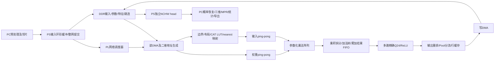

# PYNQ-Z2 / ACDC Axial：4 FPS 完整优化与 8 FPS 冲刺计划

> 2026-10-19更新：本计划已由[最终模型对齐与优化计划](FINAL_ALIGNMENT_OPTIMIZATION_PLAN_20261019.md)更新。真实模型MAC/通道与预算一致；执行表、双任务队列和AXI控制已实现并有合成参数RTL证据。当前优先级是实际模型接入、metadata综合网表故障、厂商DMA/完整BD/PS驱动。下文未同步的“模型缺失/控制器待从零实现”是历史状态，4/8 FPS仍待真实板测。

日期：2026-10-18。状态：**实施中，组件已有验证；完整新性能架构与板测尚未完成**。

本文汇总本次整体架构分析与 PYNQ-Z2 板卡分析。用户允许重构 ACDC 的 RTL、数据布局、DMA、缓存、流水和调度；A 的模型及生产数值规则不变。本文是后续性能工作的主计划，覆盖旧[实施计划](IMPLEMENTATION_PLAN.md)中的性能候选、容量调度和执行顺序；旧计划的 Axial 范围、模型资格、预处理、恢复、统计、展示要求继续有效。

原实现基线为提交 `dd3a76f04c96a111fded034831ff7656a16805ea`。正式 Skin/CAMUS 入口仍为 `delivery/current.json`，不得用 ACDC 候选替换原正式源码、服务或交付。没有 A 的合格生产参数；用户随后连接板卡并授权实施，目前已只读SSH核对，完整新硬件尚未板测。不把合成算术、仿真、布线或容量估算称为真实分割精度或板端 FPS。

## 1. 目标、范围和采用策略

### 1.1 两级目标

| 等级 | 完整 warm 推理吞吐 | 单片完整延迟 | 性质 |
|---|---:|---:|---|
| G4 | ≥4 FPS | P95 ≤250 ms | 必争取的主目标；未实测通过前保持未验收 |
| G8 | ≥8 FPS | P95 ≤125 ms | 冲刺目标；不得为它牺牲数值、稳定性或 G4 交付 |

二者均执行全部 15 Conv / 21 逻辑节点，输入 `INT8[1,3,256,256]`，输出独立持有的 `INT8[1,4,256,256]`。这是非实时 Linux 下的统计验收口径，不保证每一次请求的硬实时上限。必须同时报告最大值和超阈值比例；若今后需要每片绝不超时，须单独设计确定性调度。

采用策略：先获得数值正确、时序合格的 G4 候选并冻结为可回退版本；再在独立候选上冲刺 G8。G8 不达标时交付真实 G4 结果与限制，不能用局部周期、跨帧吞吐或缓存响应冒充 G8。

### 1.2 架构候选命名

名称中的 P 表示精确乘法打包，与 A 组名称无关。

| 候选 | 空间并行 P / 输入并行 I / 输出并行 O | 逻辑乘法/周期 | 主乘法 DSP | Q24 路数 | 定位 |
|---|---|---:|---:|---:|---|
| D192 | 3 / 8 / 8，直接乘法 | 192 | 192 | 2 | 对照和打包路径不成立时的备选 |
| P256 | 4 / 8 / 8，两个空间输入共享权重打包 | 256 | 128 | 4 | G4 首选；进一步优化后也评估 G8 |
| P384 | 6 / 8 / 8，两个空间输入共享权重打包 | 384 | 192 | 4 | G8 首选候选，须通过资源、存储与时序门槛 |

先按 100 MHz 单时钟设计；125 MHz 仅在新候选完整布线通过后采用。150 MHz、DSP 多倍频、复杂跨时钟计算不作为 G4/G8 初始依赖。保留参数化共用模块，避免复制三套互不兼容的控制系统；不要求为对照候选重复完成所有重型验收。

### 1.3 本期边界

- 只有 Axial 模型，ED/ES 全部工作切片；不扩展三方向模型或融合。
- PC 承担 NIfTI、RAS 2 mm、邻片构造、概率恢复、表面、MPR、统计与导出；PS 承担通信与硬件调度；PL 执行全部网络算术。
- 不通过 ROI、缩小图像、少推层、降低位宽、剪枝、重新训练或近似量化达标。
- HDMI 同时运行另列资源和争用配置；G4/G8 基线为 PC 网页展示。当前旧 HDMI 路径涉及 overlay 切换，不能假设可与新 CNN 同时运行。
- 本文初次编制为计划阶段；用户随后授权完整实施和测试，当前按以下阶段推进，进度见第17节。

## 2. 不得改变的模型与数值合同

来源：[A 生产数值说明](sources/production_numerics.md)、[拓扑](sources/topology.md)、[当前代码合同](../contract.py)。

### 2.1 固定拓扑

| 层 | 输入通道 | 输出通道 | 输出 H×W | 核 |
|---|---:|---:|---:|---:|
| C01 | 3 | 16 | 256×256 | 3×3 |
| C02 | 16 | 16 | 256×256 | 3×3 |
| C03 | 16 | 32 | 128×128 | 3×3 |
| C04 | 32 | 32 | 128×128 | 3×3 |
| C05 | 32 | 64 | 64×64 | 3×3 |
| C06 | 64 | 64 | 64×64 | 3×3 |
| C07 | 64 | 128 | 32×32 | 3×3 |
| C08 | 128 | 128 | 32×32 | 3×3 |
| C09 | 192 | 64 | 64×64 | 3×3 |
| C10 | 64 | 64 | 64×64 | 3×3 |
| C11 | 96 | 32 | 128×128 | 3×3 |
| C12 | 32 | 32 | 128×128 | 3×3 |
| C13 | 48 | 16 | 256×256 | 3×3 |
| C14 | 16 | 16 | 256×256 | 3×3 |
| C15 | 16 | 4 | 256×256 | 1×1 |

逻辑顺序：`C01,C02,P0,C03,C04,P1,C05,C06,P2,C07,C08,CAT1,C09,C10,CAT2,C11,C12,CAT3,C13,C14,C15`。物理融合不能删除逻辑可验证边界。

每片卷积总量 **2,674,917,376 MAC**；实际 INT8 权重 486,640 B，bias 和乘数各 708 个 INT32，总参数 **492,304 B**。邻近三片已经包含在首层 Ci=3 中，不额外乘 3。

### 2.2 精确整数要求

1. 激活/权重 INT8 范围 `[-127,127]`、零点 0；拒绝非法生产值 -128。
2. 全 Ci/K 累加完成后加入一次 bias，或在首项加入一次；输出前保持精确 INT32。用 A 的 `abs(bias)+127*sum(abs(weight))` 边界证明验证所有部分和安全。
3. INT32 acc × INT32 正乘数产生完整 INT64 乘积，按 Q24 最近偶数舍入，饱和到 `[-127,127]`。
4. C01～C14 再做 ReLU；C15 不加 ReLU、sigmoid 或 softmax。
5. CAT 为 skip-first，split 64/32/16；两支各按 A 的乘数精确映射到共同尺度，再执行逻辑拼接。nearest 使用全局坐标 `floor(index/2)`。
6. 卷积 padding 是量化数值 0；输入 letterbox 的 -127 不得混淆。
7. 内部布局变化只允许精确置换；不得更改 A 的 OIHW 参数数值、外部 NCHW 张量或输出尺度。
8. PC 保持 softmax→去 letterbox→平面恢复→原空间概率恢复→归一化→argmax 的顺序；禁止形态学或表面平滑改变结果。

### 2.3 模型交付依赖

沿用模型资格门：外部 spec SHA、真实参数、尺度、溢出边界、A 的独立整数参考、完整输入/head、21 节点 golden、FP32 来源、量化质量报告、实现绑定。取得实际配套机器合同后完成格式适配，不要求 A 为新硬件重新量化或训练。

硬件打包权重由 B 确定性生成，保存源 SHA、派生布局版本和派生 SHA，反向解包须恢复原权重。未合格模型不能用于生产验收。合成数据只承担工程验证，不证明 Dice 或 EF 精度。

## 3. 板卡事实、当前证据与限制

| 项目 | PYNQ-Z2 / 当前工程事实 | 设计含义 |
|---|---|---|
| 器件 | XC7Z020-1CLG400C | 所有综合/布线使用同一器件与速度等级 |
| PL | 53,200 LUT /106,400 FF /220 DSP /140 BRAM36 | 使用真实物理映射，不能只累加逻辑数组字节 |
| BRAM | 630 KiB 物理位容量含校验位；常见 512×64 载荷总计560 KiB | 72-bit利用需专门设计，不自动得到额外8位载荷 |
| PS | 双核 Cortex-A9，板卡标称650 MHz，每核NEON | 原生调度/布局转换，避免Python逐tile控制 |
| CPU存储 | 每核32 KiB I/D L1，共享512 KiB L2；OCM256 KiB | 不把Cache/OCM算作自由可用PL BRAM |
| DDR | 512 MiB，16-bit，1050 MT/s；工程配置525 MHz DDR时钟 | 原始读写共享峰值2.1 GB/s，非有效持续带宽 |
| HP | 四个64-bit端口；HP0/1及HP2/3分别共享DDRC通路 | 先用HP0/HP2；不把四口带宽简单相加 |
| 当前DMA | 读HP2、写HP0；simple模式，MM2S burst8拍 | 选口合理，重点重做供数、命令和重叠 |
| 外部链路 | 千兆以太网；输入+head在4/8 FPS约1.75/3.5 MiB/s | 原始载荷不大，优化每请求固定开销 |

以上运行时钟是板卡规格/工程配置，板卡恢复后必须读取实际CPU/FCLK/DDR初始化配置；不得把本地Tcl当作当前板端测量。

当前 ACD4/128MAC 完整100 MHz布线：10,183 LUT、14,235 FF、151 DSP、83 BRAM36等效；WNS+0.339 ns、WHS+0.014 ns、WPWS+3.750 ns。125 MHz候选WNS−0.861 ns，未获运行证书。见[验证记录](VALIDATION.md)与[证书](evidence/fast100_build.json)。

当前每片158卷积RUN、103非卷积RUN、547命令、32,293,264 B载荷；计算43,760,048周期，加逐字节搬运后100 MHz串行乐观下界760.53 ms，未包含PS。该下界只适用于旧结构，不是板卡极限。

已有软件24项测试、合成整网21节点零差异、RTL定向回归、构建等证据继续保留；不继承为新架构验收。

## 4. 新数据流与软硬件分工



- 正常提交单位为整张中心片，PS不介入逐tile计算。模型初始化一次，输入槽/输出槽循环使用。
- 15层执行表与3个Pool/3个CAT依赖由硬件调度器处理；常规每帧一次完成事件，调试可按节点暂停/抓取。
- 中间特征在DDR保留时由PL直接读写，不通过CPU重新拼装。CAT中间张量不落完整DDR。
- 实现有界预取：PC准备下一片、PS接收下一输入、PL执行当前片、PC恢复上一片；队列满则背压。
- 单片关键路径优化与跨片吞吐分别测量。跨片重叠不能掩盖单片响应超标。

## 5. DSP打包、累加与量化流水

### 5.1 双乘积精确打包

对共享权重w的两个空间输入a0/a1，构造 `A=a0+(a1<<16)`，一次DSP乘法得到 `P=A*w`。a0/a1/w均符号扩展；A用足够宽的有符号加法，DSP输入25位，w扩展到18位。

恢复：`p0=signed16(P[15:0])`；`p1=(P arithmetic_shift_right 16)+(p0<0)`。两个INT8乘积均落在有符号16位范围，修正项消除低乘积为负引起的高字段借位。生产范围[-127,127]在该证明之内。

已在分析中对完整[-128,127]三元组共16,777,216例验证公式，结果一致。这是整数代数验证，**尚无新打包RTL、DSP映射、时序或板测证据**。附录提供复现方法。

RTL必须：
- 显式管控signed、移位前位宽、截取与符号扩展；不能以两个8位值直接拼接代替带符号加法。
- 先拆出每个乘积，再独立累加；禁止长期累加打包P后统一拆分。
- 使用DSP48E1预加器或等价逻辑构造A；验证一个共享权重双乘积单元确实映射为一个DSP，不能仅看RTL表达式。
- 每条lane带valid、空间坐标、Co、first/last和epoch；尾lane置零且不写无效地址。
- 打包仅是硬件实现；不得改变模型包或让A重新导出近似参数。

### 5.2 持续流水

目标为读BRAM→打包/乘法→拆分→加法树→INT32累加→结果FIFO→Q24→输出，各级通过ready/valid解耦。下一组乘加不等待上一组量化或DMA写完。

结果FIFO应可整组接收P×8个INT32并由Q24逐路消费，设计组级信用与容量阈值；不能只证明平均速率。加法树与累加使用LUT/FF；若多周期反馈引入相关冒险，采用可证明的上下文交错/旁路，并把实际启动间隔计入周期模型。

Q24沿用独立验证的完整INT64乘积/RNE逻辑，参数化2/4路。四路按16 DSP初算，深流水一周期一结果/路。ReLU融合在量化后；head直通有符号结果。所有输出先量化为A要求的INT8，再进入后续算子。

### 5.3 DSP与逻辑预算

| 候选 | 主乘法+Q24估算 | 额外DSP空间 | 建议处理 |
|---|---:|---:|---|
| D192 | 200 | 20 | 地址等优先LUT，不盲目再扩阵列 |
| P256 | 144 | 76 | 首选；余量用于时序/局部运算，不为占满而加功能 |
| P384 | 208 | 12 | 额外DSP目标≤8，保留小余量；超限或时序恶化则不采用 |

加法树、拆分、标签与控制会增加LUT/FF。先通过层次资源报告核对，不承诺具体最终LUT值。不得使用false_path、多周期约束或未约束路径掩盖真实时序问题。

## 6. BRAM、LUTRAM、布局和tile规划

### 6.1 内部布局

特征采用候选 `C8HW8=[channel_block][y][x][8 lanes]`，最后一组用mask；入口3通道、head4通道的内部补齐字节仅内部使用。原始input/head接口保持NCHW。权重按Co8/Ci8/kernel分组，派生布局必须可逆。

输入按空间x mod P分bank，读取窗口时轮转lane；P256的mod4最简单。以64位为一次读写粒度；不保留逐字节卸载路径作为性能模式。大容量RAM按SDP模板实现一个读口/一个写口，显式管理读延迟和同地址冲突；以综合primitive数量验证没有意外复制。

### 6.2 起始缓存预算，不是最终综合结果

以输出24×24、最大Ci192、输入halo26×26计算；每空间bank深度按 `26*ceil(26/P)*24` 个64位word向512取整，双缓冲。权重8个输出bank，每bank最多24×9个64位word，双缓冲；输出按Co8子块双缓冲。

| 模块 | D192 | P256 | P384 |
|---|---:|---:|---:|
| 输入ping-pong | 66 | 72 | 84 |
| 权重ping-pong | 16 | 16 | 16 |
| 输出ping-pong | 4 | 4 | 4 |
| 基础BRAM36小计 | 86 | 92 | 104 |

小计之外须预算读写FIFO、Pool行缓存、命令/状态、参数、结果缓存等。P256初始目标≤120 BRAM36；P384目标≤128；140为硬上限，软预算超出时重新评估余量、布线与收益。增加lane、tile或权重驻留时重新核算，不能复用较小候选的BRAM数字。

LUTRAM/SRL用于CAT小表、浅FIFO、标签/窗口；FF用于累加上下文与流水。大输入缓存不移到大量寄存器。72位校验位利用作为后期可选优化，不作为基础容量假设。

### 6.3 自适应tile与遍历

离线planner按层选择 `tile_h/tile_w/Co驻留范围/权重缓存方式/循环顺序`，约束包括bank物理深度、读写端口、输出行缓存、burst、halo和层依赖。

- 小Ci高分辨率层：优先宽条带，降低halo和burst碎片；输出改为行缓存/环形FIFO，不能要求整条带全部输出驻留。
- C07/C08：评估32×32完整输入驻留。全图外padding可由边界逻辑生成，但不能假设省略padding后任意bank都能装下；逐bank检查尾行/列取整。
- C09：最大Ci192，限制空间块；读入skip和压缩deep源后精确展开到片上输入。
- C11/C13：使用比C09更宽的块，优先减少重复权重/输入访问。
- head：1×1无halo，特殊调度与四通道尾mask，避免按3×3路径付费。
- 空间/通道尾块、全图边界和相邻tile的全局坐标必须一致。

循环顺序比较至少包含input-stationary与weight-stationary；输入在片上覆盖全部Co会增加权重跨tile重读，权重常驻则可能增加输入重读，两者都计费。选择实际总时间更小的方案，不按单一流量最小决定。

## 7. 算子融合与数据复用

### 7.1 必做融合

**CAT/nearest→下一卷积输入装载**：两路按冻结乘数生成256项精确LUT，skip在前；读取deep原分辨率块，通过全局坐标floor/2复用相邻像素。完整CAT的5,505,024 B输出不物化，避免整张写出再读入。合成边缘测试必须覆盖奇数tile起点、跨边界、首尾像素和两分支不同尺度。

**C02/C04/C06输出→skip写入与Pool分流**：先得到正确INT8/ReLU输出，同时写完整skip和2×2 pooled输出；使用行缓存形成Pool，不再从DDR重读完整特征专门Pool。不能删除后续decoder需要的skip。

**输入/权重/输出重叠**：加载下一tile与当前计算并行，上一Co组结果写回与下一Co组计算并行。只在producer完成并发出有效标志后切换bank；尚未写完的slot不可复用。

### 7.2 后续按测量选择

- 全层小权重常驻、共享halo行缓存、合并相邻DDR请求。
- 局部Conv→Conv融合：保留每层Q24/ReLU边界，精确推导扩大halo和重复计算；先选择流量/时延收益最大的层对，不直接融合整个U-Net。
- C14→C15使用轻量专用head路径仅在资源和数值证明成立后采用，完整计算仍需计数。
- 输入平面resize/量化跨邻片复用；不得推断可复用整个网络中间特征。

默认不依赖零权重跳过、Winograd、动态稀疏、INT4、权重压缩或多倍频DSP。未来采用任何等价变换须独立证明及测量，不计入当前预算。

## 8. DDR、DMA与整网硬件调度

### 8.1 DDR生命周期

全网参数约481 KiB；三份skip共1.75 MiB。使用模型区、输入环、输出环、工作特征A/B、skip区和小型控制区，生命周期允许的内存互相复用。初步按16～32 MiB连续工作池设计，再由planner输出精确峰值及对齐；物理512 MiB不等于CMA可用量。

参数模型初始化一次；输入/输出环深度先取2～4，不按整例切片数无限扩张。调试抓取单独分配，默认关闭；PC保存整个体的概率和网格，板端不常驻多份浮点体。

### 8.2 DMA实现选择

推荐AXI DataMover或等价成熟命令流搬运IP配合PL地址生成，替代CPU逐tile simple DMA。第M0阶段核对本地Vivado2026.1 IP版本、功能、许可证、AXI3转换和资源，锁定具体选择。若采用SG DMA，则提供独立驱动；现有SimpleDMA明确只支持simple模式，不能混用。

初始保持HP2读、HP0写；输入与权重有独立请求队列、优先级和预取额度。只有测出入口争用才增加HP端口。读写混合带宽按总有效字节计算，不能将同一DDR的多端口理论速率叠加。

实施：64-bit数据通路、地址对齐、可配置burst、多outstanding、读响应FIFO、写合并、4 KiB边界拆分、错误响应上报。测试长连续、短条带、halo、参数切换、输出背压及读写并发，不以单方向大包DMA峰值替代网络带宽。

### 8.3 执行表与新ABI

新增ACDC硬件major ABI和能力字段，实际ID在实现时统一分配并测试唯一性。A的模型/外部张量合同保持不变；变更的是B的PS–PL内部协议。

初始化执行表包含层尺寸、kernel、stride/pad、参数偏移、输入/输出/skip地址、tile策略、CAT分支/LUT、Pool标志、布局版本和有效lane。可固定拓扑但不能把未知最终权重写死。

帧描述符至少包含：job/frame/epoch、模型身份绑定、input/output device_address及长度、工作区地址边界、执行表版本、debug策略。AXI-Lite只负责能力/doorbell/status/abort；常规不搬整张图。调度器防止越界、描述符不匹配和输出slot覆盖。

每个缓冲状态为EMPTY/FILLING/READY/COMPUTING/DRAINING，定义producer、consumer与释放条件；以断言和随机背压验证死锁不存在。参数预取及结果队列信用不能仅凭平均带宽估计。

### 8.4 错误恢复

单DMA/PL拥有者、服务互斥和锁继续保留。超时记录node/tile/epoch、FIFO水位、AXI状态和最后完成指令。abort先停止新请求，再确认在途读写已排空或由受控复位完成隔离；在无法确认DMA停止时不得释放/复用缓冲或恢复旧服务。

跨reset/epoch的迟到响应不能写入新帧。事务ID只在实际支持的有界范围内使用。PL重置、DMA重置及overlay重载次序要按新IP重新验证，不直接继承旧simple DMA恢复结论。

## 9. PS/PC并行与展示链路

- PS使用常驻会话，原生整网提交和有界等待；一个控制执行上下文，另一个处理网络/输入输出。Python负责管理，避免GIL内逐tile循环。
- 输入转换、范围核验、cache flush和head反布局/独立拷贝属于单片完整时间。不能预先完成后从指标中隐藏；若PC直接提供派生布局，仍须另报外部NCHW端到端口径。
- PL中间特征由PL独占，CPU不触碰。入口同步给设备、出口同步给CPU；发布描述符/读取完成标志加必要内存顺序保证。
- 持久网络连接和有界异步队列；head响应绑定模型SHA、runtime、输入SHA、几何、时相和中心层；不使用响应缓存计新鲜推理。
- PC流水保留：准备n+1、执行n、恢复n−1。恢复线程/网络完成不能覆盖已交给下游的输出数组。
- 网页显示准确的backend、model/runtime、计时层级和synthetic标志；正常UI不暴露无意义内部调试字段。
- ED/ES分别恢复原生空间，全部切片完成后生成标签、无平滑表面、体积/EF、MPR资源和ZIP。取消时保留可验证checkpoint，不能用背景补缺层。
- HDMI另列并发配置。1080p60 RGB24一次帧读理论载荷约373 MB/s，不纳入“免费显示”；SD/QSPI只用于启动和持久化，避免逐片写磁盘阻塞PS。

## 10. 性能模型与4/8 FPS预算

### 10.1 计算服务模型

对每层，P为空间并行，Q为Q24路数：

```text
groups = H * ceil(W/P) * ceil(Co/8)
reduction = ceil(Ci/8) * K*K
issue_cycles = groups * reduction
service_cycles = groups * max(reduction, ceil(P*8/Q))
```

模型假设加法/累加可以持续接受归约、结果队列足够，按行处理空间尾部；对head无效输出lane保守按满组量化服务计。它不包含tile切换、DMA延迟、bank冲突、标签/流水首尾、CAT装载和Pool的额外停顿。最终用实际调度与RTL计数替换理想项。

| 候选 | issue cycles | service cycles | 100 MHz理想服务时间 |
|---|---:|---:|---:|
| D192 | 14,439,424 | 14,791,680 |147.9168 ms|
| P256 |10,649,600|10,747,904|107.47904 ms|
| P384 |7,325,696|7,501,824|75.01824 ms|

### 10.2 公平对照的流量模型

先固定24×24 tile，不物化CAT，Pool随输出产生；每输入tile覆盖全部Co，权重随tile重读。空间越界本地补零不读DDR，CAT deep按源像素集合去重。

| 有效数据 | B/片 |
|---|---:|
| 输入读取（含halo和CAT原分辨率源） |9,541,488|
| Conv输出 |7,864,320|
| Pool输出 |458,752|
| 权重重复读取 |5,988,208|
| 合计 |23,852,768|

尚未计全部补齐lane、bias/M、描述符、DDR协议、burst碎片和缓存维护。源输入和最终输出的PS内存活动也另计。不是声称已将板上真实总流量降至该数值。自适应tile落地后重新生成全计数报告。

### 10.3 条件化预测

估算 `sum_layer(max(service_cycles/(frequency*efficiency), bytes/effective_bandwidth))`，不使用整个网络的单次max掩盖层间依赖。效率假设80%，带宽为并发读写合计有效带宽。此式仍忽略层/tile首尾及调度耦合，只用于筛选候选。

| 候选 | MHz | 200 MB/s |300 MB/s|400 MB/s|
|---|---:|---:|---:|---:|
| D192 |100|195.207 ms|185.988 ms|184.896 ms|
| P256 |100|156.188 ms|140.953 ms|136.007 ms|
| P384 |100|131.044 ms|106.621 ms|98.918 ms|
| P256 |125|138.302 ms|118.464 ms|111.429 ms|
| P384 |125|122.912 ms|93.983 ms|83.595 ms|

125 MHz行仅是假设新架构布线通过后的情景，不继承旧失败候选。200/300/400 MB/s和80%效率都未在新架构实测；外部DDR2.1 GB/s峰值不能代入。

### 10.4 可执行时间预算

| 项目 | G4预算 |G8预算|
|---|---:|---:|
| PL整网计算、内部DMA、层/tile切换及所有未覆盖停顿 |≤210 ms|≤100 ms|
| PS入口布局/同步/提交、出口同步/独立head交付 |≤25 ms|≤15 ms|
| 余量 |15 ms|10 ms|
| 完整单片目标 |250 ms|125 ms|

G4首选P256@100；如打包映射或时序失败，评估D192，不要求A改模型。G8优先P384@100，若完整PL时间无法进入100 ms则先优化实测stall/流量，再尝试125。P256@125在当前粗模型下余量较小，仅在自适应tile/局部融合等产生实测收益后采用。

不能把表中98.918 ms再简单加固定15 ms就宣布8 FPS；必须用完整RTL调度和板测替代估计。若P384的资源/频率恶化使其比P256慢，应保留P256。

### 10.5 整例时间

切片数为 `N=Nz_ED+Nz_ES`，由各期RAS 2 mm包围盒决定。原始256×256×12若spacing1.5/1.5/5 mm、轴对齐，则每期29工作片、共58片。

- 按250 ms/片规划：58片推理预算14.5 s。
- 按125 ms/片规划：58片推理预算7.25 s。

这是按目标速率计算的预算，不是“达到至少4/8 FPS时仍至少需要这些时间”的下限。总时间还包括上传/解压、预处理首尾、网络未覆盖段、恢复、表面和ZIP；必须记录流水重叠后的墙钟时间，不能重复相加，也不能删去最后一片后的工作。

## 11. 指标定义与可观测性

### 11.1 统一计时边界

| 指标 |起点→终点|用途|
|---|---|---|
| cold_start |进程/模型/overlay初始化→可接收任务|单列，不混入warm FPS也不隐瞒|
| slice_latency |PS已有原始连续NCHW输入，开始范围/布局处理→独立正确格式NCHW head可交付|完整PS-DMA-PL，含必要复制、同步和控制|
| queue_latency |任务入有界队列→开始slice|另报；不能靠无限队列提高吞吐|
| response_latency |任务入队→head可交付|在线P50/P95/P99/max|
| sustained_fps |N个新鲜完成数÷从首个计时任务开始至最后完成的墙钟|包括任务间空洞；不使用N/sum(各片计算时间)|
| rpc_latency |PC发送原始输入→收到并校验head|含网络，不等于核心FPS|
| patient_end_to_end |上传读取开始→全部ED/ES结果ZIP就绪|含恢复、表面、统计、导出；浏览器渲染/下载另报|

G4/G8分别在warm串行无排队单片测试及固定有界队列的持续测试中满足单片P95与持续吞吐；在线队列响应另外报告。前20片作为显式warmup排除且单列；参数驻留是正常warm状态，首次装载计入cold_start。

测试输入预先从磁盘读取，独立CPU oracle和结果比较在slice计时外，但必须报告它们的总验证时间。头输出拷贝属于计时内。缓存/checkpoint命中、mock/demo/emulator不计入新鲜PL FPS。

持续吞吐使用完整墙钟，若同步结果比较造成任务间空洞，该空洞不能事后扣除。可将比较移到PC并有界重叠，或单列数值与性能两次运行，但性能运行的每份head仍须有可核验身份和正确性证据；不能为了计时省略真实输出交付。

### 11.2 PL计数器

总周期、有效乘法发射周期/有效lane、BRAM等待、输入不足、权重不足、累加结果FIFO满、Q24等待、输出FIFO满、读/写请求与响应周期、有效读写字节、burst长度分布、层/tile切换周期、任务完成/错误/epoch。使用足够宽计数器，定义重叠计数与互斥stall主因，避免把可重叠计数直接相加。

正常模式不逐事件写大量日志；结果按层汇总。debug trace限量且有开销标志，debug模式不作为性能验收模式。

### 11.3 PS/系统计数

输入转换、flush、doorbell、等待、invalidate、head转换/拷贝、网络、队列；RSS峰值/趋势、CMA已用/可用、CPU负载/频率、FCLK、温度、失败/恢复次数。功耗如有可靠测量设备则记录实测；不能以估算冒充板上瓦数。

## 12. 实施阶段、依赖、产出与退出条件

阶段状态默认“待实施”。用户本次请求是生成计划，不将下列任务写成已完成。

| 阶段 |工作与产出|依赖|退出条件/失败处理|
|---|---|---|---|
| M0 合同与预算冻结 |能力/ABI草案、布局、调度模型、资源表、板测口径；核对可用DMA IP |当前合同|预测可复现、每个遗漏开销有归属，模型合同无变化|
| M1 打包原语验证 |单DSP精确双乘积RTL/TB、signed证明、primitive映射报告 |M0|整数边界与背压通过；确为1 DSP；100 MHz OOC仅作初筛。失败则修复或D192备选|
| M2 阵列与Q24流水 |P256参数化阵列、加法/累加/FIFO、4路Q24；D192对照模式 |M1|完整Ci累加、first/last/尾mask、随机stall正确；实测启动间隔符合模型|
| M3 bank/缓存与层调度 |输入/权重双缓冲、宽读写、输出行缓存、布局/边界planner |M2|无RAM意外复制；每bank容量合格；边界tile与独立卷积零差异|
| M4 融合算子 |CAT装载变换、nearest全局地址、Pool分流 |M3|三种CAT/Pool与21节点参考一致；DDR字节减少且无新算术误差|
| M5 自主整网DMA |执行表、地址生成、HP0/2、任务队列、epoch/abort、计数器 |M3/M4|全15层只输入首层即可完成，AXI压力/故障测试通过；输出无串帧|
| M6 P256整合与完整构建 |新ID/ABI、PS驱动、backend、完整仿真、100 MHz布局布线 |M5|时序/资源/DRC/产物配对/源hash门禁通过；PL预测进入G4预算。未过则按瓶颈修复|
| M7 G4板测与冻结 |微基准、A模型接入、21节点比对、短测筛选、最终长稳、整例演示 |M6+A合格模型+板卡|全部G4正确性/性能/恢复通过；冻结可回退运行包|
| M8 G8候选 |P384；自适应tile/参数驻留；必要时局部融合/125 MHz |M6，采用切换需M7回退包|只保留收益可证明候选；完整PL进入100 ms预算后做G8板测|
| M9 G8验收/最终交付 |同口径完整板测、原系统回归、报告/源码/运行包/使用文档 |M8+A+板卡|满足G8则发布候选；否则明确最高已验收等级并保留G4|

M1～M6以及M8的无板部分不依赖最终权重，可先用密集合成/边界向量开发。模型和板卡的缺失只阻塞生产精度、真实数值与性能验收，不能因此跳过能够完成的仿真和构建。P384探索不覆盖已通过的P256产物。

## 13. 代码与文件责任划分

以下新路径为计划路径，尚不存在；最终名称可按实现调整，职责和隔离边界保持。

| 路径/模块 |计划工作|
|---|---|
| `acdc/optimization/planner.py`、`layout.py` |候选、tile、物理bank/DDR生命周期、循环顺序和派生参数布局；不改变独立参考|
| `acdc/optimization/rtl/int8_pair_mul.sv` |精确共享权重打包乘法原语|
| `acdc/optimization/rtl/conv_array.sv`、`accumulator.sv` |参数化D192/P256/P384，独立累加上下文|
| `acdc/optimization/rtl/requant_lanes.sv` |2/4路精确Q24、ReLU与标签同步|
| `acdc/optimization/rtl/tile_banks.sv`、`weight_cache.sv` |SDP bank、ping-pong与端口仲裁|
| `acdc/optimization/rtl/input_transform.sv`、`pool_stream.sv` |虚拟CAT/nearest/边界，Pool分流|
| `acdc/optimization/rtl/network_sequencer.sv`、`dma_scheduler.sv` |执行表、依赖、AXI搬运、任务/epoch与恢复|
| `acdc/optimization/rtl/axis_tensor_accel_next.sv` |新顶层/能力/ABI/计数器；正式命名与模块一致|
| `acdc/optimization/sim/` |算术、bank、层、整网、AXI压力、故障TB与固定seed向量|
| `acdc/optimization/vivado/` |独立IP/BD、参数化候选/时钟、构建清单；复用原PS配置但不覆盖原工程|
| `acdc/optimization/device.py`、`native/` |新ABI设备、原生提交/同步/等待；不滥用旧SimpleDMA|
| `acdc/hardware.py`、`backend.py` |能力分派、身份检查与独占；保留ACD3/ACD4兼容入口|
| `acdc/graph.py`、`verify.py` |兼容逐节点参考；添加整网设备接口和debug抓取校验，禁止golden注入|
| `acdc/board_verify.py`、`planning.py` |新时钟/候选/性能计数、计时口径、压力与恢复入口|
| `acdc/package.py`、`deploy/` |新ABI证书和运行包、完整源码/派生布局绑定、隔离安装/回退|
| `acdc/pipeline.py`、`protocol.py`、`worker.py` |有界批处理、来源绑定、延迟分类、输出生命周期；保持外部数值语义|
| `acdc/tests/`、`acdc/docs/` |有意义的回归、正式验证记录、构建/板测结果与使用说明|

现有 `integer.py` 保持独立oracle；`volume.py/reconstruct.py/statistics.py/surface.py`不作性能重构，除非真实端到端profiling证明必要，且必须保持A算法。Skin/CAMUS、根rtl/board/delivery正式源码为只读复用；新架构变更均留在ACDC边界。

## 14. 验证矩阵

### 14.1 无模型、无板卡时必须完成

| 层级 |测试内容|通过标准|
|---|---|---|
| 算术代数 |全部INT8共享权重三元组；signed位宽与恢复 |逐乘积完全相等；代数证明记录|
| 原语RTL |极值/负值/0、随机密集值、valid空洞、输出背压、复位 |与独立结果逐元素相等；1 DSP映射证明|
| MAC/Q24 |跨全部Ci累加、bias边界、±1.5/±2.5平局、饱和、head负值 |最大绝对误差0，无中途量化或上下文串扰|
| 存储/布局 |逆变换、所有lane/地址、Co尾、奇数空间尾、halo、bank边界 |读写与张量坐标一一对应；无越界/覆盖|
| 融合 |CAT各split及不同尺度、nearest奇偶坐标、Pool首尾行 |逻辑节点与独立oracle相等|
| 层级 |15层全部真实Ci/Co/kernel，大小tile和边界 |密集权重下精确；小空间不能替代容量边界覆盖|
| 整网 |只注入首层，完整256×256、21节点；至少一套密集参数 |参考与被测执行独立，21节点/最终head零差异|
| 总线 |随机延迟、背压、burst拆分、错误响应、超时、取消和复位 |有界退出或正确完成；无数据丢失/死锁/迟到覆盖|
| 周期 |真实调度的计数与解析模型逐项对齐 |报告未覆盖停顿，不用纯MAC估计冒充完整周期|
| 构建 |完整BD/IP/布线、CDC/DRC、setup/hold/pulse、产物配对 |无未说明严重问题，时序合格；OOC不代替全系统|

穷举代数可用NumPy；不必在极慢RTL仿真中机械跑完同样的1677万例，但RTL需足够的定向/随机覆盖及位宽结构核验。若使用形式验证，记录工具和实际证明范围。完整密集整网仿真可较慢，应合理分层，不以稀疏fixture替代最终完整算术检查。

### 14.2 模型/板卡到位后的顺序

1. 检查板卡身份、实际时钟、DDR/CMA、PYNQ环境、独占和版本；只加载同次构建bit/HWH。
2. DMA微基准：实际tile/权重/输出请求分布，读单独、写单独、混合、CPU/网络争用；记录有效总带宽及延迟，不仅测1 MiB连续包。
3. 小块、单层、完整21节点；A golden与独立oracle双重核对，全部误差0。调试抓取开销不纳入性能模式。
4. 短测：相同真实输入、配置和缓存状态，比较P256/P384/时钟/调度候选。先筛选再长稳，不对所有失败候选重复1000片。
5. 最终采用候选至少1000次新鲜完整推理，优先覆盖≥20个不同真实量化堆栈及多病例ED/ES；若A交付不足，先明确缩减范围，只作预验收。
6. 每次输出与预计算oracle比较；磁盘和oracle耗时单列。报告所有失败，不删除慢样本；记录P50/P95/P99/max、超时、吞吐、内存/温度趋势。
7. 故障注入：短包/缺包（适用实际协议）、DMA错误、读写背压超时、计算中取消/复位、旧epoch迟到响应；每次恢复后从首层执行整网并核对head。
8. 真实ED/ES全流程，全部切片来源/完整性、标签/统计/导出、网页交互；与同A模型软件结果核对，性能与精度分开报告。
9. 停止ACDC、恢复原hub，执行受影响的Skin/CAMUS/网页回归；不能把旧正式1000帧证据继承给新候选。

数值任何非零差异均阻止采用；性能再好也不豁免。帧错误/死锁/泄漏阻止稳定性通过。RSS/CMA预分配后须进入稳定平台，不随帧数持续增长，结束后资源释放至可解释基线。

## 15. 风险、决策与回退

| 风险/触发证据 |处理|
|---|---|
| 打包并非1 DSP，或符号/拆分错误 |先修正原语映射；无法成立则D192，保留精确整数规则|
| P384 DSP>220、BRAM>140或布线恶化 |缩减配置/缓冲或回P256；不降低模型通道|
| 125 MHz时序失败 |保留100 MHz；查关键路径和高扇出，不改错误约束掩盖|
| BRAM复制、端口冲突 |修正SDP模板、bank和访问次序，重新核算物理资源|
| DDR带宽低于预测 |用实际burst分布复现；改宽条带、outstanding、读写调度、权重驻留，再评估端口/QoS|
| 计算阵列饥饿 |根据输入/权重stall分开修复；不盲目增加MAC|
| FIFO堵塞/死锁 |信用与所有权断言、随机背压；修正后重跑失败及关联路径|
| PS时间超预算 |原生提交、布局转换、减少复制/同步与逐层控制；不移动计时边界|
| A交付数值/格式不同 |按冻结合同定位适配，保留拒绝加载；不自行重算A生产参数|
| 8 FPS不足但4 FPS通过 |正式记录G4；保留G8差距和瓶颈，不让冲刺阻塞已验证交付|
| 故障后DMA是否停止不明 |保留活动内存并报错，按受控重配置恢复；不自动恢复其他服务抢硬件|

ACD3/ACD4与G4冻结候选独立保存；构建输出目录包含候选、时钟与源码身份。每个已验证阶段按仓库约定聚焦提交，生成物/模型/病例不进Git。部署在版本目录，切换前确认单拥有者；回退使用已验证包和管理器，不覆盖旧正式目录。

## 16. 最终交付与完成判据

交付物：
1. 完整源码与只读复用清单、依赖锁、RTL/TB、planner、PS/PC驱动和可复现命令。
2. 模型身份与派生权重布局清单；不随源码公开A的大模型/病例。
3. 每候选数值/周期/资源/布线记录，失败候选保留原因；最终bit/HWH/XSA证书与源码绑定。
4. G4和G8分别的真实验收状态、计时口径、原始样本统计、内存/稳定性/恢复证据。
5. 实际ED/ES完整结果与端到端计时；MPR/表面/体积/EF/导出不退化。
6. 运行包、使用文档、安装/停止/回退脚本；原系统回归记录。

只有真实模型+真实板卡完成全部数值与稳定性门槛后，才能标记G4或G8完成。没有板卡时可标记“离线设计/仿真/布线完成，性能待板测”，不能把条件预测改写成达标结论。

## 17. 当前执行状态

| 项目 |状态|
|---|---|
| 原Axial离线完整链路及ACD3/ACD4候选 |已存在，证据见VALIDATION.md|
| 本优化计划、候选与预算 |已编制；文档检查不等于硬件验收|
| 双乘积整数代数穷举 |分析阶段已通过，见附录复现；未实现新RTL|
| P256/P384计算与输入缓存组件 |已实现；组件仿真/OOC资源见[组件进度](../optimization/README.md)，未集成整网|
| 新架构完整仿真/布线 |待完成；已有组件结果不能替代完整BD|
| 板卡接入 |已只读SSH核对环境，未切换正式服务/overlay；尚无新架构FPS|
| A最终模型 |仍缺，生产数值/精度验收待完成|

## 附录A：轻量复现算术和计算服务模型

在仓库根目录的独立ACDC Python环境中运行以下代码，不写模型/工程文件。第一段穷举包含-128，仅扩大硬件公式验证范围，生产输入仍禁止-128。

```python
import math
import numpy as np
from acdc.contract import SHAPES

v = np.arange(-128, 128, dtype=np.int64)
a0, w = v[:, None], v[None, :]
cases = 0
for a1 in range(-128, 128):
    product = (a0 + (a1 << 16)) * w
    low = ((product & 65535) ^ 32768) - 32768
    high = (product >> 16) + (low < 0)
    assert np.array_equal(low, a0 * w)
    assert np.all(high == a1 * w)
    cases += product.size
assert cases == 16777216

for name, p, q in [('D192', 3, 2), ('P256', 4, 4), ('P384', 6, 4)]:
    issue = service = 0
    for ci, co, h, k in SHAPES:
        groups = h * math.ceil(h / p) * math.ceil(co / 8)
        reduction = math.ceil(ci / 8) * k * k
        issue += groups * reduction
        service += groups * max(reduction, math.ceil(p * 8 / q))
    print(name, issue, service, 'ideal_ms_at_100MHz=', service / 100000)
```

以下代码复现第10节固定24×24的有效流量及情景表。它刻意保留所声明的简化，不模拟AXI响应或真实DDR，也不包含bias/M等遗漏项；M0必须用完整事件模型替换它。

```python
import math
from acdc.contract import SHAPES

traffic = []
for n, (ci, co, h, k) in enumerate(SHAPES, 1):
    read = 0
    for y in range(0, h, 24):
        for x in range(0, h, 24):
            xs = range(max(0, x-k//2), min(h, x+24+k//2))
            ys = range(max(0, y-k//2), min(h, y+24+k//2))
            if n in (9, 11, 13):
                split = {9: 64, 11: 32, 13: 16}[n]
                deep_x = len({v//2 for v in xs})
                deep_y = len({v//2 for v in ys})
                read += len(xs)*len(ys)*split + deep_x*deep_y*(ci-split)
            else:
                read += len(xs)*len(ys)*ci
    write = co*h*h
    pool = co*(h//2)**2 if n in (2, 4, 6) else 0
    weights = math.ceil(h/24)**2 * ci*co*k*k
    traffic.append((read, write, pool, weights))
totals = tuple(sum(row[i] for row in traffic) for i in range(4))
assert totals == (9541488, 7864320, 458752, 5988208)
assert sum(totals) == 23852768

for name, p, q in [('D192', 3, 2), ('P256', 4, 4), ('P384', 6, 4)]:
    cycles = []
    for ci, co, h, k in SHAPES:
        groups = h*math.ceil(h/p)*math.ceil(co/8)
        cycles.append(groups*max(math.ceil(ci/8)*k*k, math.ceil(p*8/q)))
    for mhz in (100, 125):
        for mbps in (200, 300, 400):
            seconds = sum(max(c/(mhz*1e6*0.8), sum(b)/(mbps*1e6))
                          for c, b in zip(cycles, traffic))
            print(name, mhz, mbps, round(seconds*1000, 3))
```

## 附录B：资料与证据入口

- [PYNQ-Z2厂商规格](https://www.sparkle-embedded.com.tw/en/PYNQ-Z2)：器件、650 MHz、512 MB/16-bit/1050 MT/s、网络与接口。
- [AMD DSP48E1](https://docs.amd.com/r/en-US/ug953-vivado-7series-libraries/DSP48E1)：25×18乘法、预加器与流水寄存器。本文打包公式为本工程推导与验证，不冒充官方现成IP。
- [AMD RAMB36E1](https://docs.amd.com/r/2024.2-English/ug953-vivado-7series-libraries/RAMB36E1)：SDP宽度/深度与primitive约束。
- [AMD HP DMA接口](https://docs.amd.com/r/en-US/ug585-zynq-7000-SoC-TRM/PL-DMA-via-AXI-High-Performance-HP-Interface)：HP与outstanding请求。
- [AMD DDR控制器设置](https://docs.amd.com/r/en-US/ug1145-sdk-system-performance/Evaluating-DDR-Controller-Settings)：HP0/1与HP2/3共享DDRC路径，QoS重新分配带宽。
- [PYNQ allocate](https://pynq.readthedocs.io/en/latest/pynq_libraries/allocate.html)：物理连续buffer与flush/invalidate。
- [现有周期模型](../planning.py)、[板测工具](../board_verify.py)、[现有资源证书](evidence/fast100_build.json)、[现有验证范围](VALIDATION.md)。

外部手册说明能力与约束；本板实际持续带宽、时钟、温度和性能必须另行测量。不得直接引用其他Zynq板卡的32-bit DDR带宽或不同网络的FPS作为本项目验收。
