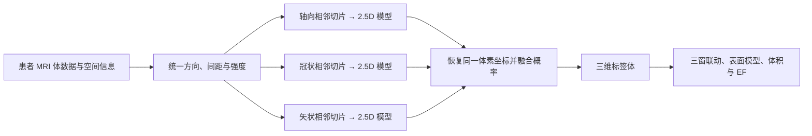

# ACDC 三方向 2.5D 分割与三维重建规划

日期：2026-10-17（北京时间）。状态：**规划待批准，尚未清理、下载影像/标注、改训练代码或启动训练。**

已确认：本轮首先验收电脑端三视图和三维重建，保留以后 PYNQ-Z2 / INT8 适配。Codex 主执行，DeepSeek 只承担方法固定的清点、校验、回归等简单重复工作。

## 1. 本轮交付目标

输入一位患者的三维心脏 MRI 体数据，输出同一物理坐标系内的三维分割；支持轴向、冠状、矢状三窗联动，以及三维表面旋转、结构显隐、ED/ES 切换和体积显示，达到参考图所示的展示形式。

初版用 ITK-SNAP / 3D Slicer 加载标准结果验收，优先复用成熟查看器。再根据模型和几何验收结果确定项目网页接入；网页重写不作为开始训练的前置任务。[3D Slicer 支持标签图与表面模型转换](https://slicer.readthedocs.io/en/latest/user_guide/modules/segmentations.html)。

这是对现有工程的 **MRI 分支扩展**。CAMUS 是超声，当前网络还将输入写死为单通道；因此复用训练、量化、打包和验收的工程经验，新增独立 ACDC 模型与类别协议，不直接改写旧权重或解除旧模型约束。

模型恢复的是采集覆盖范围内的标注结构。仅输入一张普通二维截图不能完成可信的患者三维重建。

## 2. 数据依据与可实现边界

- ACDC 官方划分为 100 名训练患者、50 名测试患者；训练集有五组、每组 20 人。[训练说明](https://www.creatis.insa-lyon.fr/Challenge/acdc/databasesTraining.html)、[测试说明](https://www.creatis.insa-lyon.fr/Challenge/acdc/databasesTesting.html)。
- 标注对应 ED、ES 两个时相。保留完整 cine 数据来源，但初版监督训练只使用有标注的 ED/ES，不把其他时相当成有真值样本。[标注说明](https://www.creatis.insa-lyon.fr/Challenge/acdc/evaluation.html)。
- 官方标签：0 背景、1 右室腔 RV、2 左室心肌 MYO、3 左室腔 LV。**与 CAMUS 的类别含义不同**，即使同为四通道也不能共用类别协议。显示拟按参考图使用 RV 红、MYO 绿、LV 蓝。
- ACDC 主要为短轴 cine MRI，官方说明层厚为 5 mm 或部分 8 mm，部分检查有层间空隙，实际采样间距可能为 5 或 10 mm。三方向重排来自同一体数据，不是另行采集的三套高分辨率影像；插值不能补回缺失解剖细节。[采集说明](https://www.creatis.insa-lyon.fr/Challenge/acdc/databases.html)。
- 因此初版目标是双心室腔及左室心肌的体数据分割与表面展示，不承诺心房、瓣膜、冠脉或完整右室心肌，也不把平滑后的表面称为真实高分辨率扫描。
- 本轮只读取了官方集合元数据和三份说明文档。官方集合记录的总 size 为 **2,456,816,223 B，约 2.46 GB**；这是来源文件元数据，尚未下载，不能充当解压和训练峰值。
- 官方许可为 **CC BY-NC-SA 4.0，限定非商业科学研究并要求引用 Bernard et al., TMI 2018，DOI 10.1109/TMI.2018.2837502**。实际下载时保留原许可、引用、来源 URL 和逐文件 SHA256。[官方数据入口](https://humanheart-project.creatis.insa-lyon.fr/database/#collection/637218c173e9f0047faa00fb)、[官方许可](https://humanheart-project.creatis.insa-lyon.fr/database/api/v1/file/66e290e0961576b1bad4ee3d/download)。

## 3. 方法：三个方向分别使用邻层，而后融合

这里的 2.5D 定义为：同一方向的前一层、中心层、后一层作为三个输入通道，预测中心层的四类结果。不是把轴、冠、矢三个画面直接当 RGB 通道；空间层维和心动周期时间维也不能混用。

### 几何与预处理

1. 用 NIfTI affine、spacing、方向信息定位患者坐标，保留原始 qform/sform 与可逆变换记录；不能把数组的 I/J/K 不经确认就叫作轴/冠/矢。
2. 区分原生短轴采集方向与标准解剖三平面。确定正交模型网格后再采样三方向；处理斜位数据，禁止仅转置数组而忽略仿射。
3. 目标间距按训练患者的数据指纹确定，不预先强制全体 1 mm 等体素。记录各方向邻层的毫米跨度，评估弱分辨率方向的效果。
4. 影像连续插值，真值标签最近邻；强度截断和标准化不读取测试标签。相邻通道使用一致空间增强。
5. 训练可用训练标签做前景采样；验证与推理不得用真值裁剪心脏。以完整视野的平铺/滑窗推理避免裁掉心尖、心底或 RV。
6. 三方向概率映回共同物理网格再融合，最后恢复原生体素网格；输出仍为 0/1/2/3 整数标签。保存转换记录，检查左右方向、尺寸、覆盖范围及坐标往返。

### 网络与融合

- 初始采用独立的小型二维 U-Net 类网络，三个方向分别训练；起点建议 base16、3 次下采样、3 通道邻层输入、4 类 logits。按显存与欠拟合情况决定是否扩大宽度。
- 复用现有 PyTorch / Nibabel / SciPy / scikit-image；本机已有这些依赖，不复制整套 CUDA 环境。优先采用普通二维卷积、ReLU、池化与上采样，给后续 INT8 留出清晰算子路径。
- 已查阅 [nnU-Net](https://github.com/MIC-DKFZ/nnUNet) 和 ACDC 官方推荐说明所指的 [ASCENT](https://github.com/creatis-myriad/ASCENT)。借鉴其数据自适应和验证流程；ASCENT 当前说明为 nnU-Net v1，且提示 Windows AMP 问题，不将其整套安装视为已经适配好的三方向 2.5D 方案。
- 默认从头训练，保留可核对的患者划分。来源不明或已经用全部 ACDC 训练的公开权重，不能用于声称独立测试的主实验。
- 首先以三方向等权概率平均作为融合对照；只用开发集选择少量、预先列明的非负融合权重。弱分辨率方向可能带来噪声，融合必须经过验证，不能默认优于主方向模型。
- 融合和三维后处理放在电脑端。首次不加入大规模 Transformer、完整 3D 网络或无界超参数搜索。

## 4. 训练与验收顺序

| 阶段 | 工作 | 进入下一阶段的依据 |
| --- | --- | --- |
| A | 获批后先清理、检查恢复链和保护清单 | 实测空间及保守峰值满足 40 GB；所有保护工件保持 |
| B | 官方数据下载、SHA 清单、患者划分与几何检查 | 文件完整；类别和图像对齐；无患者/时相泄漏 |
| C | 先训练匹配的单幅 2D 基线 | 有可复现的三维指标、失败病例、显存和吞吐记录 |
| D | 依次训练轴向、冠状、矢状 2.5D | 每个模型有独立 best/last、日志和开发结果 |
| E | 融合、三维后处理、查看与导出 | 与基线逐患者比较，确认精度、边界和连续性 |
| F | 冻结完整流程后一次独立测试、整理交付 | 不据测试结果重新选模型或调融合；明确失败与限制 |

拟将官方 100 名训练患者按疾病组分层划为 **80 训练 / 20 开发**（每组 16/4），固定随机种子、患者 ID 与清单 SHA。同一患者的 ED/ES、全部切片、三个方向必须留在同一集合。官方 50 名测试患者不参与指纹、预训练、调参、融合或阈值选择，测试标签只在冻结后的一次评估中读取。

初始批次为 **1 个 2D 基线 + 3 个 2.5D 方向模型**，每个最多 150 epoch，开发验证每 5 epoch，连续 6 次验证无改善则早停；这是待批准的首轮上限，不是已经完成的训练轮数。先以短跑测量实际步时和显存，再给出墙钟预算，不预先承诺几小时完成。

训练从 192–256 的 patch、batch 2–4 试配，逐个模型占用 GPU；使用 Dice + 交叉熵作为起点。AMP 必须先通过有限损失、梯度与短跑验证；出现异常保留证据并停，不能静默改精度后续跑。内存较紧，默认低 worker、按患者加载和有界缓存，不将全部病例或全部三方向切片装进内存。

每轮/约定安全边界保存：模型、优化器、学习率调度器、AMP scaler、随机状态、数据采样状态、配置/代码/划分身份与 epoch/step。只保存权重不算完整恢复；若只支持 epoch 边界恢复，明确记录未完成 epoch 的重放范围。

### 主要验收内容

- 原生三维网格上，按患者统计 LV / RV / MYO 的 Dice、HD95（mm）、必要的完整 Hausdorff / ASSD；前景三类宏平均为主指标，另外报告 ED/ES 和疾病组。
- 与本轮匹配的 2D 基线做配对比较。三方向融合须证明总体收益，同时检查逐结构退步、空预测、心尖/心底严重漏分和最差病例；不能用平均值掩盖失败。
- 体积在原始坐标中按体素体积计算，不从展示用平滑网格反算。计算 EDV、ESV、EF 误差；无效或不完整覆盖病例单独列出。
- 开发集确定并冻结后处理。保留原始标签与展示表面，禁止为了外观填满空腔或补造未采集组织；平滑只改变展示层时单独标明。
- 首次完整基线后，在长批次前冻结有数值依据的提升和容差门槛；不在没有实测结果时承诺特定 Dice 或临床精度。

## 5. 空间规划与拟议清理清单

本轮只读盘点：项目 **35,688,512,423 B（35.69 GB）**，83,569 文件，跳过 482 个链接/联接目标。E 盘空闲约 **64.18 GB**，但仍遵守项目 **40 GB** 上限；当前项目预算余量仅约 **4.31 GB**。

硬件：RTX 4050 Laptop，6141 MiB 显存；物理内存约 16.87 GB（约 15.7 GiB），盘点时可用约 3.37 GB。可用内存会变化，执行时重新检查。

### 第一批：先移除可复原的交付重复副本

仅拟删除下面 **5 个大文件**，小型清单、还原工具和验收记录保留：

| 路径（相对项目根） | 字节 |
| --- | ---: |
| `deliverables/release_bundles/20261017/PLD_A_Models_and_Datasets_20261017.zip` | 6,770,681,994 |
| 同目录 `release/PLD_A_Models_and_Datasets_20261017.zip.001` | 1,900,000,000 |
| 同目录 `release/PLD_A_Models_and_Datasets_20261017.zip.002` | 1,900,000,000 |
| 同目录 `release/PLD_A_Models_and_Datasets_20261017.zip.003` | 1,900,000,000 |
| 同目录 `release/PLD_A_Models_and_Datasets_20261017.zip.004` | 1,070,681,994 |
| **合计** | **13,541,363,988** |

预计清理后约 **22.15 GB**，项目内训练预算余量约 **17.85 GB**。本轮已重新只读核对现有 Release 的 8 个附件：服务端大小与 SHA256 和交付记录相符；没有重新下载整包或执行新的完整还原。删除前仍须复核本地哈希、远端身份与恢复说明，按精确白名单操作，不直接删整个目录。

### ACDC 首轮新增峰值预算（估算，执行前按实际形状修正）

| 内容 | 预留 |
| --- | ---: |
| 官方来源文件及元数据 | 3 GB |
| 按需预处理与有界缓存，不生成三份永久切片库 | 3 GB |
| 四个主实验的完整恢复检查点、配置和日志 | 2 GB |
| 原生预测、评估与三维表面 | 2 GB |
| 增量依赖和临时文件 | 1 GB |
| 安全余量 | 3 GB |
| **合计** | **14 GB** |

按当前盘点，第一批清理后加上这份预算约 **36.15 GB**，因此**很可能无需删除既有展开数据集**。官方集合 size 不包含我们的浮点缓存峰值；不能在未计算实际形状前将 36.15 GB 当成已证实的训练峰值。

### 第二批：仅在空间仍不足时处理已验证可还原的旧数据

候选顺序：已发布的 CAMUS 官方数据副本（`datasets/camus_public/official/` 当前约 **3.83 GB**），再考虑已发布的 ISIC 2016/2017 数据副本。

执行前逐文件证明其属于已有 Release/官方可恢复清单，保留原许可、来源、冻结划分、排除清单、SHA 和恢复步骤，并计入恢复所需临时空间；缺乏恢复证据的文件不删。不因目录名称相似就删除整个数据树。

ISIC 2018 等未完整发布、未证明可恢复的数据不在这批默认删除范围。三份模型的 FP32/INT8、统一模型原包、独有续训状态、必要源码/教材、训练 STOP/许可、验收证据、`.venv`、`.git` 与 B/C 正式交付全部保护。

任何清理后都重新盘点。若真实峰值超过 40 GB，则先调整缓存策略或执行已批准且可恢复的下一批；不能利用 E 盘总体空闲充足来绕过项目上限，也不能通过削减有效训练患者掩盖预算不足。

## 6. 初版交付与后续接口

初版独立命名 `acdc_triplanar`，计划包含：三个方向模型与融合配置、基线与对照结果、NIfTI 三维标签体、按结构导出的表面模型及毫米坐标说明、ED/ES 体积与 EF 表、颜色/类别协议、几何转换与运行环境记录、查看器操作说明和失败病例。

同一患者的三窗与三维表面共享同一份标签体；展示平滑和定量数据分别保存。跨方向不一致或高不确定性病例要能追溯，不把美化截图当精度证据。

Git 继续只共享 B/C 协作所需说明、接口契约和小型索引，经聚焦 PR 协作；模型及必要公开数据通过 PLD Release 按原许可交付。本轮规划本身不推送、不新建 PR、不处理既有 PR #6 的待合并步骤。

后续 PYNQ-Z2 / INT8 是另一个验收阶段：需重新评估三通道邻层输入、模型切换、权重/激活存储和整卷时延；不能把现有 CAMUS 位流或电脑端三维展示视为已经支持新 MRI 模型。

## 7. 分工、停止点与本次批准范围

- Codex：数据协议、空间预算、关键实现、训练启动与监督、融合/指标裁定、三维几何及最终验收。
- DeepSeek：固定清单清点、哈希校验、限定范围下载和固定回归；不自行选模型、改变划分、删除文件或扩张训练。
- 第一处停止点为 **等待用户批准此方案**。本次已完成的只是资料核对、只读盘点和规划文档。
- 方案获批后的顺序为：**保护与精确清理 → 重新盘点 → 官方下载与冻结划分 → 短跑测资源 → 2D 基线 → 三方向 2.5D → 融合与三维验收**。
- 每批有预算、退出条件与实际证据；额度 ≤10% 准备收尾，≤7% 保存并停止新工作，不无界续跑。
- 本方案的批准范围应包含上述第一批 5 个可复原副本的清理，以及“仍不足且有逐文件恢复依据”时的第二批旧数据清理；不包含删除独有模型/数据、扩大到其他磁盘、板端部署或开启其他疾病训练。

## 8. 本轮证据与恢复入口

全部位于 `runs/acdc_planning/20261017/`：

- `READONLY_INVENTORY.json`：物理字节、硬件内存和大文件清单。
- `ACDC_COLLECTION_METADATA.json`、`ACDC_TOP_LEVEL_METADATA.json`：官方集合大小与顶层结构，没有患者内容。
- `ACDC_OFFICIAL_DOCS.json`、`OFFICIAL_LICENSE_TERMS.md`、`OFFICIAL_MANDATORY_CITATION.md`、`OFFICIAL_STATE-OF-THE-ART-nnUNet-method.md`：官方小型说明。
- `CURRENT_RELEASE.json`、`RECOVERY_METADATA_CHECK.json`：现有总包 8 项附件的实时服务端身份核对。
- `PLANNING_CHECKPOINT.json`：已确认平台、计划状态与未执行边界。

新 dsh 凭据仅在会话中使用，不写入规划、脚本、Git 或交接记录。
