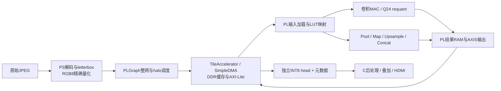

# 当前实现与代码定位

当前交付把15层TinyUNet的卷积和网络层间运算放在PL。PS负责原始JPEG解码、EXIF/RGB/letterbox、首层INT8量化、参数与LUT准备、分块搬运、调度和输出所有权。模型参数由A的最终包冻结；B按hash加载，不重新训练或改变权重。

## PS入口与生命周期

| 文件 | 职责 |
|---|---|
| `board/infer_images.py` | 无GT的JPEG推理入口；输出每帧65536字节head及JSON；当前C调用示例 |
| `reference/preprocess.py` | EXIF→RGB→256×256 letterbox、有效区域与量化；快速RGB8查表和原float32路径逐值一致 |
| `reference/pillow_resize.py`、`board/native/rgb_resize.c` | 固定Pillow 9.0.1的行访问与两线程NEON缩放；加载前核对库、源码和Pillow核心hash |
| `reference/tinyunet.py` | 模型/spec/manifest身份、INT8数学和整网软件参考；参考输出仅作比较 |
| `board/pl_graph.py` | 15层执行、skip生命周期、halo、分块容量和拼接；从一个首层输入贯通 |
| `board/tensor_accel.py` | HWH/ABI/时钟检查、装载命令、ready标签、结果复制、有界故障恢复 |
| `board/simple_dma.py` | Simple DMA的单向或独立长度收发、超时与reset确认；禁止与`ol.axi_dma`并行拥有设备 |
| `board/native_control.py`、`board/native_copy.py`、`board/cache_sync.py` | 经验证的原生控制/拷贝、TX前缀缓存同步；RX整块同步与尾保护保留 |

每帧当前175条命令。权重在同层tile间复用，编码器skip保留至相应decoder消费；head返回独立数组，下一次DMA不会覆盖。结束或故障先停止并确认DMA，之后释放DDR。模型输入必须是`[1,3,256,256]`、有符号INT8，不能把每层golden注入PL冒充整网推理。

## PL数据流与优化

`rtl/axis_tensor_accel.sv`维护AXI-Lite命令、输入/参数/LUT标签、共享RAM访问、AXIS加载和输出。`axi_lite_endpoint.sv`处理AW/W解耦与背压，`axis_byte_unpack.sv`和`axis_byte_pack.sv`处理64位AXIS字节与TKEEP/TLAST。

`conv_tile_engine.sv`从4个输入bank和32个权重bank读取数据，`conv_mac_array.sv`每组做8输出×4输入通道的INT8乘加；INT32累加显式检查溢出。`requant_q24.sv`保留宽乘积，正负最近偶数舍入后饱和到[-127,127]。输出是ReLU前的原始卷积结果。`tensor_tile_engine.sv`在同一组特征RAM上执行LUT/Pool/Upsample/Concat，和卷积互斥。

2026-10-16 按用户要求恢复板端实际版本：`conv_tile_engine.sv` 撤销 `3de993e` 的 MAC/requant 重叠实验，恢复 SHA256 `7d99b861ac5c0e3697621c97608c939113a1da03a2425881d4b484515f25943d`。皮肤镜和 CAMUS 两套运行包 `overlay/build_manifest.json` 各引用的 8 个 RTL 文件均与本地原始字节 SHA256 一致；板端 bit/hwh 未替换。该核对证明源码与既有构建绑定，不是一次新的综合、布线或烧写验收。

ABI 1.1模式5把8处独立MAP的ReLU/尺度表并入输入加载。ABI 1.2模式6把第8/10/12层decoder入口的双分支尺度转换、nearest×2和Concat并入卷积读取；deep使用半分辨率紧凑halo，PS只收集原始字节。调度器按真实bank容量选择32行tile，减少重复命令。网络算术仍在PL，PS快速量化只作用于首层图像。精确地址与容量见[寄存器合同](design/ACCELERATOR_REGISTERS.md)和[tile布局](design/TILE_ENGINES.md)。

`vivado/build_dma_bd.tcl`构建PS7、DDR、AXI DMA和CNN最小BD，`vivado/ps7_config.tcl`保留从教程机械提取的PS7配置；重新构建不需要下载整个教程目录。`scripts/build.sh cnn`打包IP、实现、提取bit/hwh/XSA并检查时序，`write_build_manifest.py`绑定源码及产物。当前125MHz布线使用7108 LUT、67 BRAM36等效、53 DSP；WNS仅+0.013ns，C更改BD后必须重新布线，不能直接继承该裕量。

## 验证如何对应实现

`sim/`覆盖量化、加载、调度、DMA异常和RTL协议；`scripts/run_sim.sh`提供命令级、算子和真实模型tile仿真。`board/verify_cnn.py`从首层贯通并比较逐层原始输出及恢复；`board/evaluate_dataset.py`从真实JPEG比较输入和head，记录每帧指标、计时与内存；`scripts/audit_board_run.py`独立检查报告和精确部署包。

最终v3的638图/1000帧结果和实测限制见[状态记录](FINAL_MODEL_STATUS.md)。本次目录整理不改变运行时或RTL；共享的冻结包保持原SHA256，历史实验保留在本机`out/`，团队只使用`delivery/c_v3/`指定版本。

C的网页与HDMI显示应用源码位于`display_web/`，板上部署为`/home/xilinx/jupyter_notebooks/PLD_Web`（部署与自启见其[说明](../display_web/docs/DEPLOYMENT.md)）。它以子进程调用`board/infer_images.py`，并按`display_web/pld_result.py`校验head合同（模型身份、尺度、阈值q≥−1与letterbox几何）；推理与HDMI显示在该应用内部串行互斥，运行B的板测脚本前应先停止`pld-web.service`。板上网页/HDMI端到端联调尚未验收。
