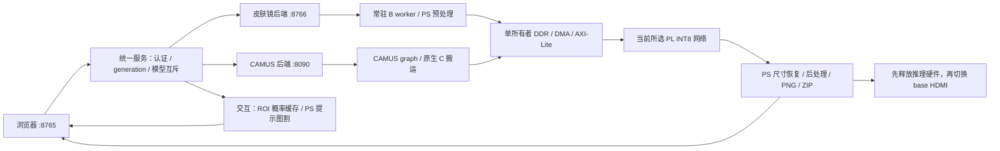

# 系统架构与当前实现

正式版本为 `pld_dual_20261017`，交付指针为 [delivery/current.json](../delivery/current.json)。

`rtl/conv_tile_engine.sv` 是当前 Skin 位流直接依赖的稳定卷积核心，不删除，也不使用未采用的 qdrain 重叠优化。CAMUS 使用独立 `camus/rtl/*_camus.sv`；共享 MAC、Q24、端点和 AXIS 字节模块。两套模型与运行时各有独立 manifest；源码字节、模型、bit/HWH 配对必须一起核对。

Skin 为 15 Conv TinyUNet，输入 RGB letterbox256，层间尺度映射与融合 decoder 在 PL；最终 q≥−1。CAMUS 为四类隐藏直方图 INT8 模型，灰度输入、独立层图和原生恢复；模型全包包含 FP32 权重、173 个 INT8 导出成员及200份开发回放，不可只交付权重。

正常流程：上传解析 → 预处理 → PS 打包/缓存同步/DMA/PL → 原生尺寸恢复与后处理 → 结果保存 → PNG → ZIP。Skin 可先返回预览，完整六张全尺寸图与 ZIP 在完成后提供。CAMUS 四宫格是在原 pipeline 返回后追加，其耗时在 HTTP 结果中；原 ZIP 内 report 是追加前快照，不把它当完整 HTTP wall time。

交互首次请求调用现有 PL 后端；同图、同 ROI、同模型 generation 的概率可缓存，点/框/阈值细化在 PS。ROI 改变触发 PL。Skin ROI 以 JPEG quality100 4:4:4 输入，CAMUS 转换 8 位灰度；不等同于无损原图推理。交互生成五张 PNG/统计，单独下载；不改写原任务 ZIP/历史/HDMI。缓存身份中的 backend_timing 是来源任务，当前 prediction_timings_ms 才是本次耗时。

硬件所有权通过统一服务、systemd cgroup 与 FPGA lease 控制；停止未确认则拒绝启动另一模型。不使用无界 PYNQ DMA wait 或强制杀死活动 DMA 所有者。HDMI 与 CNN 使用不同 overlay，不能声称并行连续显示。

源码、构建、部署、数值板测和物理显示是不同证据层次。当前状态、性能与限制见 [验证](validation/CLEANUP_20261017.md)。
